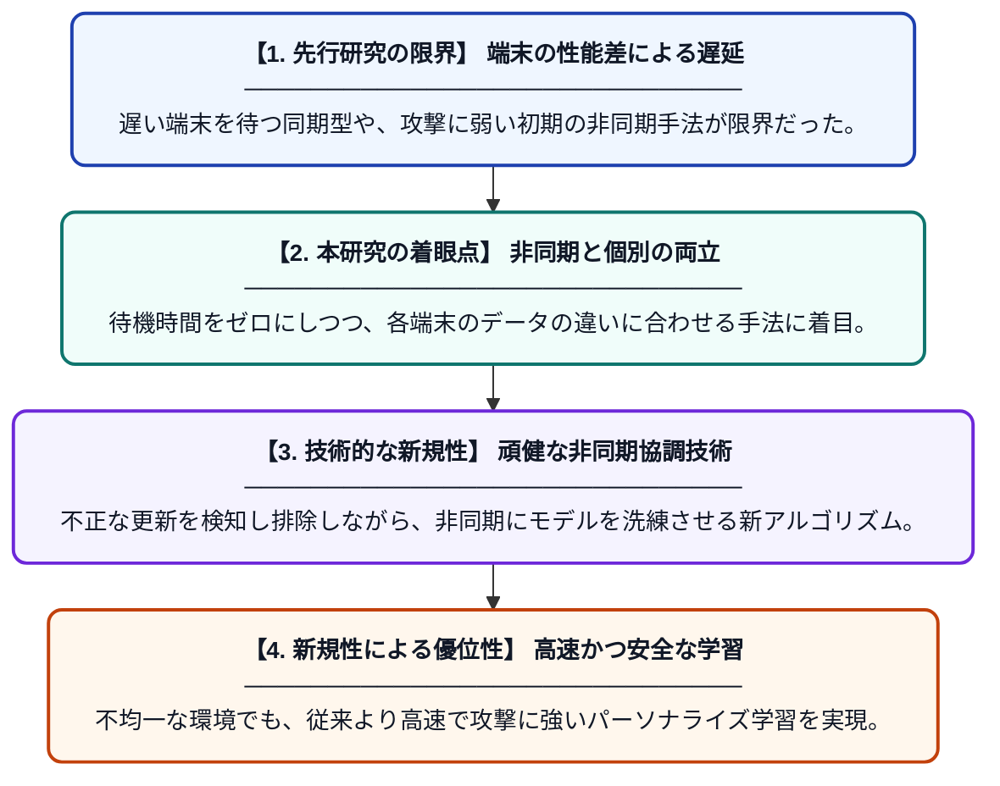

# デバイスの不均一性下におけるパーソナライズされた非同期連合学習での非同期協調

**Original Title**: *Asynchronous Collaboration in Personalized Federated Learning under Device Heterogeneity*

> **💡 一言要約**: 不揃いな端末でも高速・安全に個別学習を実現

| 項目 | 内容 |
|---|---|
| **著者** | B Liu, Z Zhou, S Cheng, S Kang, Y Tong |
| **掲載誌** | IEEE Transactions on Mobile Computing 2026 |
| **アラートキーワード** | Federated Learning |
| **原文リンク** | [https://ieeexplore.ieee.org/abstract/document/11806873/](https://ieeexplore.ieee.org/abstract/document/11806873/) |
| **PDF版要約** | [README.pdf](./README.pdf) |

---

## 📊 新規性の図解（先行研究との違いと本研究のブレークスルー）

## 📝 要約

通信速度や計算能力が異なる多様なデバイス環境において、効率的かつ安全に連合学習を行うための新しいフレームワークを提案しています。各デバイスに最適化されたモデルを構築するパーソナライズ化と、遅い端末を待たずに学習を進める非同期通信を、高い堅牢性を保ちつつ両立させました。

## ❓ どんな問題に取り組んだか

従来の連合学習では、全てのデバイスの更新を待つ必要があるため、処理の遅い端末が全体のボトルネックになる課題がありました。また、デバイスごとにデータの傾向が異なることへの対応や、悪意のあるデータ送信による攻撃への耐性（堅牢性）を非同期環境で確保することが困難でした。

## ✨ 何が新しい？何がすごい？（新規性）

本研究は、デバイスの不均一性とセキュリティ上の脅威を同時に解決する、頑健な非同期パーソナライズ連合学習を提案した点が画期的です。先行研究が同期型や特定の攻撃のみに焦点を当てていたのに対し、本手法はバイザンチン障害（悪意ある攻撃）が存在する非同期環境下でも、各ユーザーに最適なモデルを安定して提供できる独自のアルゴリズムを導入しました。

## 🎓 大学1年生向けの解説

「連合学習」は、みんなのスマホにあるプライベートなデータはそのままに、学習結果（知識）だけを集めて賢くなる技術です。しかし、スマホには最新型もあれば古い型もあり、通信が遅い人を待っていると学習がなかなか進みません。この研究は、遅い人を待たずに学習を進めつつ、さらに「悪いデータ」を混ぜて邪魔をする攻撃からも身を守り、一人ひとりにぴったりの学習結果を届ける魔法のような仕組みを作りました。
