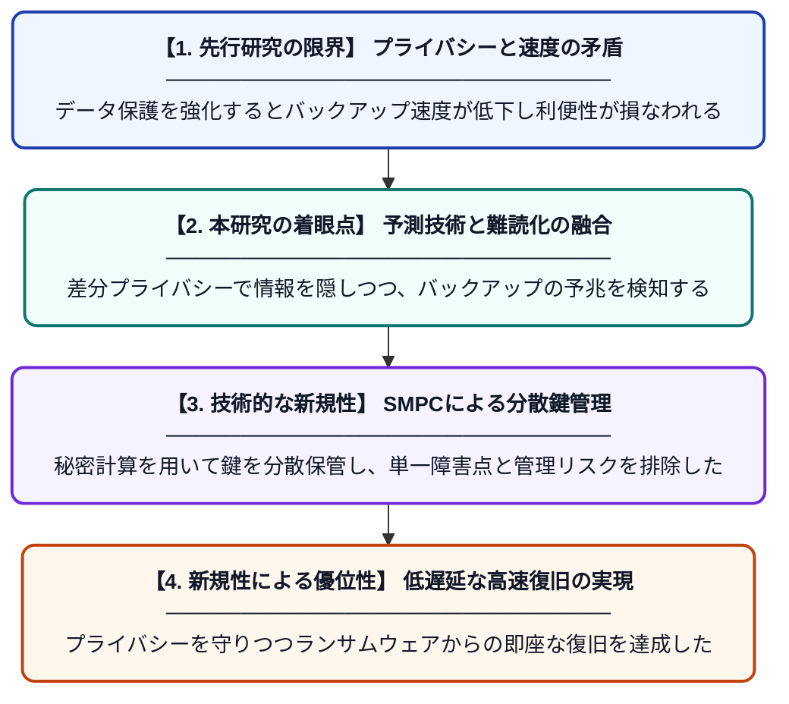

# ランサムウェア耐性を備えたプライバシー保護型の予測的クラウドバックアップ

**Original Title**: *Privacy-Preserving Predictive Cloud Backup with Ransomware-Resilient Recovery*

> **💡 一言要約**: プライバシーと復旧力を両立した次世代バックアップ

| 項目 | 内容 |
|---|---|
| **著者** | A Mathew, R Haldar |
| **掲載誌** | International Conference on Secure IoT and … 2026 |
| **アラートキーワード** | differential privacy |
| **原文リンク** | [https://ieeexplore.ieee.org/abstract/document/11746687/](https://ieeexplore.ieee.org/abstract/document/11746687/) |
| **PDF版要約** | [README.pdf](./README.pdf) |

---

## 📊 新規性の図解（先行研究との違いと本研究のブレークスルー）

## 📝 要約

テレメトリデータの難読化に差分プライバシーを、分散型の鍵管理に秘密計算（SMPC）を用いることで、プライバシーを維持しつつランサムウェアから迅速に復旧できるクラウドバックアップシステムを提案しています。低遅延を維持しながら、データの機密性と予測的なバックアップ管理を両立させている点が特徴です。

## ❓ どんな問題に取り組んだか

従来のクラウドバックアップでは、ランサムウェア攻撃に対する防御とデータのプライバシー保護を、処理速度を損なわずに両立させることが困難でした。特に、バックアップ用の鍵が中央集権的に管理されている場合、そこが侵害されると全てのデータが危険にさらされるという課題がありました。

## ✨ 何が新しい？何がすごい？（新規性）

本論文の新規性は、クライアント側での差分プライバシー導入により、ユーザーの動作統計を隠蔽しつつ予測的なバックアップ最適化を可能にした点にあります。また、鍵管理に秘密計算（SMPC）を採用することで、単一のサーバーが攻撃されてもデータ復号が不可能な分散型セキュリティを実現しました。先行研究と比較して、プライバシー保護とランサムウェア復旧の自動化を高い次元で統合している点が画期的です。

## 🎓 大学1年生向けの解説

パソコンがウイルス（ランサムウェア）に感染してデータがロックされても、自動で安全に元に戻してくれる魔法のようなバックアップ技術です。あなたのデータの中身を誰にも見られないように特殊な加工を施しつつ、データの「合鍵」をバラバラにして複数の場所に隠すことで、どこか一箇所が攻撃されても安全な仕組みを作りました。難しい暗号化を使いながらも、パソコンの動作が重くならないように工夫されているのがこの研究のすごいところです。
