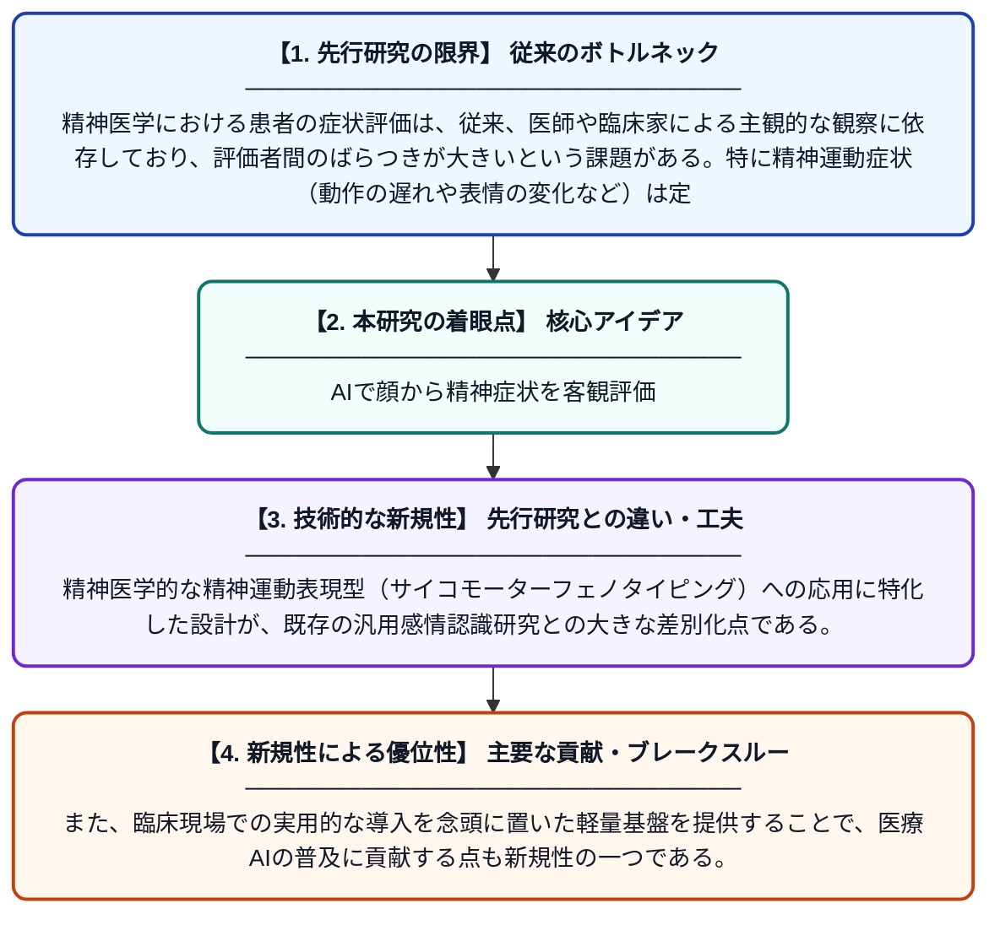

# KGLA-Net：精神医学における精神運動表現型解析のための効率的な顔面感情コンピューティングフレームワーク

**Original Title**: *KGLA-Net: An Efficient Facial Affective Computing Framework for Psychomotor Phenotyping in Psychiatry*

> **💡 一言要約**: AIで顔から精神症状を客観評価

| 項目 | 内容 |
|---|---|
| **著者** | F Li, J Yu, M Sun, X Li |
| **掲載誌** | Frontiers in Psychiatry 2026 |
| **アラートキーワード** | affective computing |
| **原文リンク** | [https://www.frontiersin.org/journals/psychiatry/articles/10.3389/fpsyt.2026.1903055/full](https://www.frontiersin.org/journals/psychiatry/articles/10.3389/fpsyt.2026.1903055/full) |
| **PDF版要約** | [README.pdf](./README.pdf) |

---

## 📊 新規性の図解（先行研究との違いと本研究のブレークスルー）

## 📝 要約

本論文では、精神医学における精神運動症状の客観的評価を目的とした、顔面感情コンピューティングの効率的なフレームワーク「KGLA-Net」を提案している。このフレームワークは軽量設計を採用しており、リアルタイムでの顔の表情分析と感情認識を可能にする。精神疾患患者の症状を定量的かつ客観的に捉えるための基盤技術として活用できる。

## ❓ どんな問題に取り組んだか

精神医学における患者の症状評価は、従来、医師や臨床家による主観的な観察に依存しており、評価者間のばらつきが大きいという課題がある。特に精神運動症状（動作の遅れや表情の変化など）は定量化が難しく、客観的・自動的に計測する手法が不足していた。このため、再現性のある診断補助ツールの開発が強く求められていた。

## ✨ 何が新しい？何がすごい？（新規性）

KGLA-Netは、顔面の感情情報を効率的に抽出するための軽量なネットワーク構造を新たに設計しており、従来の重量級な深層学習モデルと比較して計算コストを大幅に削減している。精神医学的な精神運動表現型（サイコモーターフェノタイピング）への応用に特化した設計が、既存の汎用感情認識研究との大きな差別化点である。また、臨床現場での実用的な導入を念頭に置いた軽量基盤を提供することで、医療AIの普及に貢献する点も新規性の一つである。

## 🎓 大学1年生向けの解説

人間の気持ちや感情は、顔の表情に現れることが多いです。この研究では、カメラで撮影した顔の映像をAIが分析し、精神的な病気の症状を自動的に数値化する仕組みを開発しました。たとえば、うつ病の患者さんは表情が乏しくなることがありますが、そういった変化をAIが客観的に検出できます。このシステムは計算量が少なく軽量なため、病院などの現場でも使いやすい設計になっています。医師の主観に頼らない、公平で再現性のある診断補助ツールを目指した研究です。
