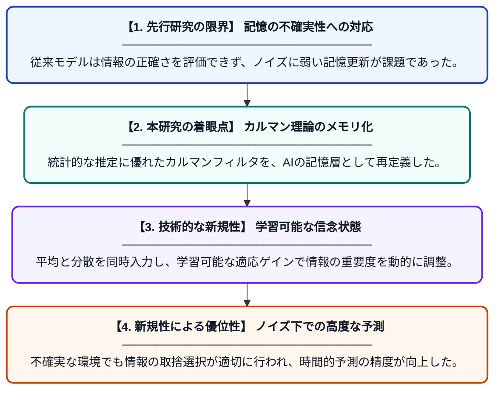

# カルマンフィルタに基づく時間差分ニューラルネットワーク（KBTDNN）：信念入力、カルマンゲイン、および学習ループの制御された再評価

**Original Title**: *Kalman-Based Temporal Difference Neural Network (KBTDNN): A Controlled Reassessment of Belief Input, Kalman Gain and Training Loop*

> **💡 一言要約**: カルマンフィルタを記憶層に統合した次世代AIアーキテクチャ

| 項目 | 内容 |
|---|---|
| **著者** | A Sardağ, A Sardağ |
| **掲載誌** | Applied Sciences 2026 |
| **アラートキーワード** | kalman filter |
| **原文リンク** | [https://www.mdpi.com/2076-3417/16/22/11493](https://www.mdpi.com/2076-3417/16/22/11493) |
| **PDF版要約** | [README.pdf](./README.pdf) |

---

## 📊 新規性の図解（先行研究との違いと本研究のブレークスルー）

## 📝 要約

カルマンフィルタをメモリ層として統合した新しいニューラルネットワーク構造「KBTDNN」を提案し、不確実性を含む情報の処理能力を向上させています。カルマンゲインの算出方法や信頼状態（平均と分散）の入力を最適化することで、時系列データにおける長期的な依存関係の学習精度を検証しました。

## ❓ どんな問題に取り組んだか

従来のニューラルネットワークでは、過去の情報の「確信度」を考慮した効率的な記憶の更新が困難でした。また、カルマンフィルタを深層学習に統合する際、ゲインの調整や状態の表現方法について最適な設計指針が確立されていませんでした。

## ✨ 何が新しい？何がすごい？（新規性）

カルマンフィルタの信念状態（平均と分散）をTDNNの入力に直接組み込む新しいアーキテクチャを提案しました。カルマンゲインを解析的に算出するだけでなく、データの変化に適応して学習させる手法（H2仮説）を導入し、理論と学習のハイブリッド化を実現。これにより、ノイズの多い環境下でも、情報の信頼性を考慮した高度な時間的推論が可能になりました。

## 🎓 大学1年生向けの解説

AIが過去のことを思い出すとき、単にデータを見るだけでなく「その記憶がどのくらい正しいか」という自信（確信度）も一緒に計算する仕組みを作りました。ロケットの軌道計算などに使われる数学的な道具「カルマンフィルタ」を、AIの記憶装置として使っています。これにより、曖昧な情報が多い場面でも、AIが賢く判断を下せるようになります。大学生が統計学や数学で学ぶ理論が、最新のAIをより賢くするために使われている一例です。
