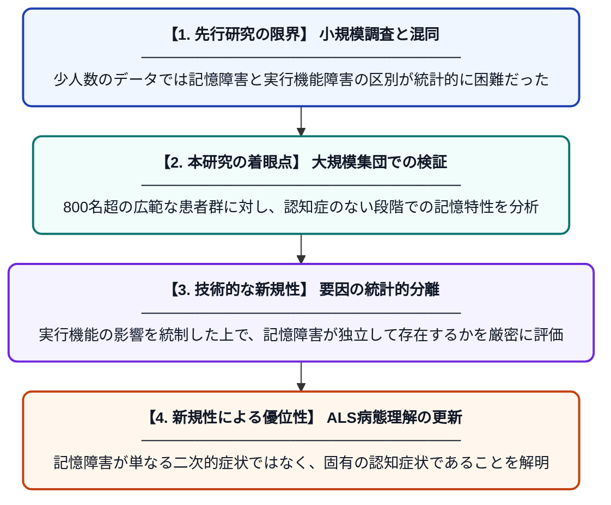

# 筋萎縮性側索硬化症（ALS）における記憶障害の性質

**Original Title**: *The nature of memory impairment in amyotrophic lateral sclerosis*

> **💡 一言要約**: ALSの記憶障害は実行機能低下とは独立した性質を持つ

| 項目 | 内容 |
|---|---|
| **著者** | B Poletti, EN Aiello, M Consonni, B Iazzolino, S Torre… |
| **掲載誌** | Brain Communications 2026 |
| **アラートキーワード** | ALS |
| **PDF** | [https://academic.oup.com/braincomms/advance-article-pdf/doi/10.1093/braincomms/fcag458/73994358/fcag458.pdf](https://academic.oup.com/braincomms/advance-article-pdf/doi/10.1093/braincomms/fcag458/73994358/fcag458.pdf) |
| **原文リンク** | [https://academic.oup.com/braincomms/advance-article-pdf/doi/10.1093/braincomms/fcag458/73994358/fcag458.pdf](https://academic.oup.com/braincomms/advance-article-pdf/doi/10.1093/braincomms/fcag458/73994358/fcag458.pdf) |
| **PDF版要約** | [README.pdf](./README.pdf) |

---

## 📊 新規性の図解（先行研究との違いと本研究のブレークスルー）

## 📝 要約

認知症を伴わない筋萎縮性側索硬化症（ALS）患者808名を対象に、記憶障害（MI）の要因と実行機能障害（ED）との関連を調査した大規模研究です。分析の結果、ALSにおける記憶障害は実行機能の低下だけに起因するものではなく、独立した障害としての側面を持つことが明らかになりました。

## ❓ どんな問題に取り組んだか

ALSは運動神経の疾患として知られていますが、多くの患者に記憶障害も見られます。しかし、その記憶障害が「注意力の低下や計画性の欠如（実行機能障害）」による二次的なものなのか、あるいは記憶そのものの機能不全なのかは長らく議論の対象となっていました。

## ✨ 何が新しい？何がすごい？（新規性）

800名を超える大規模な非認知症ALS患者のデータを用いた点が最大の強みです。従来の小規模研究では困難だった統計的検証により、記憶障害が実行機能障害の影響を除いた後でも独立して存在し得ることを証明しました。これにより、ALSの認知プロファイルにおける記憶障害の独自性と重要性を明確に示しました。

## 🎓 大学1年生向けの解説

ALSは体が動かなくなる病気ですが、実は脳の働き、特に「覚えたり思い出したりする力」にも影響が出ることがあります。これまでは「物事を整理する力が落ちたせいで、ついでに記憶も悪く見えるだけ」と思われていた部分がありました。しかしこの研究は、たくさんの患者さんを調べた結果、記憶の低下そのものが病気の一部として起きていることを突き止めました。これは、患者さんの日常生活のサポート方法を考える上でとても大切な発見です。
