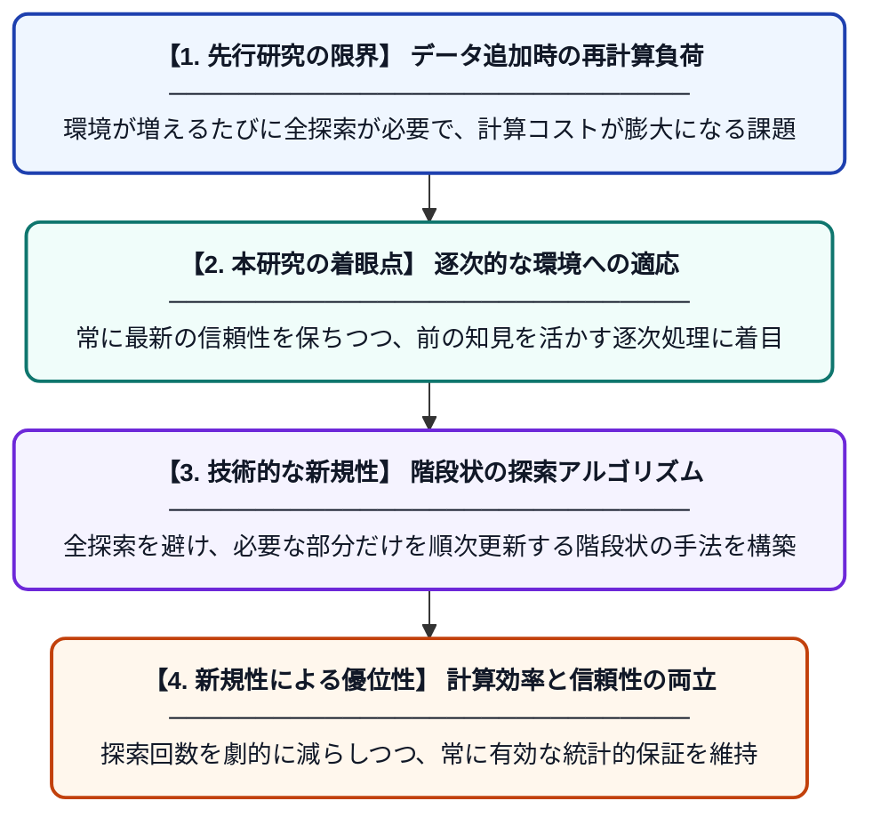

# sHAIL-Causal：不変な因果予測因子発見のための逐次的階段手順

**Original Title**: *sHAIL-Causal: A Sequential Staircase Procedure for Invariant Causal Predictor Discovery*

> **💡 一言要約**: データの追加にも動じるな。逐次的に因果を探す新手法。

| 項目 | 内容 |
|---|---|
| **著者** | E Fokoué |
| **掲載誌** | arXiv e-prints 2026 |
| **アラートキーワード** | one shot |
| **原文リンク** | [https://ui.adsabs.harvard.edu/abs/2026arXiv261007057F/abstract](https://ui.adsabs.harvard.edu/abs/2026arXiv261007057F/abstract) |
| **PDF版要約** | [README.pdf](./README.pdf) |

---

## 📊 新規性の図解（先行研究との違いと本研究のブレークスルー）

## 📝 要約

異なる環境下でも変化しない「不変な因果関係」を特定するための新しいアルゴリズム、sHAIL-Causalを提案しています。データが順次到着する場合でも、計算コストを抑えつつ常に統計的な信頼性を維持できるのが特徴です。

## ❓ どんな問題に取り組んだか

従来の因果予測手法は、新しいデータ環境が追加されるたびに膨大な組み合わせ検索を一からやり直す必要があり、計算負荷が極めて高いという課題がありました。また、逐次的にデータが流入する状況で、常に一貫した統計的保証を維持することが困難でした。

## ✨ 何が新しい？何がすごい？（新規性）

本研究は、データ環境が順次追加される状況下で、全探索を繰り返すことなく有効な信頼性を維持できる「階段状」の逐次手順を導入しました。これにより、計算コストを大幅に削減しながら、任意のタイミングで統計的に妥当な因果因子の絞り込みが可能になります。これは、一度きりの全探索しか行えなかった従来手法に対する決定的なブレークスルーです。

## 🎓 大学1年生向けの解説

身の回りには、状況が変わっても変化しない「本当の原因（因果関係）」があります。これまでのAI手法は、新しいデータが届くたびに計算をやり直す必要があり、非常に時間がかかっていました。この研究では、データが後から追加されても、それまでの計算を無駄にせず効率よく原因を見つける方法を開発しました。これにより、常に正しい判断を保ちながら、スピーディに原因を特定できるようになります。
