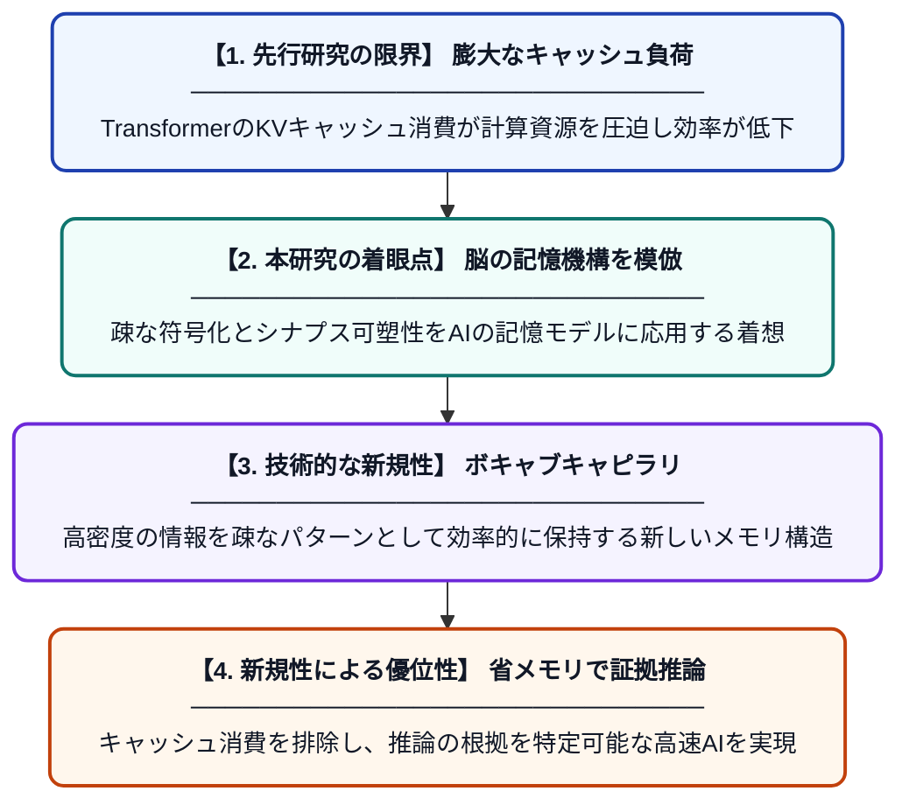

# キャッシュレスTransformerとエビデンス誘導型AIのための「ボキャブキャピラリ」メモリ

**Original Title**: *Vocabucapillary Memory for Cacheless Transformers and Evidence Guided AI*

> **💡 一言要約**: 脳を模した新メモリで、重いキャッシュを不要に。

| 項目 | 内容 |
|---|---|
| **著者** | DP Ghosh |
| **掲載誌** | 2026 |
| **アラートキーワード** | sparse coding |
| **PDF** | [https://www.researchgate.net/profile/Debi-Prasad-Ghosh/publication/417561576_Vocabucapillary_Memory_for_Cacheless_Transformers_and_Evidence-Guided_AI/links/6aeddba4dc41aa6ac310a680/Vocabucapillary-Memory-for-Cacheless-Transformers-and-Evidence-Guided-AI.pdf](https://www.researchgate.net/profile/Debi-Prasad-Ghosh/publication/417561576_Vocabucapillary_Memory_for_Cacheless_Transformers_and_Evidence-Guided_AI/links/6aeddba4dc41aa6ac310a680/Vocabucapillary-Memory-for-Cacheless-Transformers-and-Evidence-Guided-AI.pdf) |
| **原文リンク** | [https://www.researchgate.net/profile/Debi-Prasad-Ghosh/publication/417561576_Vocabucapillary_Memory_for_Cacheless_Transformers_and_Evidence-Guided_AI/links/6aeddba4dc41aa6ac310a680/Vocabucapillary-Memory-for-Cacheless-Transformers-and-Evidence-Guided-AI.pdf](https://www.researchgate.net/profile/Debi-Prasad-Ghosh/publication/417561576_Vocabucapillary_Memory_for_Cacheless_Transformers_and_Evidence-Guided_AI/links/6aeddba4dc41aa6ac310a680/Vocabucapillary-Memory-for-Cacheless-Transformers-and-Evidence-Guided-AI.pdf) |
| **PDF版要約** | [README.pdf](./README.pdf) |

---

## 📊 新規性の図解（先行研究との違いと本研究のブレークスルー）

## 📝 要約

脳のシナプス可塑性や海馬の記憶分離メカニズムをヒントに、従来のTransformerの弱点であるKVキャッシュを不要にする新しい記憶構造を提案しています。疎な符号化（Sparse Coding）を用いることで、メモリ消費を劇的に抑えつつ、根拠に基づいた高精度な推論を可能にします。

## ❓ どんな問題に取り組んだか

従来のTransformerモデルは、長い文脈を扱う際に「KVキャッシュ」と呼ばれる膨大なメモリを消費し、これが計算速度や効率のボトルネックとなっていました。また、AIがなぜその回答を導き出したのか、具体的な「証拠（エビデンス）」を特定するのが難しいという課題がありました。

## ✨ 何が新しい？何がすごい？（新規性）

本研究の新規性は、生物学的なシナプスモデルを模倣した「ボキャブキャピラリ・メモリ」の導入にあります。先行研究の連続的な高負荷計算とは異なり、海馬のように似た経験を分離して記録する「疎な符号化」を採用することで、メモリを節約しながら情報を保持できます。これにより、キャッシュなしで高速動作し、かつ推論の根拠を明示できる「エビデンス誘導型AI」という新たなパラダイムを提示しました。

## 🎓 大学1年生向けの解説

AIが長い文章を理解するとき、これまでは「大量のメモ帳」を積み上げるような方式で、すぐにコンピュータのメモリが足りなくなっていました。この論文では、人間の脳が重要な情報を効率よく記憶する仕組みを真似て、メモ帳（キャッシュ）を使わずに情報を処理する技術を開発しました。これによって、スマホのような小さな機器でも賢いAIが動きやすくなり、さらにAIが「何を根拠に答えたか」も分かりやすくなります。脳の仕組みをコンピュータに応用した、次世代のAI技術です。
