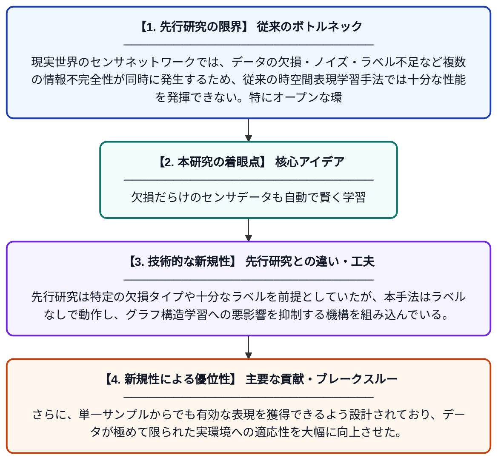

# オープン環境における複数の情報不完全性を持つセンサネットワークのための教師なし時空間表現学習

**Original Title**: *Unsupervised Spatiotemporal Representation Learning for Sensor Networks with Multiple Information Incompleteness in Open Environments*

> **💡 一言要約**: 欠損だらけのセンサデータも自動で賢く学習

| 項目 | 内容 |
|---|---|
| **著者** | H Yuan, C Li, T Cui, W Wang |
| **掲載誌** | IEEE Transactions on Signal and Information Processing over Networks 2026 |
| **アラートキーワード** | representation learning |
| **原文リンク** | [https://ieeexplore.ieee.org/abstract/document/11631672/](https://ieeexplore.ieee.org/abstract/document/11631672/) |
| **PDF版要約** | [README.pdf](./README.pdf) |

---

## 📊 新規性の図解（先行研究との違いと本研究のブレークスルー）

## 📝 要約

本論文は、現実のセンサネットワークで生じる欠損・ノイズ・ラベルなしといった複数の情報不完全性に対応するため、「Robust Group-driven」と呼ばれる教師なし時空間表現学習アルゴリズムを提案する。グラフ構造学習への悪影響を軽減しながら、単一サンプルでも有効な表現学習を実現する点が特徴である。オープンな実環境においてセンサデータから堅牢な時空間特徴を自動的に獲得することを目指している。

## ❓ どんな問題に取り組んだか

現実世界のセンサネットワークでは、データの欠損・ノイズ・ラベル不足など複数の情報不完全性が同時に発生するため、従来の時空間表現学習手法では十分な性能を発揮できない。特にオープンな環境では予期せぬ状況が多く、グラフ構造の推定や単一サンプルからの学習が困難になるという課題がある。

## ✨ 何が新しい？何がすごい？（新規性）

本研究は、複数種類の情報不完全性を同時に扱える教師なし学習フレームワーク「Robust Group-driven」を初めて提案した点が新しい。先行研究は特定の欠損タイプや十分なラベルを前提としていたが、本手法はラベルなしで動作し、グラフ構造学習への悪影響を抑制する機構を組み込んでいる。さらに、単一サンプルからでも有効な表現を獲得できるよう設計されており、データが極めて限られた実環境への適応性を大幅に向上させた。

## 🎓 大学1年生向けの解説

スマートシティや工場などに設置されたセンサは、故障や通信エラーでデータが途切れたり、正解ラベルが付いていないことが多くあります。この論文は、そのような「不完全なデータ」でもコンピュータが自動でデータの特徴をうまく学習できる方法を開発しました。人間が正解を教えなくても（教師なし学習）、センサの位置関係や時間的なつながりを考慮して賢く学べる仕組みです。これにより、欠けたデータが多くても異常検知や予測などのタスクをより正確に行えるようになります。
