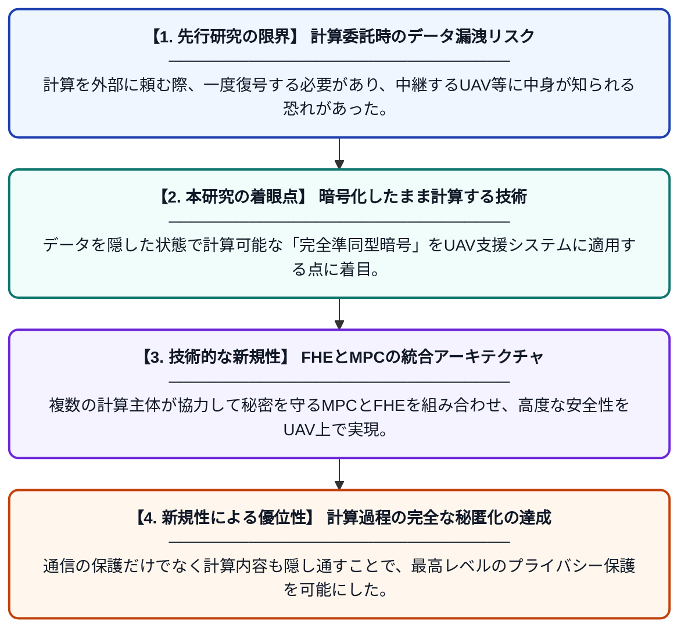

# 完全準同型暗号に基づくUAV支援型のプライバシー保護・セキュア無線通信・計算システム

**Original Title**: *A Privacy-Preserving UAV-Assisted Secure Wireless Communication and Computing System Based on Fully Homomorphic Encryption*

> **💡 一言要約**: UAVと暗号技術で守る、究極のプライバシー保護計算

| 項目 | 内容 |
|---|---|
| **著者** | Q Zhou, W Mao, Y Tao, M Tsukada, K Fukuda, Y Ji |
| **掲載誌** | arXiv preprint arXiv:2611.12064 2026 |
| **アラートキーワード** | Secure Computing |
| **PDF** | [https://arxiv.org/pdf/2611.12064](https://arxiv.org/pdf/2611.12064) |
| **原文リンク** | [https://arxiv.org/pdf/2611.12064](https://arxiv.org/pdf/2611.12064) |
| **PDF版要約** | [README.pdf](./README.pdf) |

---

## 📊 新規性の図解（先行研究との違いと本研究のブレークスルー）

## 📝 要約

無人航空機（UAV）を活用し、データを暗号化したまま処理する完全準同型暗号（FHE）と多者間計算（MPC）を統合したセキュアな計算システムを提案しています。UAVが介在する無線通信において、計算の信頼性と個人のプライバシー保護を高度に両立させることに成功しました。

## ❓ どんな問題に取り組んだか

無線ネットワークを介した計算アウトソーシングにおいて、中継機や計算サーバーによるデータの盗聴やプライバシー侵害が深刻な課題です。特にUAVのような動的な環境では、通信の安全性と計算の秘匿性を同時に確保する効率的な手法が不足していました。

## ✨ 何が新しい？何がすごい？（新規性）

本研究は、完全準同型暗号（FHE）とマルチパーティ計算（MPC）を融合させ、UAVがデータを復号せずに計算を支援する独自のシステムを構築しました。先行研究が通信路の暗号化に留まっていたのに対し、計算プロセスそのものの秘匿性を担保した点が画期的です。さらに、リソース制約のあるUAV環境に最適化された計算モデルを導入し、セキュリティと実用性を両立させています。

## 🎓 大学1年生向けの解説

ドローン（UAV）に難しい計算を代わりにやってもらうとき、自分のデータの中身を見られたくないですよね。この研究では、データを「鍵がかかった箱」に入れたまま計算できる魔法のような暗号技術を使っています。ドローンは中身を見ることができませんが、箱を外から操作するように計算だけは進めることができます。これにより、プライバシーを完全に守りながらドローンの力を借りる、安全な未来のネットワークを実現しています。
