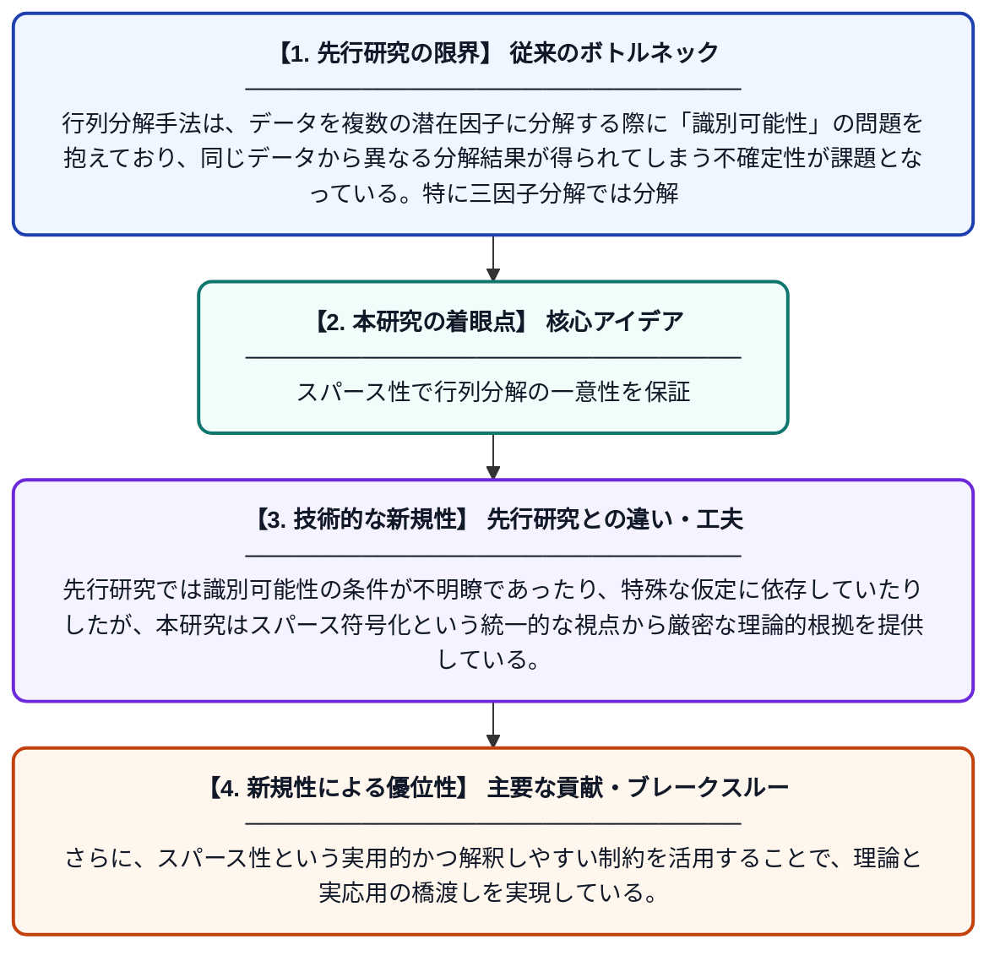

# 行列三因子分解におけるスパース性による識別可能性

**Original Title**: *Sparsity Induced Identifiability in Matrix Tri-Factorisation*

> **💡 一言要約**: スパース性で行列分解の一意性を保証

| 項目 | 内容 |
|---|---|
| **著者** | T Mu |
| **掲載誌** | arXiv preprint arXiv:2607.27507 2026 |
| **アラートキーワード** | sparse coding |
| **PDF** | [https://arxiv.org/pdf/2607.27507](https://arxiv.org/pdf/2607.27507) |
| **原文リンク** | [https://arxiv.org/abs/2607.27507](https://arxiv.org/abs/2607.27507) |
| **PDF版要約** | [README.pdf](./README.pdf) |

---

## 📊 新規性の図解（先行研究との違いと本研究のブレークスルー）

## 📝 要約

本論文は、行列の三因子分解（Matrix Tri-Factorisation）において、係数行列にスパース性（疎性）を課すことで「識別可能性」を保証する理論的枠組みを提案する。スパース符号化の観点から、各行オブジェクトが少数の基底成分のみで表現されるよう制約を設けることで、分解の一意性に関する理論的解析を展開している。これにより、行列分解の解が一意に定まる条件を明確化し、機械学習やデータ解析における応用基盤を強化する。

## ❓ どんな問題に取り組んだか

行列分解手法は、データを複数の潜在因子に分解する際に「識別可能性」の問題を抱えており、同じデータから異なる分解結果が得られてしまう不確定性が課題となっている。特に三因子分解では分解の自由度が高く、解の一意性を理論的に担保することが難しかった。

## ✨ 何が新しい？何がすごい？（新規性）

本研究は、係数行列に行方向のスパース性（各行が少数の成分のみを持つ性質）を課すことで、三因子分解の識別可能性を理論的に保証できることを初めて体系的に示した点が新しい。先行研究では識別可能性の条件が不明瞭であったり、特殊な仮定に依存していたりしたが、本研究はスパース符号化という統一的な視点から厳密な理論的根拠を提供している。さらに、スパース性という実用的かつ解釈しやすい制約を活用することで、理論と実応用の橋渡しを実現している。

## 🎓 大学1年生向けの解説

大きなデータ（行列）を3つの小さな行列の積として分解する手法があるのですが、このとき「分解の仕方が一通りに決まるか」という問題があります。本研究では、分解後の係数行列をなるべくゼロの多いスカスカな（スパースな）形にするという制約を加えると、分解結果が一意に定まることを数学的に証明しました。たとえるなら、「材料を少ししか使わない料理レシピ」という制約をつけることで、同じ料理を作るレシピが一通りに絞れる、というイメージです。この成果により、機械学習やデータ分析でより信頼性の高い行列分解が実現できます。
