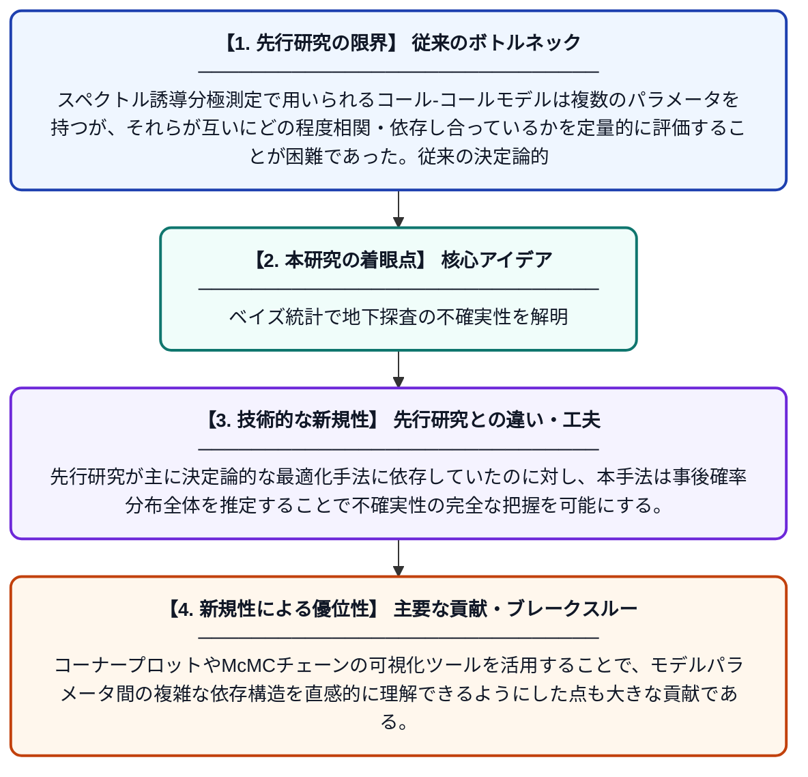

# スペクトル誘導分極測定におけるコール-コールモデルパラメータの相互依存性と相関のベイズ推論による評価

**Original Title**: *Bayesian reasoning for evaluating interdependence and correlation of Cole-Cole model variables in spectral induced polarization measurements*

> **💡 一言要約**: ベイズ統計で地下探査の不確実性を解明

| 項目 | 内容 |
|---|---|
| **著者** | MS Roudsari, R Ghanati, CL Bérubé, T Günther |
| **掲載誌** | Applied Computing and … 2026 |
| **アラートキーワード** | MCMC |
| **原文リンク** | [https://www.sciencedirect.com/science/article/pii/S2590197426000704](https://www.sciencedirect.com/science/article/pii/S2590197426000704) |
| **PDF版要約** | [README.pdf](./README.pdf) |

---

## 📊 新規性の図解（先行研究との違いと本研究のブレークスルー）

## 📝 要約

本研究は、地下探査に用いられるスペクトル誘導分極（SIP）測定のコール-コール（CCM）モデルパラメータ間の相互依存性と相関を評価するため、マルコフ連鎖モンテカルロ（McMC）アルゴリズムを用いたベイズ推論フレームワークを提案する。合成モデリングとMcMCインバージョンを通じてその有効性を検証し、McMCチェーンやコーナープロットの可視化によってパラメータ間の相互依存関係を明示した。これにより、SIP測定のパラメータ推定における不確実性定量化と信頼性向上に貢献する。

## ❓ どんな問題に取り組んだか

スペクトル誘導分極測定で用いられるコール-コールモデルは複数のパラメータを持つが、それらが互いにどの程度相関・依存し合っているかを定量的に評価することが困難であった。従来の決定論的インバージョン手法では、パラメータ推定の不確実性や相互依存性を十分に捉えることができなかった。

## ✨ 何が新しい？何がすごい？（新規性）

本研究は、McMCアルゴリズムを用いたベイズ推論をコール-コールモデルのインバージョンに適用し、パラメータ間の相関・相互依存性を統計的に可視化・定量化する手法を提案した点が新しい。先行研究が主に決定論的な最適化手法に依存していたのに対し、本手法は事後確率分布全体を推定することで不確実性の完全な把握を可能にする。コーナープロットやMcMCチェーンの可視化ツールを活用することで、モデルパラメータ間の複雑な依存構造を直感的に理解できるようにした点も大きな貢献である。

## 🎓 大学1年生向けの解説

地面の中に電気を流すと、地下の岩石や鉱物の種類によって電気の通り方が変わります。この「スペクトル誘導分極」という方法で地下を調べるとき、いくつかの数値（パラメータ）を使ってモデルを作りますが、それらの数値がお互いにどう影響し合っているかを知ることが大切です。この研究では「ベイズ推論」という統計的な方法とコンピュータシミュレーションを組み合わせて、各パラメータの不確かさや関係性をグラフで見えるようにしました。これにより、地下探査の結果がどれくらい信頼できるかをより正確に評価できるようになります。
