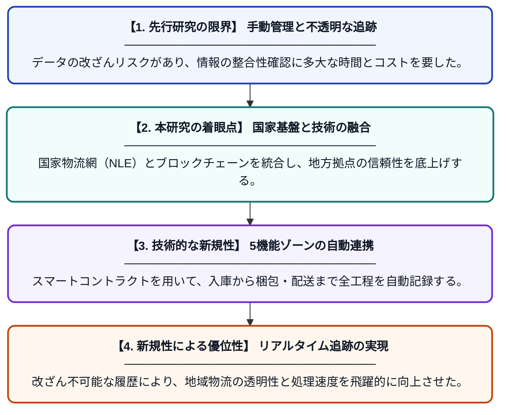

# マディウン県における国家物流エコシステム統合型倉庫区域の取引自動化と商品追跡のためのブロックチェーン活用

**Original Title**: *… Blockchain untuk Otomatisasi Transaksi dan Keterlacakan (Traceability) Barang pada Kawasan Pergudangan Kabupaten Madiun Terintegrasi National Logistics …*

> **💡 一言要約**: ブロックチェーンで地域の物流倉庫を劇的にスマート化

| 項目 | 内容 |
|---|---|
| **著者** | E Ratnawati, F Maherda |
| **掲載誌** | Birokrasi Pancasila: Jurnal Pemerintahan … 2026 |
| **アラートキーワード** | logistics |
| **原文リンク** | [https://jurnalbirokrasipancasila.com/index.php/jbp/article/view/94](https://jurnalbirokrasipancasila.com/index.php/jbp/article/view/94) |
| **PDF版要約** | [README.pdf](./README.pdf) |

---

## 📊 新規性の図解（先行研究との違いと本研究のブレークスルー）

## 📝 要約

インドネシア・マディウン県の「ゲートウェイ・ロジスティクス・パーク」において、ブロックチェーン技術を導入し、物流倉庫の自動化と商品追跡を実現する構想です。国家物流エコシステム（NLE）と連携することで、入庫から配送までの全工程を透明化し、地域流通のハブとしての機能を最適化します。

## ❓ どんな問題に取り組んだか

従来の地域物流や倉庫管理では、情報の不透明さや取引処理の遅延が大きな課題となっていました。特に、広域な物流ネットワークとの連携が不十分で、商品の追跡やデータの信頼性を確保することが困難な状況にありました。

## ✨ 何が新しい？何がすごい？（新規性）

本研究の核心は、地方の倉庫拠点にブロックチェーンを導入し、インドネシアの国家物流エコシステム（NLE）と直接統合させた点にあります。スマートコントラクトによる取引の自動実行と、改ざん不能な追跡システムを5つの機能ゾーンに適用したことで、地方ハブを自律的なデジタル拠点へ進化させました。単なる保管施設の枠を超え、国家レベルの物流網とシームレスに繋がる信頼性の高いインフラモデルを構築したことが主要な貢献です。

## 🎓 大学1年生向けの解説

物流倉庫は、荷物が届いてから発送されるまでの膨大なデータ管理が必要です。この研究では「ブロックチェーン」という、情報を嘘偽りなく記録する技術を使い、倉庫の作業を自動化する仕組みを提案しています。これにより、荷物が今どこにあるかが正確に分かり、面倒な手続きもコンピューターが自動で処理してくれます。インドネシアの地方都市を最新のデジタル技術で支え、物流をスムーズにする挑戦的なプロジェクトです。
