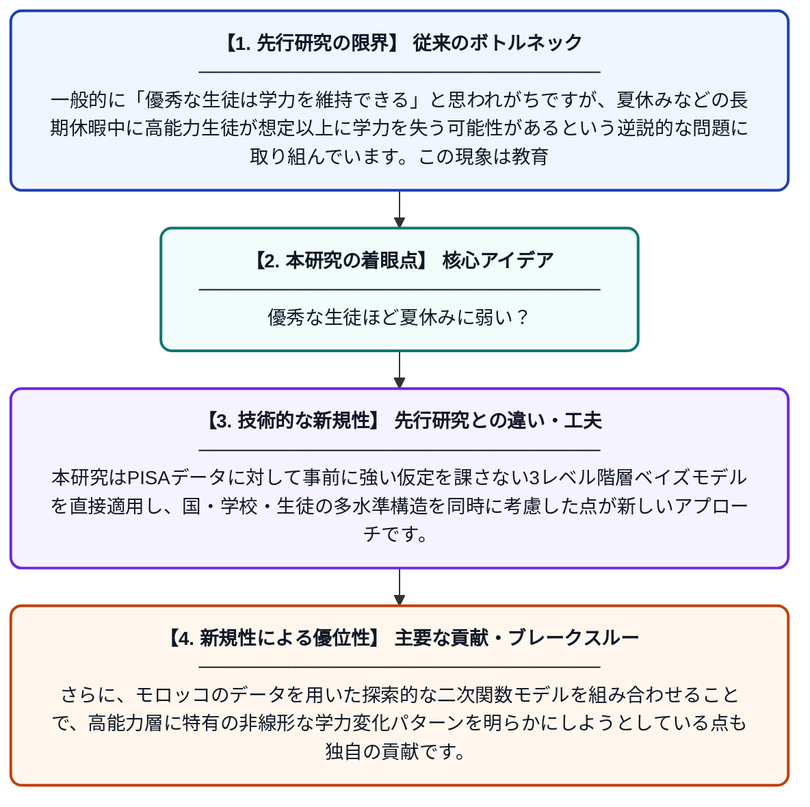

# 卓越性のパラドックス：高能力数学生徒における夏期学習損失という重大な脆弱性――PISAデータの階層的ベイズ分析

**Original Title**: *The paradox of excellence: Summer learning loss as a critical vulnerability for high-ability math students: A hierarchical Bayesian analysis of PISA Data*

> **💡 一言要約**: 優秀な生徒ほど夏休みに弱い？

| 項目 | 内容 |
|---|---|
| **著者** | D El Bouda, H Malek |
| **掲載誌** | High Ability Studies 2026 |
| **アラートキーワード** | Bayesian hierarchical ... |
| **原文リンク** | [https://www.tandfonline.com/doi/abs/10.1080/13598139.2026.2707462](https://www.tandfonline.com/doi/abs/10.1080/13598139.2026.2707462) |
| **PDF版要約** | [README.pdf](./README.pdf) |

---

## 📊 新規性の図解（先行研究との違いと本研究のブレークスルー）

## 📝 要約

この研究は、数学において高い能力を持つ生徒が夏休み期間中に学力を喪失する「夏期学習損失」という逆説的な現象を分析したものです。モロッコのサンプルを探索的に用いた二次関数モデルを含む、PISAデータに基づく3レベル階層ベイズモデルを構築し、高能力生徒の脆弱性を定量的に検討しています。結果として、優秀な生徒ほど夏休みの学習空白の影響を強く受ける可能性があることを示しています。

## ❓ どんな問題に取り組んだか

一般的に「優秀な生徒は学力を維持できる」と思われがちですが、夏休みなどの長期休暇中に高能力生徒が想定以上に学力を失う可能性があるという逆説的な問題に取り組んでいます。この現象は教育政策や才能教育プログラムの設計において見過ごされてきた重要な課題です。

## ✨ 何が新しい？何がすごい？（新規性）

先行研究では夏期学習損失の研究が平均的な生徒を対象とすることが多く、高能力生徒への焦点は限られていました。本研究はPISAデータに対して事前に強い仮定を課さない3レベル階層ベイズモデルを直接適用し、国・学校・生徒の多水準構造を同時に考慮した点が新しいアプローチです。さらに、モロッコのデータを用いた探索的な二次関数モデルを組み合わせることで、高能力層に特有の非線形な学力変化パターンを明らかにしようとしている点も独自の貢献です。

## 🎓 大学1年生向けの解説

夏休みに勉強しないと学力が下がる「夏期学習損失」という現象はよく知られていますが、この研究は「成績の良い生徒ほど実はその影響を強く受けているかもしれない」という驚きの問いを立てています。世界規模の学力調査データ（PISA）を使い、国・学校・個人という三つの層を同時に分析できる高度な統計手法（階層ベイズモデル）で検証しました。優秀であることが必ずしも学力の安定を保証しないというパラドックスを明らかにすることで、才能ある生徒への教育支援のあり方を問い直す研究です。
