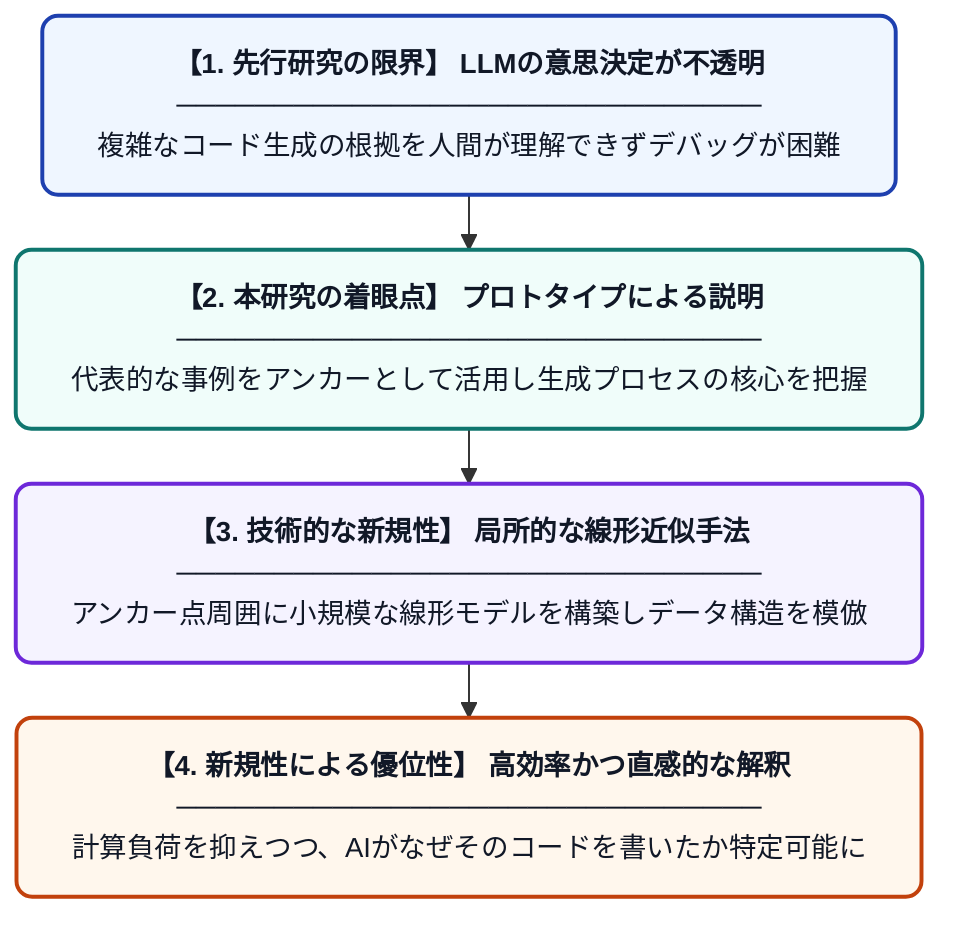

# Protocode: プロトタイプ駆動によるLLMコード生成の解釈可能性向上

**Original Title**: *Protocode: Prototype-Driven Interpretability for Code Generation in LLMs*

> **💡 一言要約**: プロトタイプでLLMのコード生成を「見える化」

| 項目 | 内容 |
|---|---|
| **著者** | BK Vamshi, H Yang |
| **掲載誌** | Proceedings of the 15th International Joint Conference … 2026 |
| **アラートキーワード** | manifold learning |
| **PDF** | [https://aclanthology.org/2026.aacl-long.20.pdf](https://aclanthology.org/2026.aacl-long.20.pdf) |
| **原文リンク** | [https://aclanthology.org/2026.aacl-long.20.pdf](https://aclanthology.org/2026.aacl-long.20.pdf) |
| **PDF版要約** | [README.pdf](./README.pdf) |

---

## 📊 新規性の図解（先行研究との違いと本研究のブレークスルー）

## 📝 要約

大規模言語モデル（LLM）によるコード生成の根拠を、代表的なデータ点である「プロトタイプ」を用いて説明可能にする手法「Protocode」を提案しています。複雑な高次元のデータ構造を、アンカーポイント周辺の局所的な線形モデルとして近似することで、効率的かつ直感的な解釈を可能にしました。

## ❓ どんな問題に取り組んだか

現在のLLMは高度なコード生成が可能ですが、その意思決定プロセスはブラックボックス化しており、なぜ特定のコードが生成されたのかを人間が理解するのは困難です。特に、生成の根拠を数学的に厳密かつ直感的に説明できる手法が不足していました。

## ✨ 何が新しい？何がすごい？（新規性）

本研究の核心は、データの多様体を「区分線形多様体」として近似し、特定のアンカーポイント（プロトタイプ）に基づいた局所的な構造を学習する点にあります。先行研究では全体的な近似に留まっていたのに対し、ミニバッチ内の局所領域ごとに最適な線形モデルを構築することで、計算コストを抑えつつ極めて精度の高い説明性を実現しました。これにより、モデルの内部表現と生成結果の因果関係を具体的に特定できる点が大きな貢献です。

## 🎓 大学1年生向けの解説

AIがプログラミングのコードを自動で作るとき、その中身が複雑すぎて「どうしてこの書き方を選んだのか」は専門家にも分かりませんでした。この研究は、AIが参考にした「お手本（プロトタイプ）」を具体的に示すことで、その理由を人間に分かりやすく教える技術を作りました。難しい計算を小さな区画に分けて考える工夫をしており、素早く正確にAIの考えを突き止めることができます。これによって、AIが作ったコードを人間が自信を持って修正したり使いこなしたりできるようになります。
