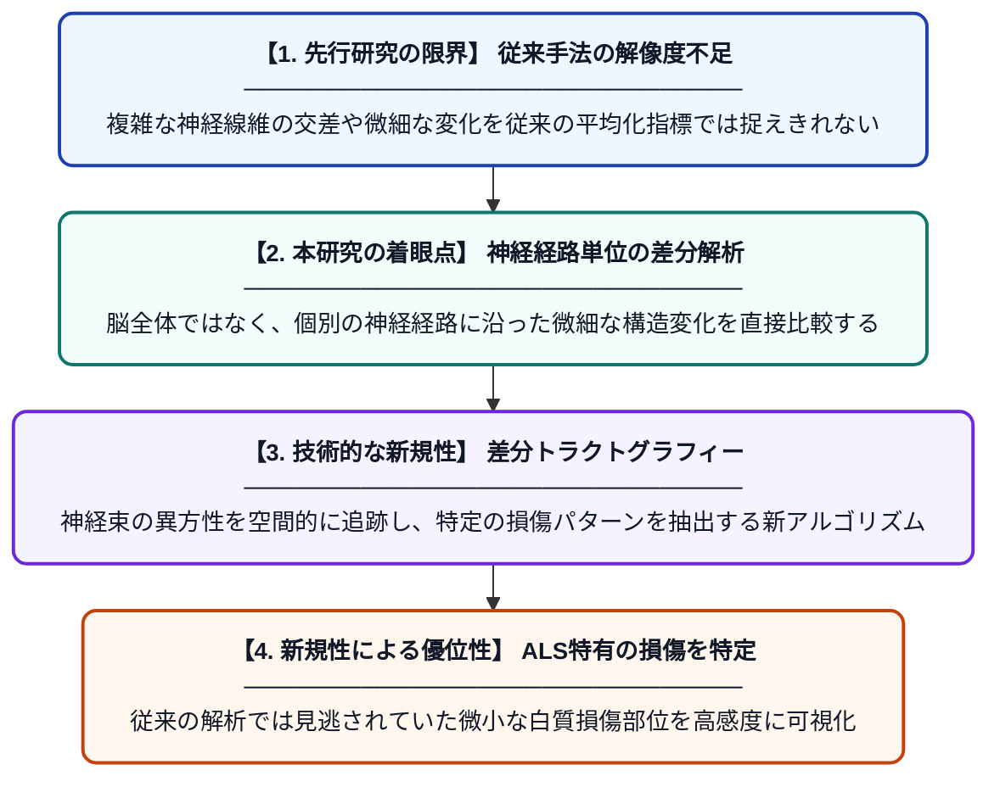

# 差分トラクトグラフィーによる筋萎縮性側索硬化症（ALS）の白質微細構造障害の検出

**Original Title**: *Differential tractography detects white matter microstructural impairments in amyotrophic lateral sclerosis*

> **💡 一言要約**: 最新技術でALSの脳内変化を精密に可視化

| 項目 | 内容 |
|---|---|
| **著者** | JY Zeng, ZY Huang, HY Lin, S Chen, Y Wu, ZY Zou… |
| **掲載誌** | BMC Medical Imaging 2026 |
| **アラートキーワード** | ALS |
| **原文リンク** | [https://link.springer.com/article/10.1186/s12880-026-03019-2](https://link.springer.com/article/10.1186/s12880-026-03019-2) |
| **PDF版要約** | [README.pdf](./README.pdf) |

---

## 📊 新規性の図解（先行研究との違いと本研究のブレークスルー）

## 📝 要約

筋萎縮性側索硬化症（ALS）における白質変性を調査するため、差分トラクトグラフィーを用いた新しい解析手法を提案した研究です。この手法により、従来の解析では困難だったALS患者の白質における微細な構造変化を、より詳細かつ正確に特定することに成功しました。

## ❓ どんな問題に取り組んだか

ALSの進行には脳内の白質変性が深く関わっていますが、従来の拡散テンソル画像（DTI）などの手法では、神経線維が複雑に交差する部位などの微細な構造変化を正確に捉えることが困難でした。そのため、早期診断や病態把握のためのより精密なイメージング手法が求められていました。

## ✨ 何が新しい？何がすごい？（新規性）

本研究の核心は、神経線維の密度や構造の変化を追跡する「差分トラクトグラフィー」をALS解析に導入した点にあります。先行研究の多くは脳全体の平均的な指標に頼っていましたが、本手法は個々の神経経路における異方性の減少を直接的に比較できます。これにより、ALS特有の皮質脊髄路などの損傷を、より高い感度で空間的に特定することが可能になりました。

## 🎓 大学1年生向けの解説

脳の中には、情報を伝えるための「神経の束（白質）」が張り巡らされています。ALSという病気ではこの束が傷ついてしまいますが、今までの技術ではどこがどう傷ついているか細かく見ることが困難でした。この研究では、最新の計算手法を使って、神経の束が細くなったり密度が下がったりしている場所を「差分」として浮かび上がらせることに成功しました。これにより、病気の進行をより正確に知る手がかりが得られます。
