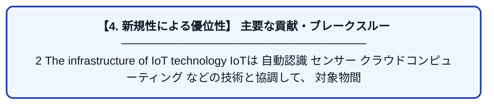

# IoT technology in maritime logistics management: exploration of data analysis methods

| 項目 | 内容 |
|---|---|
| **PDF版要約** | [README.pdf](./README.pdf) |

---

## 📊 新規性の図解（先行研究との違いと本研究のブレークスルー）

## 📝 要約

2 The infrastructure of IoT technology

IoTは

自動認識

センサー

クラウドコンピューティング

などの技術と協調して、

対象物間のシームレスな情報交換や情報統合、それによって広範で堅牢なネットワークを構築することを促進します。

1 8. Yang F, He C, Liu Y, Zeng A, Hu L. Vessel trajectory prediction based on automatic identification system data: multi-gated attention encoder
decoder network. J Mar Sci Eng. 2024;12:1695.

1 9. Li J, Wan M. Sensor-based mountain landslide sensitivity and logistics supply chain management optimization. Arab J Geosci. 2021;14(16):1.

2 0. Cegielski CG, Jones-Farmer LA, Wu Y, Hazen BT. Adoption of cloud computing technologies in supply chains. Int J Logist Manag.
2012;23(2):184–211

海運業の分野では、

物品の状態のリアルタイムトラッキング

倉庫の管理

より正確な輸送スケジュール

などに役立っている。

このような機能は、輸送の効率化やコストの削減に寄与している。

IoTのアーキテクチャー

パーセプションレイヤー

ネットワークレイヤー

アプリケーションレイヤー

Singh SP, Kumar V, Singh AK, Singh S. A Survey on Internet of Things (IoT): Layer Specific vs. domain specific architecture. In: 2nd International Conference on Computer Networks and Communication Technologies, Lecture notes on Data Engineering and Communication
Technologies. 2020. p. 44.

プロトコル

Bluetooth Low Energy (BLE),

iFi (LoRaWAN),

Specifically, it can be applied in water monitoring, environmental
monitoring, energy monitoring, emergency services, logistics and automobiles, and manufacturing, etc. [35],

Bonilla V, Campoverde B, Yoo SG. A systematic literature review of LoRaWAN: sensors and applications. Sensors. 2023;23(20):8440.

3.1 Industry status

国際貿易の極めて重要な構成要素として、海上物流は世界経済の安定と繁栄に多大な影響を与えています

近年、海上輸送においては、国際化の加速と輸送の頻度が増えている。

3.2 Challenges to the industry

コストの制御という観点からは、輸送の効率化と倉庫の費用という挑戦に直面している。

オイルの価格の変動

労働者のコストの上昇

やその他の要因が、輸送コストの不確実性をもたらし従って、運用のリスクを企業にもたらす。

さらに、外洋物流に複数の国や地域が関与することで、規制の違いによる複雑さが加わり、コスト管理の取り組みにさらなる障害をもたらしています[42]。

3.3 The value of data analysis in maritime logistics

データ分析の重要性は、ますます強調されてきている。

運用の効率さ、コスト制御、サービスの品質を向上するのに決定的なツールを提供するからである。

Durlik I, Miller T, Cembrowska-Lech D, Krzemińska A, Złoczowska E, Nowak A. Navigating the sea of data: a comprehensive review on data analysis in maritime IoT applications. Appl Sci. 2023;13:9742.

輸送、倉庫、割り当て、その他の領域を跨いでリアルタイムに監視することにより、海運業者はボトルネックとなっている箇所を速やかに特定し、取り組むことができる。

船の軌跡や荷物の取り扱いにかかる時間などの情報を詳しく調べることにより、企業はより

効率的な輸送計画

倉庫の空室率を最小化するための戦略

などを開発することができる。

Shaw SL, Feng M, Peng G, Fang Z. Time efficiency assessment of ship movements in maritime ports: a case study of two ports based
on AIS data. J Transp Geogr. 2020;86: 102741

データ分析はコスト制御においても重要な役割を果たしている。

石油価格の変動や

為替レートなど

を分析することによって、より合理的な予算や戦略を立てることができる。

Thai VV. Service quality in maritime transport: conceptual model and empirical evidence.

4.1 Data collection methods

様々なデータ分析手法にとって、センサーからのデータ取得重要な役割を果たしています。

センサーからは、温度や湿度、圧力などのデータを取得できます。

このデータは、設備の稼働状況を監視し、生産プロセスを最適化する上で非常に重要です。

さらに、対象物の動きの状態、位置情報などもあります。

実際のケースではワイヤレスのセンサーがたくさんの輸送会社の多様な側面で採用されています。

輸送している物品にセンサーを取り付け、圧力や振動などを図る

ある閾値を超えたらすぐアラートを上げる。

位置情報などと合わせて、盗まれているかどうかなどもわかる。

.The Automatic Identification Systems (AIS) systemという、ものの位置やスピード方向を監視できるシステムは船や荷物の追跡をより向上させることができる。

クラウドコンピューティングは、収集したデータの最終的な格納先として選ばれています。

Röseler C, Backhuß J, Aksentijević S, Tijan E. Cloud computing for efficient data storage and processing in maritime logistics. J Marit
Transp Sci. 2023;63:75–92.

クラウド上に情報を集約することで、ビッグデータの解析を可能にする。

7.1 Summary of research

海上物流管理におけるIoT技術の応用を研究する過程で、私たちはIoT技術が物流効率の向上と資源配分の最適化において極めて重要な役割を果たすことを発見しました。IoT技術の利用は、海上物流管理に前例のない変革をもたらしました。これは主に、データ収集、伝送、処理、および分析の全プロセスにおいて顕著です。IoT技術を通じて、船舶の位置、貨物の状態、気象条件、燃料消費量などを含む、海上物流に関する様々なデータをリアルタイムで正確かつ包括的に収集することができます。このデータの収集は、海上物流の管理のための強固な基盤を確立します。データ伝送の面では、IoT技術は高度な通信方法を採用し、データのリアルタイムかつ正確な配信を保証します。大量のデータを処理することにより、IoT技術は情報を迅速かつ正確に処理および分析する強力な能力を発揮し、それによって海上物流管理のための意思決定支援を提供します。
