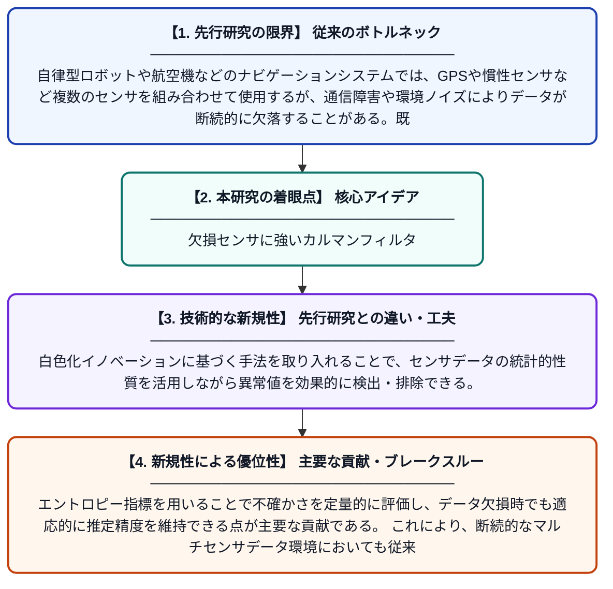

# 断続的なマルチセンサデータストリームに対するロバストナビゲーションのための強化エントロピーマハラノビスカルマンフィルタ

**Original Title**: *An Enhanced Entropy Mahalanobis Kalman Filter for Robust Navigation Under Intermittent Multisensor Data Streams*

> **💡 一言要約**: 欠損センサに強いカルマンフィルタ

| 項目 | 内容 |
|---|---|
| **著者** | J Zhao, X Tang, L Kang, K He, P Tan, Z Yuan |
| **掲載誌** | Aerospace Science and Technology 2026 |
| **アラートキーワード** | kalman filter |
| **原文リンク** | [https://www.sciencedirect.com/science/article/pii/S1270963826016512](https://www.sciencedirect.com/science/article/pii/S1270963826016512) |
| **PDF版要約** | [README.pdf](./README.pdf) |

---

## 📊 新規性の図解（先行研究との違いと本研究のブレークスルー）

## 📝 要約

本論文では、複数のセンサからのデータが断続的に欠落するような状況下でも高精度なナビゲーションを実現するため、強化エントロピーマハラノビスカルマンフィルタ（EEMKF）を提案している。EEMKFは、白色化イノベーションに基づく手法とマハラノビス距離を組み合わせることで、異常値や欠損データに対してロバストな状態推定を行う。これにより、従来手法の限界を克服し、信頼性の高い自律ナビゲーションを実現する。

## ❓ どんな問題に取り組んだか

自律型ロボットや航空機などのナビゲーションシステムでは、GPSや慣性センサなど複数のセンサを組み合わせて使用するが、通信障害や環境ノイズによりデータが断続的に欠落することがある。既存のカルマンフィルタはこうした不規則なデータ欠損や外れ値に対して脆弱であり、推定精度が大幅に低下するという課題があった。特に複数センサが同時に不安定になる状況では、従来手法では適切に対処することが困難であった。

## ✨ 何が新しい？何がすごい？（新規性）

本研究は、情報エントロピーとマハラノビス距離を統合した新しいフィルタリング枠組みEEMKFを提案しており、これは従来の単純なカルマンフィルタや既存のロバストフィルタとは根本的に異なるアプローチである。白色化イノベーションに基づく手法を取り入れることで、センサデータの統計的性質を活用しながら異常値を効果的に検出・排除できる。エントロピー指標を用いることで不確かさを定量的に評価し、データ欠損時でも適応的に推定精度を維持できる点が主要な貢献である。これにより、断続的なマルチセンサデータ環境においても従来手法を凌駕するロバスト性を実現している。

## 🎓 大学1年生向けの解説

スマートフォンのカーナビがGPSの電波が途切れても現在地を推定し続けるように、ロボットや飛行機も複数のセンサを使って自分の位置を把握しています。しかし、センサが壊れたりデータが途切れたりすると、位置の推定が大きく狂ってしまうことがあります。この論文では、「カルマンフィルタ」というデータ処理の仕組みを改良し、センサデータが欠けていたり誤ったデータが混入しても正確に位置を推定できる新しい方法を開発しました。エントロピー（情報の不確かさを表す指標）とマハラノビス距離（データの異常度を測る指標）を組み合わせることで、どのデータを信用してよいかを賢く判断できるようにしています。これにより、過酷な環境でも信頼性の高いナビゲーションが可能になります。
