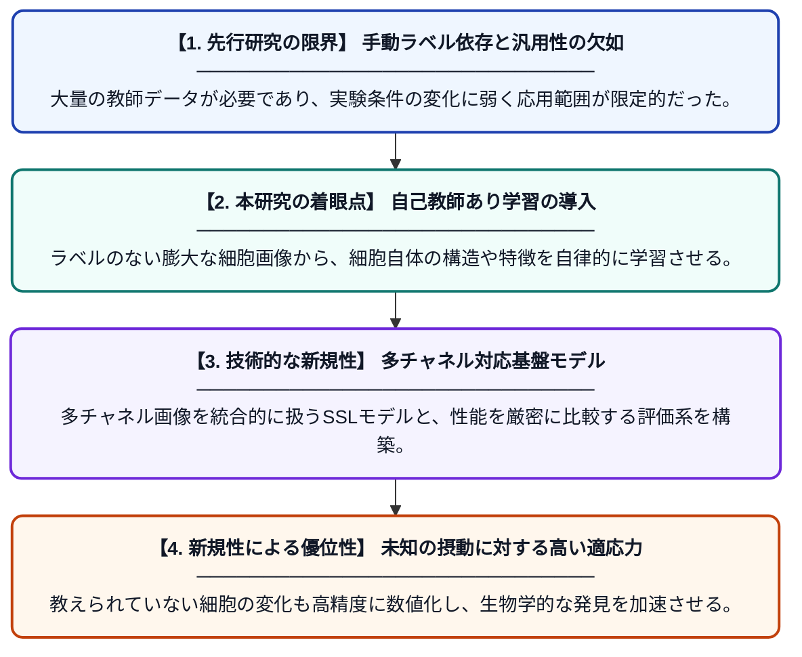

# 自己教師あり学習を用いた細胞形態プロファイリングの高度化：細胞摂動の表現学習に関する比較分析

**Original Title**: *Advancing morphological profiling with self-supervised learning through comparative insights into representation learning of cellular perturbations*

> **💡 一言要約**: AIが細胞の微細な変化を自ら学び、薬の効果を精密に解析

| 項目 | 内容 |
|---|---|
| **著者** | WM Abdelmoula, T Albuquerque, S Jaensch, P Pati… |
| **掲載誌** | Nature Methods 2026 |
| **アラートキーワード** | representation learning |
| **原文リンク** | [https://www.nature.com/articles/s41592-026-03270-z](https://www.nature.com/articles/s41592-026-03270-z) |
| **PDF版要約** | [README.pdf](./README.pdf) |

---

## 📊 新規性の図解（先行研究との違いと本研究のブレークスルー）

## 📝 要約

多チャネル高コンテンツ画像（HCI）から細胞の形態的特徴を抽出するため、自己教師あり学習を用いた基盤モデルの事前学習とベンチマークを行うフレームワークを提案しました。この手法により、薬剤や遺伝子操作などの細胞への刺激（摂動）がもたらす複雑な変化を、ラベルなしで高精度に数値化することが可能になりました。

## ❓ どんな問題に取り組んだか

細胞画像から生物学的な意味を抽出する従来の手法は、人間による大量のラベル付けが必要であり、解析コストが高いことが課題でした。また、実験環境や細胞種が異なると精度が安定せず、多様な細胞の変化を汎用的に捉えることが困難でした。

## ✨ 何が新しい？何がすごい？（新規性）

大規模な細胞画像データセットを用いて、自己教師あり学習（SSL）に基づく基盤モデルを構築し、その表現能力を網羅的に評価する比較フレームワークを開発しました。特定のタスクに依存しない汎用的な特徴量を抽出できるため、未知の薬剤反応や遺伝子機能の解析において、従来の教師あり学習を凌駕する柔軟性と精度を実証しました。

## 🎓 大学1年生向けの解説

顕微鏡で撮った細胞の画像から、その細胞が薬の影響でどう変化したかをAIに自動で判断させる研究です。これまでは「この細胞はAという状態」と人間が教える必要がありましたが、今回のAIは膨大な画像を見るだけで、自ら細胞の特徴を学習します。これにより、人間には見分けがつかないような微かな細胞の変化も見逃さず、新しい薬の開発をより効率的に進められるようになります。
