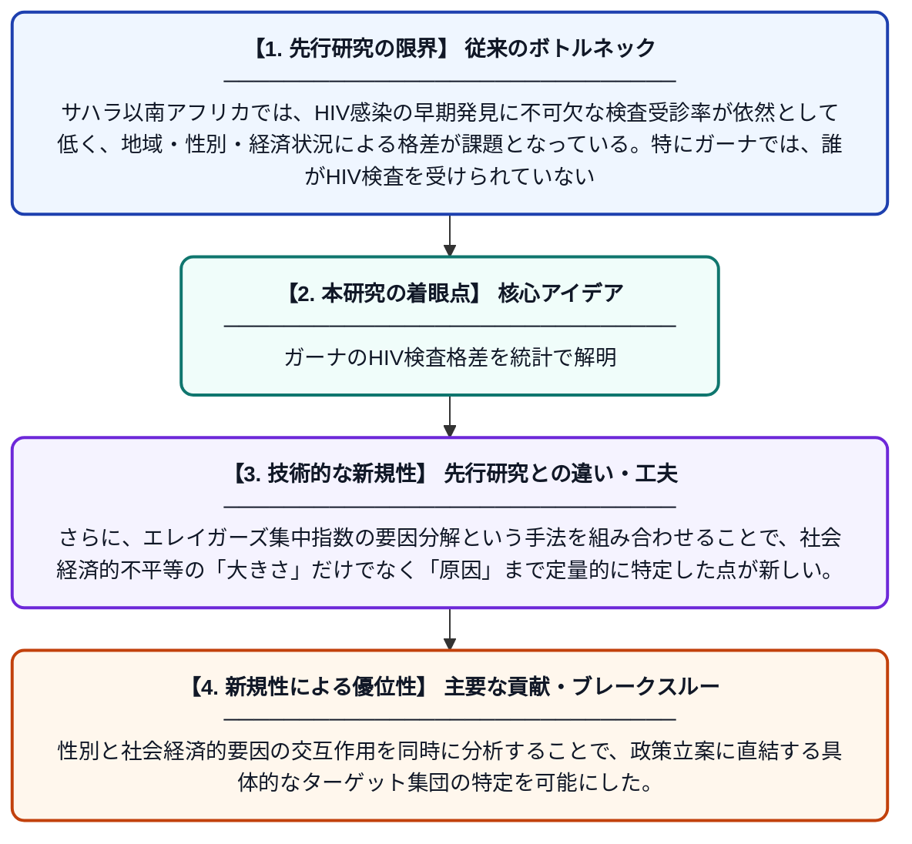

# ガーナにおけるHIV検査受診の性別・社会経済的不平等のベイズ階層分析

**Original Title**: *Bayesian hierarchical analysis of gender and socioeconomic inequalities in HIV testing uptake in Ghana*

> **💡 一言要約**: ガーナのHIV検査格差を統計で解明

| 項目 | 内容 |
|---|---|
| **著者** | D Ngmenbelle, S Nimirkpen |
| **掲載誌** | BMC Infectious Diseases 2026 |
| **アラートキーワード** | Bayesian hierarchical ... |
| **原文リンク** | [https://link.springer.com/article/10.1186/s12879-026-14085-w](https://link.springer.com/article/10.1186/s12879-026-14085-w) |
| **PDF版要約** | [README.pdf](./README.pdf) |

---

## 📊 新規性の図解（先行研究との違いと本研究のブレークスルー）

## 📝 要約

本研究では、ガーナにおけるHIV検査の受診率に影響する要因を、ベイズ多水準ロジスティック回帰モデルを用いて分析した。また、エレイガーズ集中指数を用いて社会経済的不平等を定量化し、その要因分解によって不平等の主な寄与因子を特定した。性別および社会経済的地位が検査受診に与える複合的な影響を明らかにすることを目的としている。

## ❓ どんな問題に取り組んだか

サハラ以南アフリカでは、HIV感染の早期発見に不可欠な検査受診率が依然として低く、地域・性別・経済状況による格差が課題となっている。特にガーナでは、誰がHIV検査を受けられていないのか、そしてその背景にある社会経済的要因が十分に解明されていなかった。このような格差の実態を把握することが、効果的な公衆衛生介入策の立案に不可欠である。

## ✨ 何が新しい？何がすごい？（新規性）

従来の研究が単純なロジスティック回帰に留まっていたのに対し、本研究はベイズ多水準モデルを採用することでデータの階層構造（個人・地域レベル）を適切に考慮している。さらに、エレイガーズ集中指数の要因分解という手法を組み合わせることで、社会経済的不平等の「大きさ」だけでなく「原因」まで定量的に特定した点が新しい。性別と社会経済的要因の交互作用を同時に分析することで、政策立案に直結する具体的なターゲット集団の特定を可能にした。

## 🎓 大学1年生向けの解説

HIVという感染症は早期に検査を受けることがとても大切ですが、お金持ちかどうかや男性・女性かによって、検査を受ける割合が大きく違うことがあります。この研究では、ガーナという西アフリカの国のデータを使って、どんな人が検査を受けられていないかを高度な統計手法で調べました。「ベイズ統計」という方法を使うと、地域の違いも考慮しながら分析でき、より正確な結論が得られます。その結果、貧しい人や特定の性別の人が検査を受けにくい状況にあることが明らかになりました。この発見は、支援が必要な人に確実に届く公衆衛生政策を作るために役立てられます。
