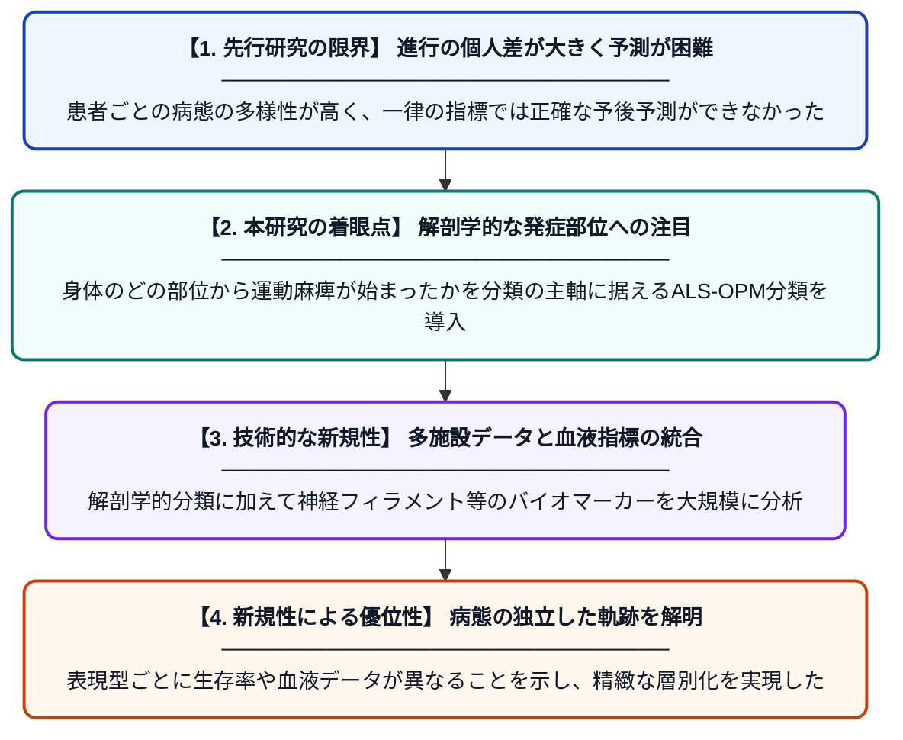

# 解剖学的に定義された運動表現型によるALSの進行、神経フィラメントプロファイル、および生存期間の解離した軌跡の解明

**Original Title**: *Anatomically Defined Motor Phenotypes Reveal Dissociated Trajectories of Progression, Neurofilament Profiles, and Survival in ALS*

> **💡 一言要約**: 発症部位の分類でALSの予後と血液指標を精密に予測

| 項目 | 内容 |
|---|---|
| **著者** | T Meyer, T Grehl, P Schumann, U Weyen, A Rödiger… |
| **掲載誌** | European journal of … 2026 |
| **アラートキーワード** | ALS |
| **原文リンク** | [https://pmc.ncbi.nlm.nih.gov/articles/PMC13714081/](https://pmc.ncbi.nlm.nih.gov/articles/PMC13714081/) |
| **PDF版要約** | [README.pdf](./README.pdf) |

---

## 📊 新規性の図解（先行研究との違いと本研究のブレークスルー）

## 📝 要約

この研究は、ALSの解剖学的な発症部位に基づく分類（ALS-OPM）が、病気の進行速度、神経フィラメント値、および生存期間に与える影響を多施設共同研究のデータから分析しました。その結果、解剖学的表現型によってこれら3つの要素が異なる軌跡をたどることを明らかにし、ALSの多様な病態を予測する新たな枠組みを提示しました。

## ❓ どんな問題に取り組んだか

ALS（筋萎縮性側索硬化症）は患者ごとに進行や生存期間が大きく異なり、個々の予後を正確に予測することが困難でした。また、バイオマーカーである神経フィラメント値と解剖学的な発症部位、そして実際の病気の進行との間の複雑な関係性は十分に解明されていませんでした。

## ✨ 何が新しい？何がすごい？（新規性）

本研究は、解剖学的な決定要因に基づく「ALS-OPM分類」を用いることで、進行速度・神経フィラメント・生存期間という3つの重要指標が、特定の表現型ごとに独立した（解離した）傾向を示すことを実証しました。先行研究では進行の速さのみが注目されがちでしたが、本研究は大規模な多施設データを用いて解剖学的分布と生化学的指標を初めて統合的に紐付けた点が画期的です。これにより、単一の疾患モデルではなく、複数の生物学的軌跡が存在することを明確に示しました。

## 🎓 大学1年生向けの解説

ALSは全身の筋肉が動かなくなる病気ですが、人によって「どこから症状が出るか」や「どのくらいの速さで進むか」がバラバラです。この研究では、最初に症状が出た体の場所で患者さんをグループ分けしました。すると、グループごとに血液検査の結果や、どれくらい長く生きられるかといった特徴がはっきりと異なることがわかりました。この発見により、患者さん一人ひとりに合わせた「今後の予測」がより正確にできるようになると期待されています。
