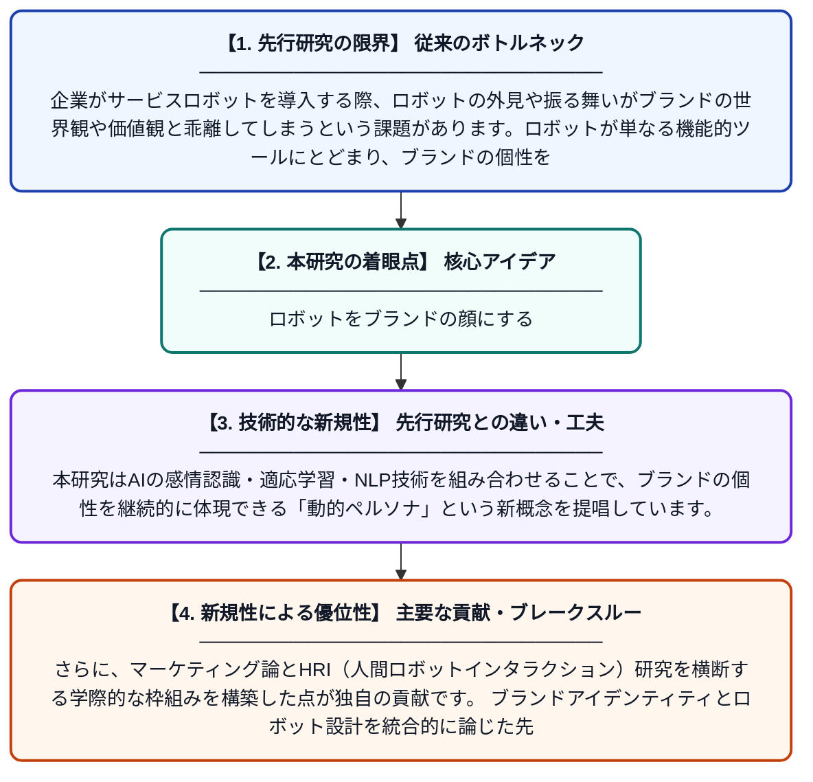

# デザインで刻むブランド：AI搭載サービス環境における擬人化ロボットペルソナとブランドアイデンティティの統合

**Original Title**: *Branded by Design: Aligning Anthropomorphic Robot Personas With Brand Identity in AI-Powered Service Environments*

> **💡 一言要約**: ロボットをブランドの顔にする

| 項目 | 内容 |
|---|---|
| **著者** | N Yadav, M Singh, V Tyagi |
| **掲載誌** | Branding with Anthropomorphic Service Robots and AI 2027 |
| **アラートキーワード** | affective computing |
| **原文リンク** | [https://www.igi-global.com/chapter/branded-by-design/417479](https://www.igi-global.com/chapter/branded-by-design/417479) |
| **PDF版要約** | [README.pdf](./README.pdf) |

---

## 📊 新規性の図解（先行研究との違いと本研究のブレークスルー）

## 📝 要約

本論文は、サービス現場で活躍する擬人化ロボットのペルソナをブランドアイデンティティと整合させる方法を探求しています。自然言語処理（NLP）、感情コンピューティング、適応的行動学習などのAI技術を活用することで、ブランドの価値観や個性を体現する動的なロボットペルソナの構築方法を検討しています。これにより、顧客体験の一貫性と企業ブランドの強化を同時に実現する枠組みを提示しています。

## ❓ どんな問題に取り組んだか

企業がサービスロボットを導入する際、ロボットの外見や振る舞いがブランドの世界観や価値観と乖離してしまうという課題があります。ロボットが単なる機能的ツールにとどまり、ブランドの個性を顧客に伝えられないと、顧客体験が損なわれます。この研究はこうしたブランドとロボットペルソナの不一致をいかに解消するかに取り組んでいます。

## ✨ 何が新しい？何がすごい？（新規性）

従来研究はロボットの機能性やユーザビリティに焦点を当てることが多く、ブランド戦略との統合という視点は見落とされがちでした。本研究はAIの感情認識・適応学習・NLP技術を組み合わせることで、ブランドの個性を継続的に体現できる「動的ペルソナ」という新概念を提唱しています。さらに、マーケティング論とHRI（人間ロボットインタラクション）研究を横断する学際的な枠組みを構築した点が独自の貢献です。ブランドアイデンティティとロボット設計を統合的に論じた先駆的な章として位置づけられます。

## 🎓 大学1年生向けの解説

最近、お店やホテルでロボットが接客するシーンが増えてきましたよね。でも、そのロボットがそのお店らしい雰囲気を出せているかどうか、考えたことはありますか？この研究は、ロボットがまるでそのブランドの「顔」になれるよう、AIを使ってロボットの話し方や振る舞いをブランドのイメージに合わせる方法を研究しています。たとえば高級ホテルなら上品に、カジュアルなカフェなら親しみやすく振る舞えるロボットを作る仕組みを考えているのです。AIが顧客の感情を読み取りながら、ブランドらしさを保ちつつ柔軟に対応できるロボットの設計指針を提示しています。
