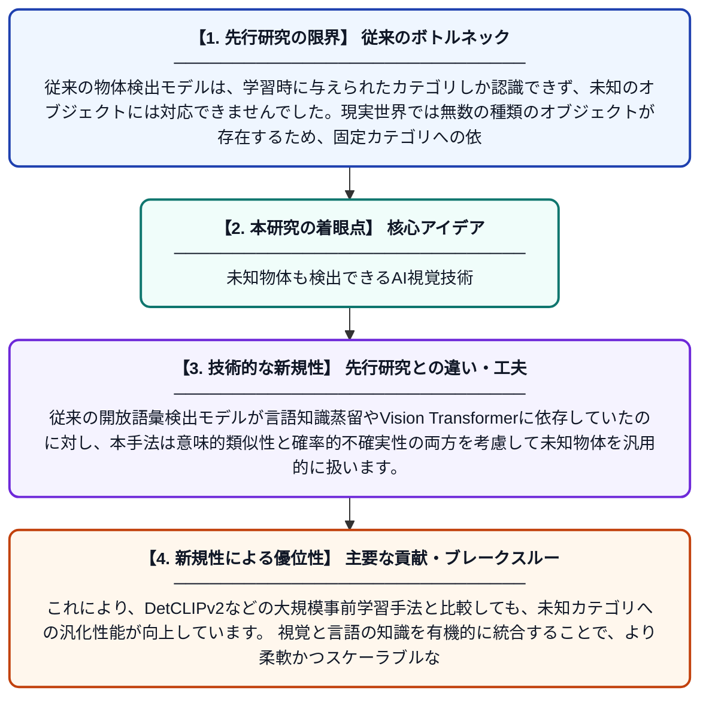

# 開放世界物体検出のためのマルチモーダル意味論的・確率論的物体性

**Original Title**: *Multimodal Semantic-Probabilistic Objectness for Open World Object Detection*

> **💡 一言要約**: 未知物体も検出できるAI視覚技術

| 項目 | 内容 |
|---|---|
| **著者** | W Tian, R Liu |
| **掲載誌** | arXiv preprint arXiv:2607.23981 2026 |
| **アラートキーワード** | Open-Vocabulary Object ... |
| **PDF** | [https://arxiv.org/pdf/2607.23981](https://arxiv.org/pdf/2607.23981) |
| **原文リンク** | [https://arxiv.org/pdf/2607.23981](https://arxiv.org/pdf/2607.23981) |
| **PDF版要約** | [README.pdf](./README.pdf) |

---

## 📊 新規性の図解（先行研究との違いと本研究のブレークスルー）

## 📝 要約

本論文は、事前に定義されたカテゴリに限らず、未知のオブジェクトも検出できる「開放世界物体検出」の課題に取り組んでいます。視覚と言語の両方の情報（マルチモーダル）を組み合わせ、意味的・確率的なアプローチでオブジェクトらしさ（物体性）を推定する新手法を提案しています。これにより、訓練データに含まれないカテゴリの物体も柔軟に検出できるようになります。

## ❓ どんな問題に取り組んだか

従来の物体検出モデルは、学習時に与えられたカテゴリしか認識できず、未知のオブジェクトには対応できませんでした。現実世界では無数の種類のオブジェクトが存在するため、固定カテゴリへの依存は大きな制約となっています。この論文は、開放世界設定において未知オブジェクトをいかに正確に検出するかという課題に取り組んでいます。

## ✨ 何が新しい？何がすごい？（新規性）

本研究は、視覚情報と言語情報を融合したマルチモーダルなアプローチで「物体性スコア」を確率論的かつ意味論的に定義する点が新しいです。従来の開放語彙検出モデルが言語知識蒸留やVision Transformerに依存していたのに対し、本手法は意味的類似性と確率的不確実性の両方を考慮して未知物体を汎用的に扱います。これにより、DetCLIPv2などの大規模事前学習手法と比較しても、未知カテゴリへの汎化性能が向上しています。視覚と言語の知識を有機的に統合することで、より柔軟かつスケーラブルな物体検出フレームワークを実現しています。

## 🎓 大学1年生向けの解説

スマートフォンのカメラで写真を撮ると、AIが「これは猫」「これは車」と認識してくれますが、普通のAIは学習したことがないものは認識できません。この研究は、見たことのない物体でも「これは何か物体っぽい」と検出できるAIを作ることを目指しています。そのために、画像（目で見る情報）と言語（言葉の意味）を組み合わせた新しい方法を使っています。確率的な考え方も取り入れることで、「これが物体である可能性はどのくらいか」を柔軟に判断できるようにしました。将来的には、自動運転や医療画像診断など、未知の物体にも対処が必要な場面での活躍が期待されます。
