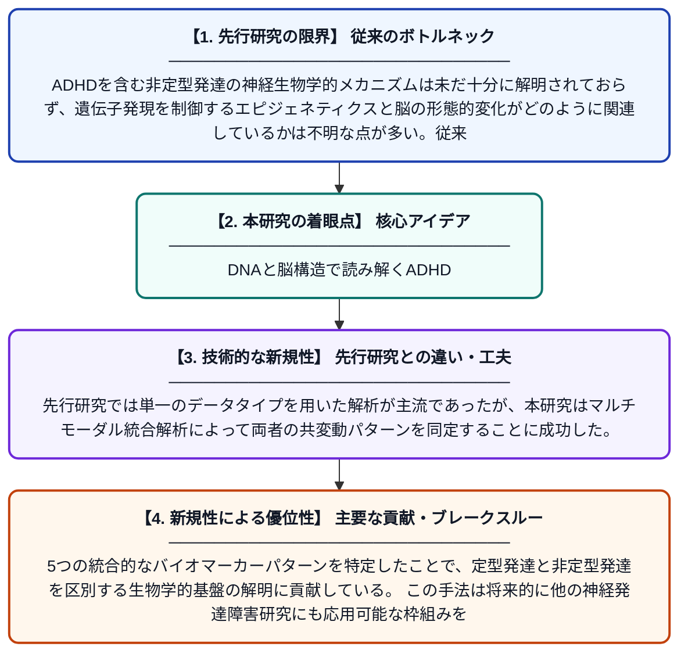

# 定型発達および非定型発達におけるエピジェネティクスと脳構造の共変動パターン

**Original Title**: *Epigenetic and Brain Structure Covariation Patterns in Typical and Atypical Development*

> **💡 一言要約**: DNAと脳構造で読み解くADHD

| 項目 | 内容 |
|---|---|
| **著者** | V Chirokoff, J Wrigglesworth, PD Fransquet, YT Wong |
| **掲載誌** | Human Brain Mapping 2026 |
| **アラートキーワード** | independent component ... |
| **PDF** | [https://onlinelibrary.wiley.com/doi/pdf/10.1002/hbm.70587](https://onlinelibrary.wiley.com/doi/pdf/10.1002/hbm.70587) |
| **原文リンク** | [https://onlinelibrary.wiley.com/doi/pdf/10.1002/hbm.70587](https://onlinelibrary.wiley.com/doi/pdf/10.1002/hbm.70587) |
| **PDF版要約** | [README.pdf](./README.pdf) |

---

## 📊 新規性の図解（先行研究との違いと本研究のブレークスルー）

## 📝 要約

本研究は、ADHDの有無を問う144名の子どもを対象に、エピジェネティクス（DNAメチル化）データと脳構造MRIデータを並列独立成分分析（pICA）によって統合解析した。この手法により、エピジェネティクスと脳構造の間に存在する5つの関連パターンを特定した。これにより、ADHDの発症に関わる生物学的メカニズムの理解を深める新たな知見が得られた。

## ❓ どんな問題に取り組んだか

ADHDを含む非定型発達の神経生物学的メカニズムは未だ十分に解明されておらず、遺伝子発現を制御するエピジェネティクスと脳の形態的変化がどのように関連しているかは不明な点が多い。従来の研究では、これら二種類の生体情報を個別に解析することが多く、両者の複合的な関係性を捉えることが難しかった。

## ✨ 何が新しい？何がすごい？（新規性）

本研究は、エピジェネティクス（DNAメチル化）と脳構造MRIという異なるモダリティのデータを同時に解析する並列独立成分分析（pICA）を子どものADHD研究に適用した点が新しい。先行研究では単一のデータタイプを用いた解析が主流であったが、本研究はマルチモーダル統合解析によって両者の共変動パターンを同定することに成功した。5つの統合的なバイオマーカーパターンを特定したことで、定型発達と非定型発達を区別する生物学的基盤の解明に貢献している。この手法は将来的に他の神経発達障害研究にも応用可能な枠組みを提供する。

## 🎓 大学1年生向けの解説

ADHDとは、注意力の維持や衝動の制御が難しくなる発達障害の一種です。この研究では、子どもたちのDNAの「スイッチ」（エピジェネティクス）と、脳のかたち（構造MRI）という2種類の情報を同時に分析しました。特別なコンピューター手法を使うことで、DNAの状態と脳の形が一緒に変化するパターンを5つ見つけることができました。これにより、ADHDがなぜ起こるのかを、遺伝子と脳の両方の視点から理解する手がかりが得られました。
