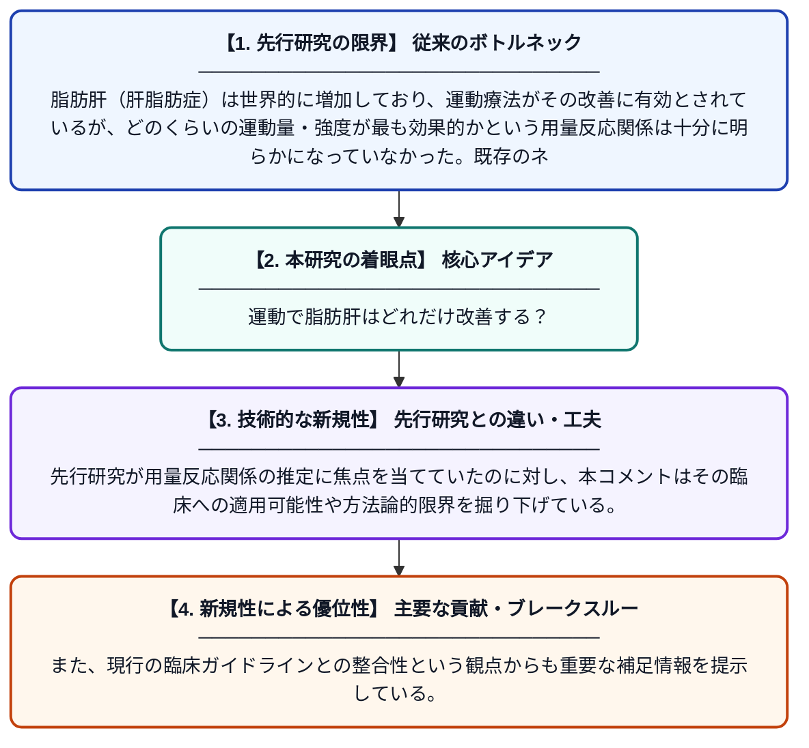

# 運動と肝脂肪蓄積の用量反応関係に関するベイズネットワークメタ解析へのコメント

**Original Title**: *Comment on: Dose–response relationship between exercise and hepatic steatosis: A systematic review with Bayesian network meta-analysis of randomized controlled trials*

> **💡 一言要約**: 運動で脂肪肝はどれだけ改善する？

| 項目 | 内容 |
|---|---|
| **著者** | A García-Hermoso, Y Ezzatvar |
| **掲載誌** | Journal of Sport and Health Science 2026 |
| **アラートキーワード** | bayesian network |
| **原文リンク** | [https://www.sciencedirect.com/science/article/pii/S2095254626000542](https://www.sciencedirect.com/science/article/pii/S2095254626000542) |
| **PDF版要約** | [README.pdf](./README.pdf) |

---

## 📊 新規性の図解（先行研究との違いと本研究のブレークスルー）

## 📝 要約

本論文は、運動と肝脂肪症（脂肪肝）の関係を調べたネットワークメタ解析に対するコメント・考察論文である。運動の種類や量と肝脂肪の改善効果の用量反応関係について、方法論的な観点や臨床的な意義を検討している。特に、現在のライフスタイル介入ガイダンスを踏まえた上で、研究知見の解釈に関する重要な補足的視点を提供している。

## ❓ どんな問題に取り組んだか

脂肪肝（肝脂肪症）は世界的に増加しており、運動療法がその改善に有効とされているが、どのくらいの運動量・強度が最も効果的かという用量反応関係は十分に明らかになっていなかった。既存のネットワークメタ解析に対して、方法論上の課題や解釈上の注意点を指摘する必要があった。

## ✨ 何が新しい？何がすごい？（新規性）

本研究は元のメタ解析の知見に対して批判的・補足的な視点を提供しており、ベイズネットワークメタ解析という高度な統計手法の適用における解釈上の注意を促す点が新しい。先行研究が用量反応関係の推定に焦点を当てていたのに対し、本コメントはその臨床への適用可能性や方法論的限界を掘り下げている。また、現行の臨床ガイドラインとの整合性という観点からも重要な補足情報を提示している。

## 🎓 大学1年生向けの解説

脂肪肝とは、肝臓に余分な脂肪が溜まってしまう病気で、生活習慣病の一つです。運動すると脂肪肝が改善することは知られていますが、「どのくらい運動すれば良いか」は難しい問題です。この論文は、その量と効果の関係を大規模に分析した研究に対して、「ここをもっと注意して解釈すべきだ」という専門家からのコメントです。より正確で安全な運動指導につなげるために、研究の読み方や限界を丁寧に議論しています。
