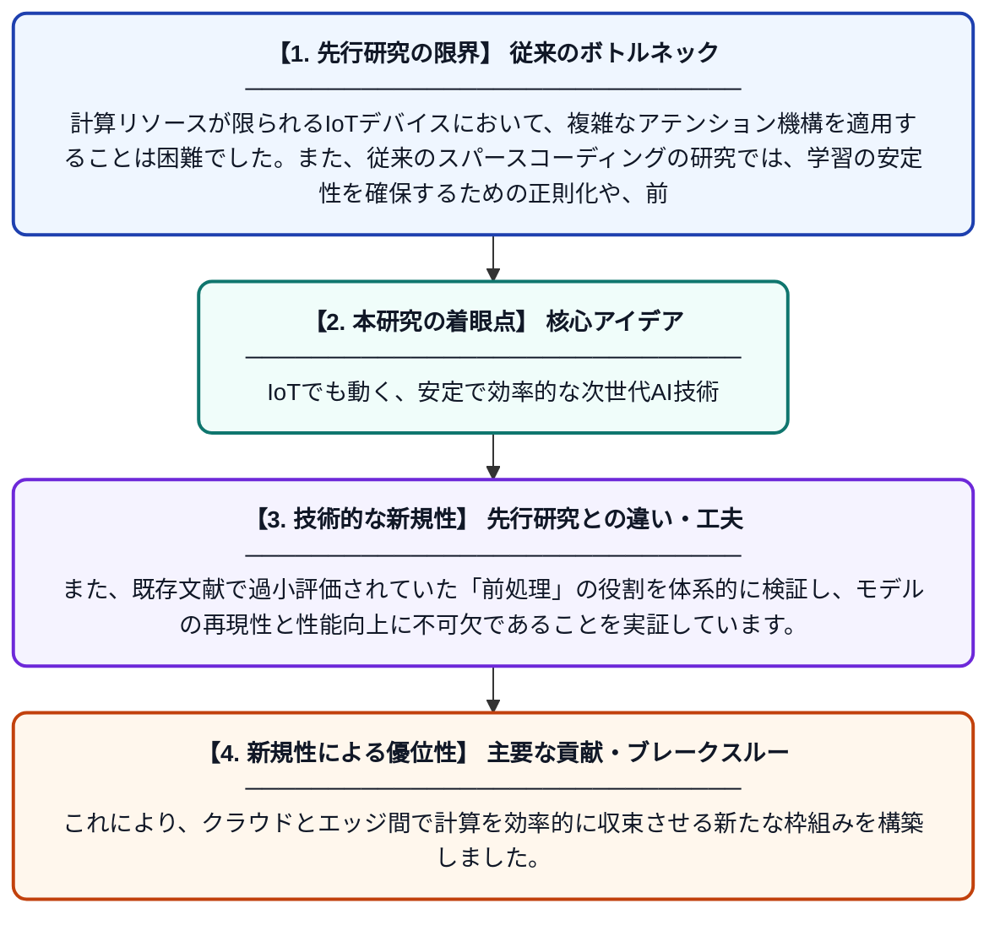

# Cloud-IoTインフラに向けたアテンション機構の拡張：収束から得られた教訓

**Original Title**: *Scaling Attention Mechanisms to Cloud-IoT Infrastructures: Lessons from Convergence*

> **💡 一言要約**: IoTでも動く、安定で効率的な次世代AI技術

| 項目 | 内容 |
|---|---|
| **著者** | R Ali |
| **アラートキーワード** | sparse coding |
| **PDF** | [https://www.researchgate.net/profile/Ramy-Ali-9/publication/416700267_Scaling_Attention_Mechanisms_to_Cloud-IoT_Infrastructures_Lessons_from_Convergence/links/6adb99e97b91621e003809a9/Scaling-Attention-Mechanisms-to-Cloud-IoT-Infrastructures-Lessons-from-Convergence.pdf](https://www.researchgate.net/profile/Ramy-Ali-9/publication/416700267_Scaling_Attention_Mechanisms_to_Cloud-IoT_Infrastructures_Lessons_from_Convergence/links/6adb99e97b91621e003809a9/Scaling-Attention-Mechanisms-to-Cloud-IoT-Infrastructures-Lessons-from-Convergence.pdf) |
| **原文リンク** | [https://www.researchgate.net/profile/Ramy-Ali-9/publication/416700267_Scaling_Attention_Mechanisms_to_Cloud-IoT_Infrastructures_Lessons_from_Convergence/links/6adb99e97b91621e003809a9/Scaling-Attention-Mechanisms-to-Cloud-IoT-Infrastructures-Lessons-from-Convergence.pdf](https://www.researchgate.net/profile/Ramy-Ali-9/publication/416700267_Scaling_Attention_Mechanisms_to_Cloud-IoT_Infrastructures_Lessons_from_Convergence/links/6adb99e97b91621e003809a9/Scaling-Attention-Mechanisms-to-Cloud-IoT-Infrastructures-Lessons-from-Convergence.pdf) |
| **PDF版要約** | [README.pdf](./README.pdf) |

---

## 📊 新規性の図解（先行研究との違いと本研究のブレークスルー）

## 📝 要約

本研究は、リソース制限のあるCloud-IoT環境においてアテンション機構を効率的に動作させる手法を提案しています。特に、スパースコーディングにおける安定性ベースの正則化と、これまで軽視されてきた前処理の重要性を明らかにすることで、システム全体の収束性を向上させています。

## ❓ どんな問題に取り組んだか

計算リソースが限られるIoTデバイスにおいて、複雑なアテンション機構を適用することは困難でした。また、従来のスパースコーディングの研究では、学習の安定性を確保するための正則化や、前処理が性能に与える影響が十分に議論されていませんでした。

## ✨ 何が新しい？何がすごい？（新規性）

本論文は、安定性に基づく正則化がスパースコーディングを改善するための原理的なレバー（手段）であることを示しました。また、既存文献で過小評価されていた「前処理」の役割を体系的に検証し、モデルの再現性と性能向上に不可欠であることを実証しています。これにより、クラウドとエッジ間で計算を効率的に収束させる新たな枠組みを構築しました。

## 🎓 大学1年生向けの解説

AIが情報の重要な部分を見つける「アテンション」という仕組みを、身の回りの小さなセンサー（IoT機器）でも動かせるようにする研究です。難しい計算を簡略化する際に、データの「事前準備」を丁寧に行い、計算が不安定にならないようにルールを決めました。その結果、非力な機器でもクラウドと協力して、賢く効率的にデータを処理できるようになります。
