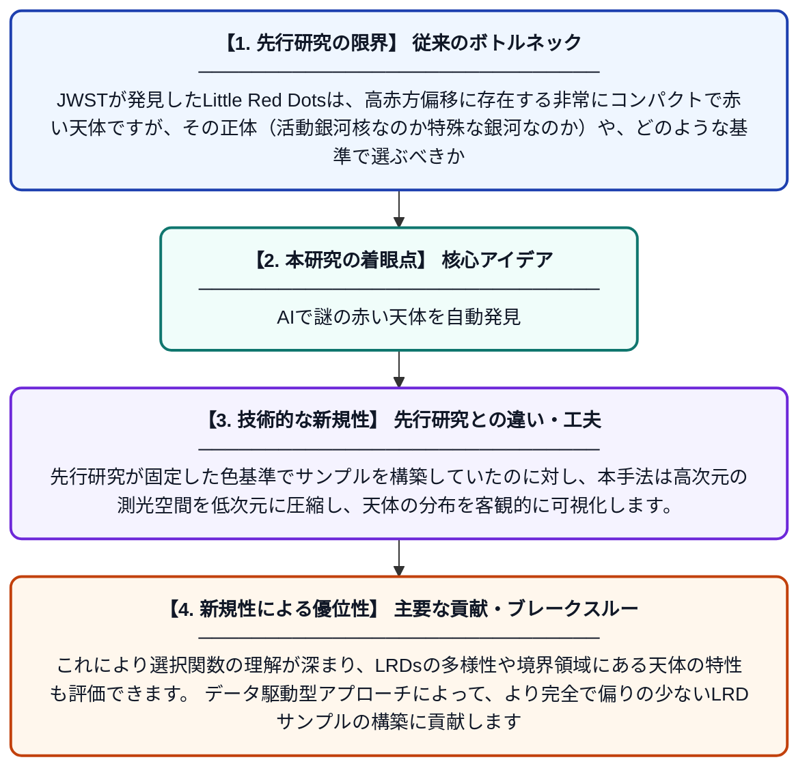

# 多様体学習を用いたJWST観測におけるLittle Red Dotsの教師なし選択と特性評価

**Original Title**: *Unsupervised selection and characterisation of Little Red Dots in JWST surveys with manifold learning*

> **💡 一言要約**: AIで謎の赤い天体を自動発見

| 項目 | 内容 |
|---|---|
| **著者** | M Ginolfi, F Mannucci, A Marconi, F D'Eugenio |
| **掲載誌** | arXiv preprint arXiv:2607.22835 2026 |
| **アラートキーワード** | manifold learning |
| **PDF** | [https://arxiv.org/pdf/2607.22835](https://arxiv.org/pdf/2607.22835) |
| **Git リポジトリ** | [https://github.com/micginolfi/compressedUniverse](https://github.com/micginolfi/compressedUniverse) |
| **原文リンク** | [https://arxiv.org/pdf/2607.22835](https://arxiv.org/pdf/2607.22835) |
| **PDF版要約** | [README.pdf](./README.pdf) |

---

## 📊 新規性の図解（先行研究との違いと本研究のブレークスルー）

## 📝 要約

JWSTが発見した高赤方偏移の小さく赤い天体「Little Red Dots（LRDs）」は、その物理的性質や選択基準がいまだ議論中です。本研究では、多バンド測光データに教師なし機械学習（多様体学習）を適用し、LRDsを系統的に選択・分類する手法を開発しました。これにより、従来の色選択基準に依存しない客観的なLRD同定が可能になります。

## ❓ どんな問題に取り組んだか

JWSTが発見したLittle Red Dotsは、高赤方偏移に存在する非常にコンパクトで赤い天体ですが、その正体（活動銀河核なのか特殊な銀河なのか）や、どのような基準で選ぶべきかが研究者間で一致していません。従来の選択手法は恣意的な色のカットに依存しており、サンプルの偏りやバイアスが生じる可能性がありました。

## ✨ 何が新しい？何がすごい？（新規性）

本研究は、LRDsの同定に初めて教師なし機械学習（多様体学習）を導入し、人間が事前に定めたカラーカットに頼らずデータそのものの構造からLRDsを抽出する点が革新的です。先行研究が固定した色基準でサンプルを構築していたのに対し、本手法は高次元の測光空間を低次元に圧縮し、天体の分布を客観的に可視化します。これにより選択関数の理解が深まり、LRDsの多様性や境界領域にある天体の特性も評価できます。データ駆動型アプローチによって、より完全で偏りの少ないLRDサンプルの構築に貢献します。

## 🎓 大学1年生向けの解説

JWSTという宇宙望遠鏡が、遠い宇宙に「Little Red Dots（小さな赤い点）」と呼ばれる不思議な天体をたくさん見つけました。これらが何者なのかはまだよくわかっていません。この研究では、AIの一種である「多様体学習」という技術を使って、人間が色のルールを決めなくても自動でこれらの天体を見つけ出す方法を開発しました。たくさんの色の情報をコンピュータに学ばせ、似た天体同士をグループ分けすることで、より正確にLRDsの仲間を探せるようになります。まるで星の「顔認識」のようなもので、宇宙の謎を解くための新しい道具です。
