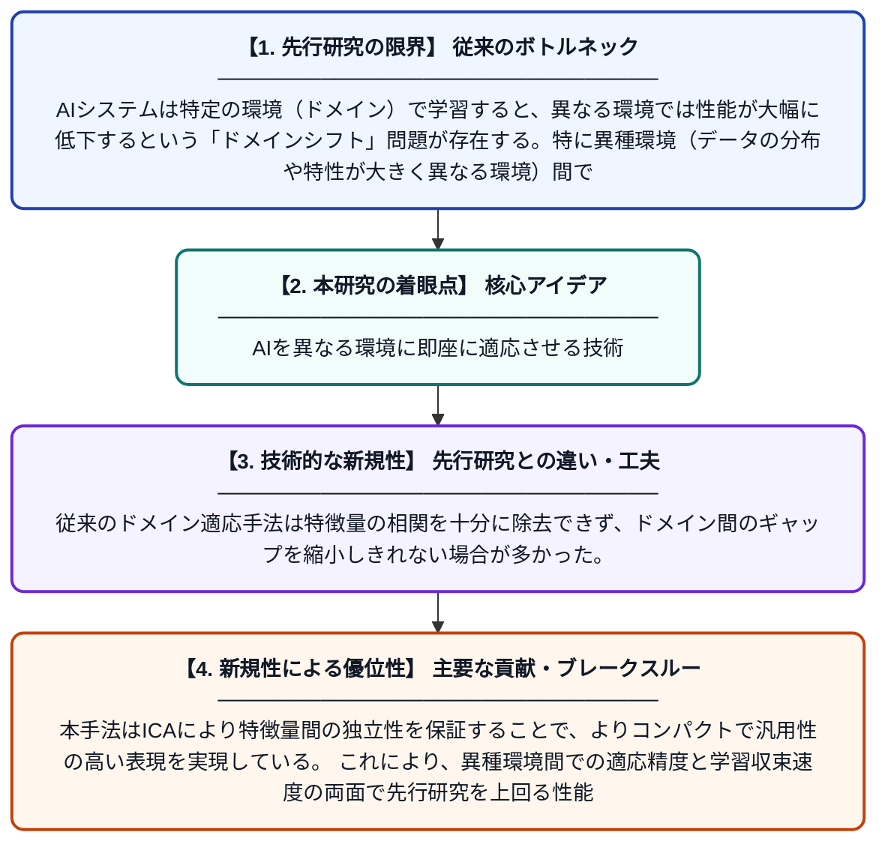

# 異種環境におけるインテリジェントシステムのクロスドメイン適応

**Original Title**: *Cross-Domain Adaptation Of Intelligent Systems In Heterogeneous Environments*

> **💡 一言要約**: AIを異なる環境に即座に適応させる技術

| 項目 | 内容 |
|---|---|
| **著者** | P Jamsandekar, TA Wani, V Khugshal, P Kuppuswamy |
| **掲載誌** | International Journal of AI and Machine Learning 2026 |
| **アラートキーワード** | independent component ... |
| **PDF** | [https://svedbergopen.com/index.php/ijaiml/article/download/585/446](https://svedbergopen.com/index.php/ijaiml/article/download/585/446) |
| **原文リンク** | [https://svedbergopen.com/index.php/ijaiml/article/download/585/446](https://svedbergopen.com/index.php/ijaiml/article/download/585/446) |
| **PDF版要約** | [README.pdf](./README.pdf) |

---

## 📊 新規性の図解（先行研究との違いと本研究のブレークスルー）

## 📝 要約

本論文は、異なるドメイン間でAIシステムを効果的に適応させるための手法を提案している。Min-max正規化による入力特徴量のスケーリングと独立成分分析（ICA）を組み合わせることで、ドメインに依存しない統計的に独立したコンパクトな特徴量を抽出し、学習の収束を高速化する。これにより、異種環境間での知識転移と汎化性能の向上を実現している。

## ❓ どんな問題に取り組んだか

AIシステムは特定の環境（ドメイン）で学習すると、異なる環境では性能が大幅に低下するという「ドメインシフト」問題が存在する。特に異種環境（データの分布や特性が大きく異なる環境）間での適応は困難であり、再学習にコストがかかる。既存手法では特徴量の統計的独立性を十分に活用できておらず、効率的な知識転移が課題となっていた。

## ✨ 何が新しい？何がすごい？（新規性）

本研究の新規性は、Min-max正規化とICAを組み合わせることで、ドメイン不変かつ統計的に独立した特徴量表現を効率的に獲得する点にある。従来のドメイン適応手法は特徴量の相関を十分に除去できず、ドメイン間のギャップを縮小しきれない場合が多かった。本手法はICAにより特徴量間の独立性を保証することで、よりコンパクトで汎用性の高い表現を実現している。これにより、異種環境間での適応精度と学習収束速度の両面で先行研究を上回る性能を示している。

## 🎓 大学1年生向けの解説

AIは特定の場所やデータで学習すると、別の場所では上手く動かなくなることがあります。例えば、晴れた日の写真で学習した自動運転AIが、雨の日には正しく認識できなくなるイメージです。この研究では、データをうまく整理・変換することで、AIがどんな環境でも共通して使える「本質的な特徴」を見つけられるようにしました。具体的には、データの数値を揃える「正規化」と、データの独立した要素を抽出する「ICA」という技術を組み合わせています。これにより、AIを一から学習し直すことなく、新しい環境にすばやく対応できるようになります。
