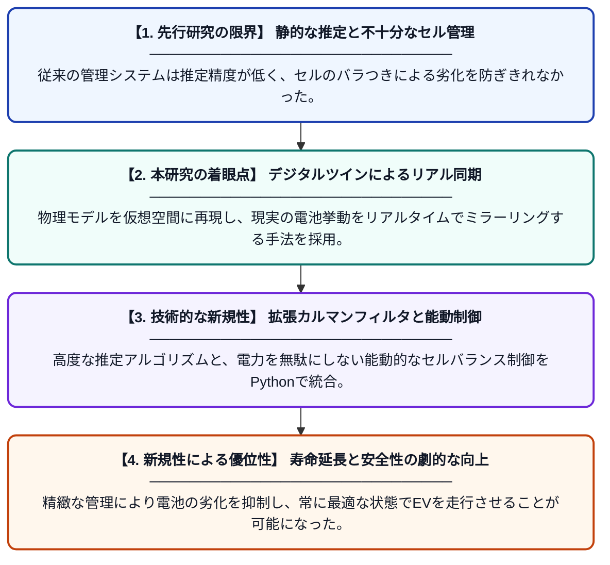

# リチウムイオン電池管理のためのデジタルツイン・フレームワーク：電気自動車向け拡張カルマンフィルタを用いた充電状態推定と能動的セルバランス

**Original Title**: *Digital Twin Framework for Lithium-Ion Battery Management: Kalman Filter-Based State of Charge Estimation with Active Cell Balancing for Electric Vehicle …*

> **💡 一言要約**: デジタルツインでEV電池の寿命と安全を最大化

| 項目 | 内容 |
|---|---|
| **著者** | P Gururajan |
| **掲載誌** | IEEE/CCAE Symposium on Advanced … 2026 |
| **アラートキーワード** | kalman filter |
| **原文リンク** | [https://ieeexplore.ieee.org/abstract/document/11766601/](https://ieeexplore.ieee.org/abstract/document/11766601/) |
| **PDF版要約** | [README.pdf](./README.pdf) |

---

## 📊 新規性の図解（先行研究との違いと本研究のブレークスルー）

## 📝 要約

電気自動車（EV）のリチウムイオン電池を効率的に管理するため、Pythonベースのデジタルツイン・フレームワークを提案しています。テブナン等価回路モデルと拡張カルマンフィルタを組み合わせることで、高精度な充電状態（SOC）の推定と、各セルの電圧を均一化する能動的な制御を実現しています。

## ❓ どんな問題に取り組んだか

EVのバッテリー管理において、電池内部の状態を正確に把握することは難しく、セルの電圧不均衡が劣化や安全性の低下を招くことが課題でした。また、現実の電池の状態をリアルタイムで仮想空間に再現し、最適に制御する高度な仕組みが不足していました。

## ✨ 何が新しい？何がすごい？（新規性）

本研究は、Pythonを用いて「デジタルツイン」を構築し、一次テブナンモデルと拡張カルマンフィルタ（EKF）を統合した点に新規性があります。これにより、非線形な電池特性を考慮した高精度なSOC推定が可能になりました。さらに、推定結果に基づき自動でセルの電荷を再分配する「アクティブ・セルバランシング」を組み込み、従来手法よりも効率的に電池寿命を延ばすことに成功しています。

## 🎓 大学1年生向けの解説

電気自動車の電池はたくさんの小さな電池（セル）が繋がってできていますが、使い続けると各セルの電気の残量にバラつきが出てしまいます。この研究では、コンピュータの中に現実の電池とそっくりな「分身（デジタルツイン）」を作り、今どれだけ電気が残っているかを正確に計算する魔法のような仕組みを作りました。さらに、バラバラになった残量を自動で整える機能も持たせており、これによって電池が長持ちし、故障しにくい安全な電気自動車が実現できます。
