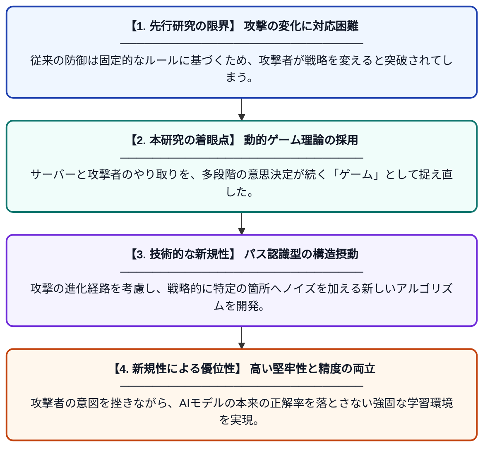

# 連合学習におけるバックドア防御のためのパス認識構造摂動：動的ゲーム理論的フレームワーク

**Original Title**: *Path-Aware Structured Perturbation for Backdoor Defense in Federated Learning: A Dynamic Game-Theoretic Framework*

> **💡 一言要約**: ゲーム理論で連合学習のバックドア攻撃を打破する

| 項目 | 内容 |
|---|---|
| **著者** | H Liu, W Ma, J Wang, J Chen, J He, X Lan |
| **掲載誌** | IEEE Transactions on Dependable and … 2026 |
| **アラートキーワード** | Federated Learning |
| **原文リンク** | [https://ieeexplore.ieee.org/abstract/document/11806783/](https://ieeexplore.ieee.org/abstract/document/11806783/) |
| **PDF版要約** | [README.pdf](./README.pdf) |

---

## 📊 新規性の図解（先行研究との違いと本研究のブレークスルー）

## 📝 要約

連合学習でのバックドア攻撃をサーバーと攻撃者の多段階の意思決定プロセスとして捉え、スタックルバーグ・ゲームを用いた動的な防御フレームワークを提案しています。攻撃者の行動パスを考慮して構造的な摂動を加えることで、モデルの性能を維持しながら攻撃を効果的に無力化します。

## ❓ どんな問題に取り組んだか

連合学習では、悪意のある参加者が特定の入力に対して誤った出力を出す「バックドア」を仕込む攻撃が脅威となっています。従来の防御手法は静的なものが多く、攻撃者が時間の経過とともに戦略を変化させる動的な攻撃に対しては、十分な耐性を持てないという課題がありました。

## ✨ 何が新しい？何がすごい？（新規性）

本研究の最大の新規性は、サーバーと攻撃者の攻防を「スタックルバーグ・ゲーム」としてモデル化し、動的な相互作用を考慮した点にあります。攻撃の進化プロセス（パス）を予測し、それに合わせて最適な構造的摂動（ノイズ）を加えることで、攻撃者の最適な戦略を封じ込める仕組みを構築しました。これにより、先行研究よりも高い検知精度と、モデル本来の精度維持を両立させています。

## 🎓 大学1年生向けの解説

「連合学習」とは、みんなのデータを一箇所に集めずに、バラバラの場所にあるデータのままでAIを賢くする仕組みです。しかし、こっそり嘘の情報を混ぜてAIを勘違いさせる「バックドア攻撃」という悪い方法があります。この論文では、サーバーと攻撃者の関係を「追いかけっこ」のようなゲームとして考え、悪い人が次にどう動くかを予測してAIに少し工夫を加えることで、攻撃を無効にする賢い方法を開発しました。
