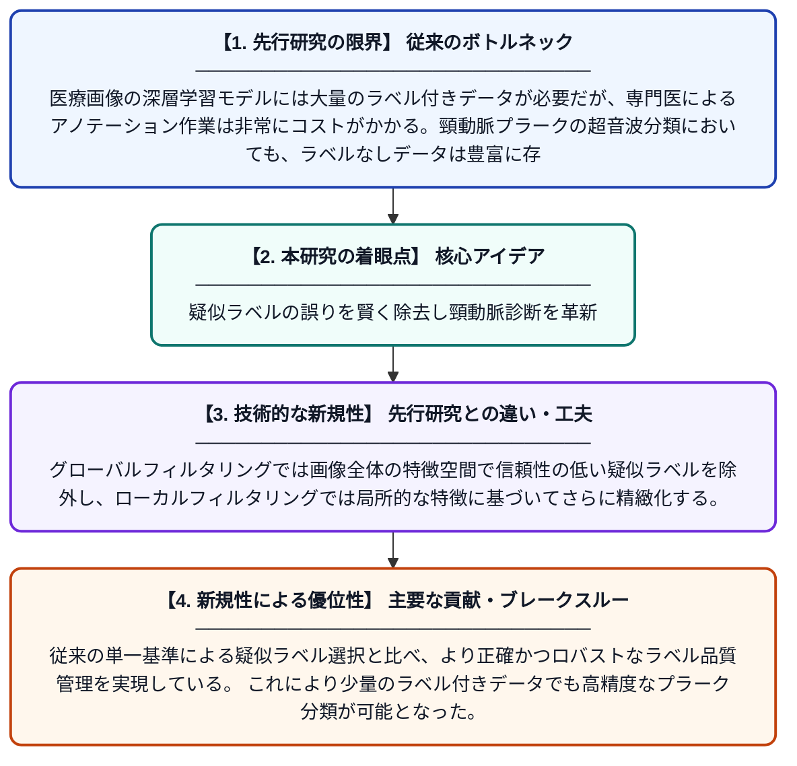

# 超音波画像における頸動脈プラーク分類のための半教師あり学習：グローバル・ローカル疑似ラベルフィルタリング手法

**Original Title**: *Global and local pseudo-label filtering for semi-supervised carotid plaque classification from ultrasound*

> **💡 一言要約**: 疑似ラベルの誤りを賢く除去し頸動脈診断を革新

| 項目 | 内容 |
|---|---|
| **著者** | R Zhou, W Deng, W Yu, F Wang, X Cheng, H Gan, Z Ye |
| **掲載誌** | Computer Methods and Programs in Biomedicine 2026 |
| **アラートキーワード** | Semi supervise |
| **原文リンク** | [https://www.sciencedirect.com/science/article/pii/S0169260726003172](https://www.sciencedirect.com/science/article/pii/S0169260726003172) |
| **PDF版要約** | [README.pdf](./README.pdf) |

---

## 📊 新規性の図解（先行研究との違いと本研究のブレークスルー）

## 📝 要約

本論文では、頸動脈超音波画像のプラーク分類精度を向上させるため、グローバルおよびローカルな疑似ラベルフィルタリング（GLPF）を用いた新しい深層半教師あり学習アルゴリズムを提案している。ラベルなしデータを効果的に活用しつつ、誤った疑似ラベルによるノイズを抑制することで分類性能を高める。医療画像分野でのラベル付きデータ不足という実用上の課題に対応した手法である。

## ❓ どんな問題に取り組んだか

医療画像の深層学習モデルには大量のラベル付きデータが必要だが、専門医によるアノテーション作業は非常にコストがかかる。頸動脈プラークの超音波分類においても、ラベルなしデータは豊富に存在するが、それを安全に活用する手法が不足していた。特に半教師あり学習で生成される疑似ラベルには誤りが含まれやすく、モデルの学習を妨げるという問題があった。

## ✨ 何が新しい？何がすごい？（新規性）

本研究は、グローバル特徴とローカル特徴の両方を利用した二段階の疑似ラベルフィルタリング機構（GLPF）を提案した点が新しい。グローバルフィルタリングでは画像全体の特徴空間で信頼性の低い疑似ラベルを除外し、ローカルフィルタリングでは局所的な特徴に基づいてさらに精緻化する。従来の単一基準による疑似ラベル選択と比べ、より正確かつロバストなラベル品質管理を実現している。これにより少量のラベル付きデータでも高精度なプラーク分類が可能となった。

## 🎓 大学1年生向けの解説

頸動脈（首の血管）に脂肪などが溜まった「プラーク」は脳卒中の原因となるため、超音波画像で早期発見することが大切です。AIにプラークを自動判定させるには、専門医が正解ラベルを付けた大量の画像が必要ですが、それは非常に手間がかかります。そこでこの研究では、ラベルのない画像も使って学習できる「半教師あり学習」を活用しました。ただしラベルなし画像にAIが自動でつけた「疑似ラベル」には間違いが多いため、本研究では画像全体と局所的な情報の両方を使って間違いを取り除く仕組みを考えました。これにより少ない正解データでも精度の高い診断AIを実現しています。
