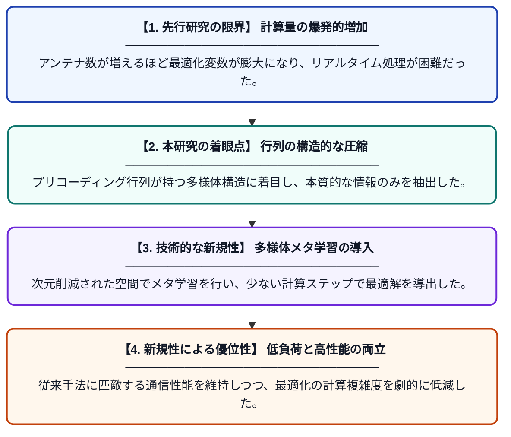

# 多様体メタ学習によるRIS支援ネットワークの低複雑度ビームフォーミング設計

**Original Title**: *Manifold Meta Learning-Assisted Low Complexity Beamforming Design in RIS-Assisted Networks*

> **💡 一言要約**: 多様体学習でRIS通信の最適化を劇的に高速化！

| 項目 | 内容 |
|---|---|
| **著者** | B Shuai, Y Cao, T Ohtsuki, TQS Quek |
| **掲載誌** | IEEE Internet of Things Journal 2026 |
| **アラートキーワード** | manifold learning |
| **原文リンク** | [https://ieeexplore.ieee.org/abstract/document/11780686/](https://ieeexplore.ieee.org/abstract/document/11780686/) |
| **PDF版要約** | [README.pdf](./README.pdf) |

---

## 📊 新規性の図解（先行研究との違いと本研究のブレークスルー）

## 📝 要約

RIS（再構成可能知能表面）を導入した通信システムにおいて、基地局のプリコーディング行列を多様体学習で次元削減し、メタ学習と組み合わせることで最適化の計算負荷を大幅に軽減する手法を提案しています。これにより、通信品質を維持しつつ、リアルタイムでの最適化が可能な低複雑度のビームフォーミング設計を実現しました。

## ❓ どんな問題に取り組んだか

RISを用いたネットワークでは、基地局の送信設定とRISの反射設定を同時に最適化する必要がありますが、変数の数が膨大で計算時間がかかりすぎるという課題がありました。特に動的な通信環境において、高いスループットを維持しながらリアルタイムに計算を行うことは困難でした。

## ✨ 何が新しい？何がすごい？（新規性）

本研究の核心は、基地局の送信プリコーディング行列に対して多様体学習を適用し、最適化すべき変数の次元を劇的に削減した点にあります。さらにメタ学習を導入することで、過去の学習結果を活かして未知の通信環境にも即座に適応できる枠組みを構築しました。これにより、従来の最適化手法と同等の性能を保ちながら、計算量を大幅に抑えることに成功しています。

## 🎓 大学1年生向けの解説

スマホの電波を鏡のように反射させて遠くまで届ける「RIS」という技術がありますが、その鏡の向きを瞬時に計算するのは非常に大変です。この論文では、数学的な「次元削減」というテクニックを使い、計算に必要なデータの量をギュッと小さくしました。これにより、複雑な計算をショートカットして、一瞬で最適な通信環境を作り出すことができるようになります。
