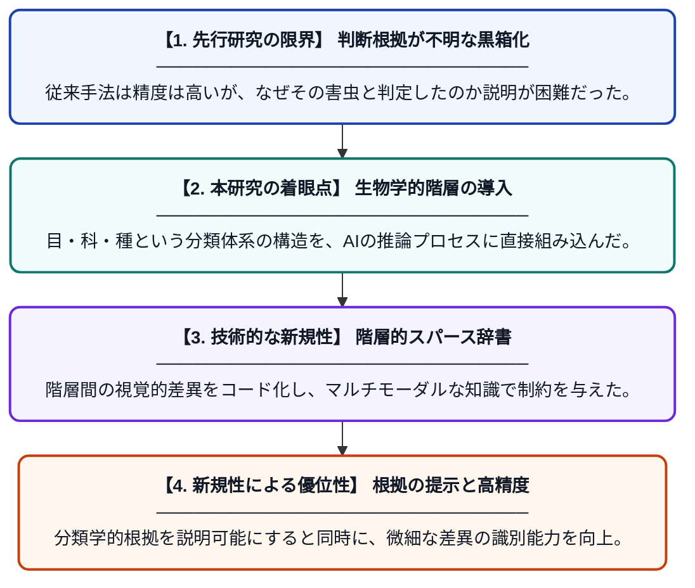

# GEPC: マルチモーダル事前知識と階層的概念制約を用いた生成・説明型害虫分類

**Original Title**: *GEPC: Generative-Explanatory Pest Classification with Multi-Modal Priors and Hierarchical Concept Constraints*

> **💡 一言要約**: 分類階層で「根拠」を語る害虫識別AI

| 項目 | 内容 |
|---|---|
| **著者** | Y Xian, Y Song |
| **掲載誌** | 2026 |
| **アラートキーワード** | sparse coding |
| **PDF** | [https://assets-eu.researchsquare.com/files/rs-11578453/v1_covered_8c16b6f0-c372-4b81-b9e6-b697869a1710.pdf?c=1793771145](https://assets-eu.researchsquare.com/files/rs-11578453/v1_covered_8c16b6f0-c372-4b81-b9e6-b697869a1710.pdf?c=1793771145) |
| **原文リンク** | [https://www.researchsquare.com/article/rs-11578453/latest.pdf](https://www.researchsquare.com/article/rs-11578453/latest.pdf) |
| **PDF版要約** | [README.pdf](./README.pdf) |

---

## 📊 新規性の図解（先行研究との違いと本研究のブレークスルー）

## 📝 要約

害虫の分類において、生物学的な階層構造（目・科・種）に基づいたスパースコーディング辞書を構築し、高い分類精度と説明可能性を両立させた研究です。画像生成的なアプローチとマルチモーダルな事前知識を組み合わせることで、AIがどの特徴に基づいて判断したかを明示的に示すことができます。

## ❓ どんな問題に取り組んだか

従来の害虫分類AIは高い精度を持つ一方で、判断の根拠が不透明な「ブラックボックス」であるという課題がありました。また、よく似た種を見分けるための微細な視覚的特徴を、生物学的な分類体系と結びつけて学習させる効果的な手法が不足していました。

## ✨ 何が新しい？何がすごい？（新規性）

目・科・種というタクソノミー（分類学）に基づいた「階層的スパースコーディング辞書」を提案した点が革新的です。各要素が「親グループと子グループの視覚的差異」を学習するため、推論プロセスが生物学的な論理に沿ったものとなります。さらに、マルチモーダルな事前知識を制約として加えることで、生成モデルの枠組みで高精度かつ解釈可能な説明を生成することに成功しました。

## 🎓 大学1年生向けの解説

虫の種類を当てるAIに、「なぜその虫だと思ったのか」を説明させる研究です。人間が虫を分類するときのように、「このグループの中では、羽の形がこう違うからこの種類だ」というステップをAIに学習させています。AIの中に「目・科・種」という生物の家系図のような辞書を作ることで、専門家のように論理的な根拠を示しながら、正確に虫の名前を当てることができるようになりました。
