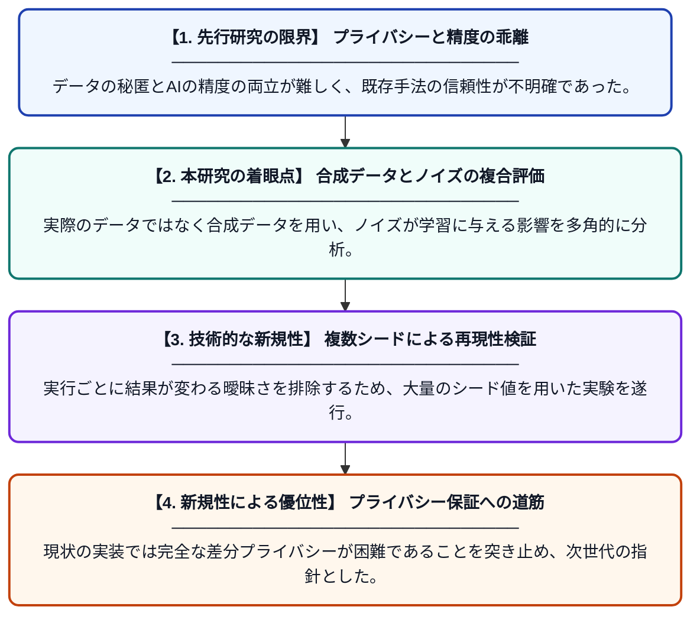

# 合成ウェアラブルヘルスモニタリングにおけるノイズ付加連合学習：再現可能なマルチシード評価

**Original Title**: *Noise-Perturbed Federated Learning for Synthetic Wearable Health Monitoring: A Reproducible Multi-Seed Evaluation*

> **💡 一言要約**: ノイズ付加連合学習の再現性と限界を徹底検証

| 項目 | 内容 |
|---|---|
| **著者** | B Essaid |
| **掲載誌** | Mesopotamian Journal of Artificial Intelligence in … 2026 |
| **アラートキーワード** | differential privacy |
| **PDF** | [https://map.researchcommons.org/cgi/viewcontent.cgi?article=1061&context=mjaih](https://map.researchcommons.org/cgi/viewcontent.cgi?article=1061&context=mjaih) |
| **原文リンク** | [https://map.researchcommons.org/cgi/viewcontent.cgi?article=1061&context=mjaih](https://map.researchcommons.org/cgi/viewcontent.cgi?article=1061&context=mjaih) |
| **PDF版要約** | [README.pdf](./README.pdf) |

---

## 📊 新規性の図解（先行研究との違いと本研究のブレークスルー）

## 📝 要約

ウェアラブルデバイスの健康データを対象とした連合学習において、ノイズ付加がモデルの性能とプライバシーに与える影響を調査した研究です。複数の乱数シードを用いた広範な実験により再現性を評価していますが、現行の手法では厳密な差分プライバシー（DP）の保証には至っていないことを明らかにしています。

## ❓ どんな問題に取り組んだか

ヘルスケア分野での連合学習はプライバシー保護が不可欠ですが、ノイズを付加する手法が実際にどの程度の保護性能と学習精度を両立できるかが不明確でした。特に、特定の実験結果に依存しない再現性の高い評価指標が不足しているという課題がありました。

## ✨ 何が新しい？何がすごい？（新規性）

合成データを用いたウェアラブルヘルスケアの枠組みで、ノイズ付加連合学習の頑健性をマルチシード評価によって詳細に検証した点が新しいです。単なる精度の測定にとどまらず、現在の実装では安全な集約や厳密な差分プライバシーの会計処理が不足しているという、実用上の重大なボトルネックを具体的に指摘しています。これにより、将来的なプライバシー保護技術の改善に向けた明確なベンチマークを提示しました。

## 🎓 大学1年生向けの解説

スマートウォッチなどで集めた個人の健康データを、プライバシーを守りながらAIで賢く学習させる方法についての研究です。データに「ノイズ」という情報を混ぜて誰のものか分からなくする工夫をしていますが、その混ぜ方が不十分だと、実はプライバシーが完全に守られないことが分かりました。この論文では、たくさんの実験を繰り返すことで、今の技術のすごい点と足りない点を正直にレポートしています。
