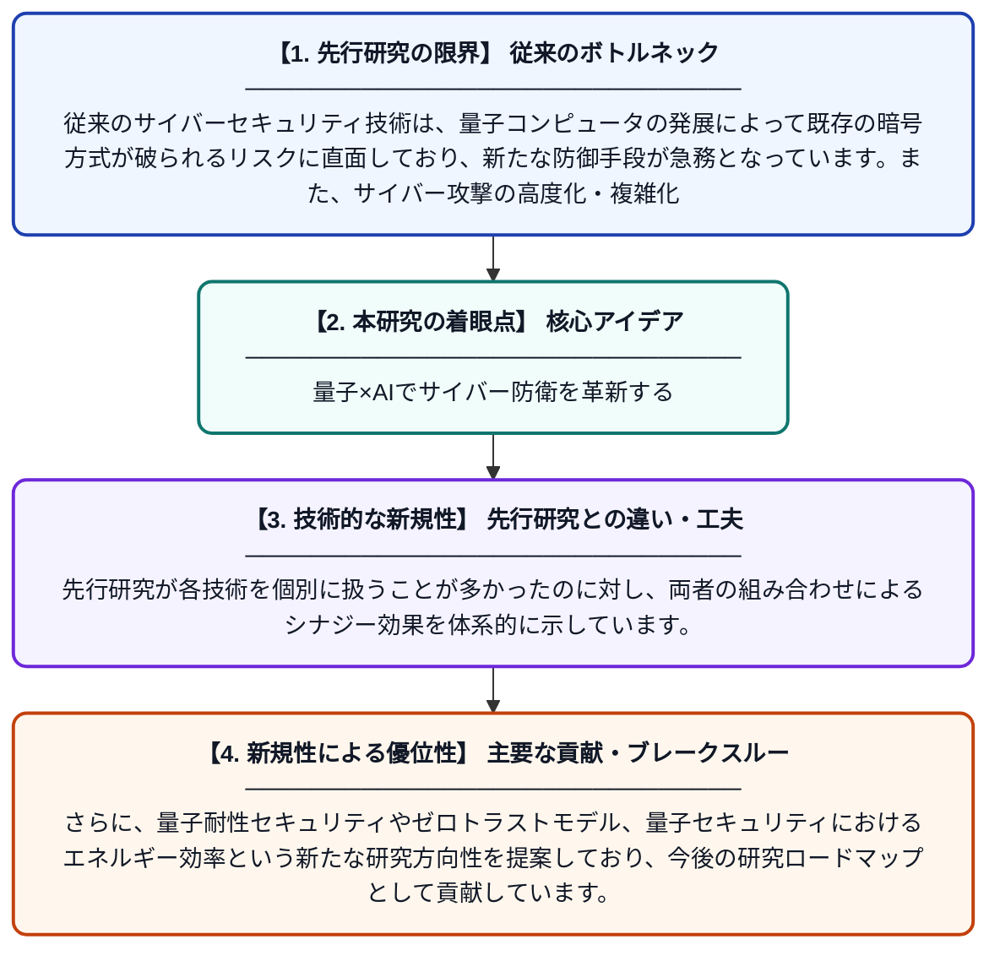

# サイバーセキュリティにおける量子コンピューティングと機械学習：技術・課題・将来展望

**Original Title**: *Quantum computing and machine learning for cybersecurity: Technologies, challenges, and future perspectives*

> **💡 一言要約**: 量子×AIでサイバー防衛を革新する

| 項目 | 内容 |
|---|---|
| **著者** | S Terli, JSB Banisetti, VSV Dokala |
| **掲載誌** | International Journal of Applied Resilience and … 2026 |
| **アラートキーワード** | Secure Computing |
| **PDF** | [https://deepscipub.com/ijars/article/download/106/132](https://deepscipub.com/ijars/article/download/106/132) |
| **原文リンク** | [https://deepscipub.com/ijars/article/download/106/132](https://deepscipub.com/ijars/article/download/106/132) |
| **PDF版要約** | [README.pdf](./README.pdf) |

---

## 📊 新規性の図解（先行研究との違いと本研究のブレークスルー）

## 📝 要約

本論文は、量子コンピューティングと機械学習を組み合わせることでサイバーセキュリティの耐性（サイバーレジリエンス）を強化できる可能性をレビューしたものです。両技術の統合によってセキュアなコンピューティングやデジタル防御がどのように向上するかを体系的に整理しています。さらに、量子セキュリティにおけるエネルギー問題・量子耐性セキュリティ・ゼロトラストといった将来の研究課題も提示しています。

## ❓ どんな問題に取り組んだか

従来のサイバーセキュリティ技術は、量子コンピュータの発展によって既存の暗号方式が破られるリスクに直面しており、新たな防御手段が急務となっています。また、サイバー攻撃の高度化・複雑化に対して、従来の機械学習単独では対処しきれない限界も指摘されています。

## ✨ 何が新しい？何がすごい？（新規性）

本論文は、量子コンピューティングと機械学習を統合的に捉え、サイバーセキュリティへの応用を包括的にレビューした点が新しいアプローチです。先行研究が各技術を個別に扱うことが多かったのに対し、両者の組み合わせによるシナジー効果を体系的に示しています。さらに、量子耐性セキュリティやゼロトラストモデル、量子セキュリティにおけるエネルギー効率という新たな研究方向性を提案しており、今後の研究ロードマップとして貢献しています。

## 🎓 大学1年生向けの解説

皆さんが使うスマホやインターネットは、暗号という「鍵」で守られていますが、量子コンピュータはその鍵を簡単に壊してしまう可能性があります。この論文は、そんな脅威に対抗するために、量子コンピュータ自身の力とAI（機械学習）を組み合わせて、より強固なセキュリティを作れないか研究しています。たとえば、AIが怪しい通信を素早く検知し、量子技術で解読不可能な暗号を作ることで、二重の防御を実現するイメージです。この研究は将来のインターネット社会を安全に守るための重要な道しるべとなっています。
