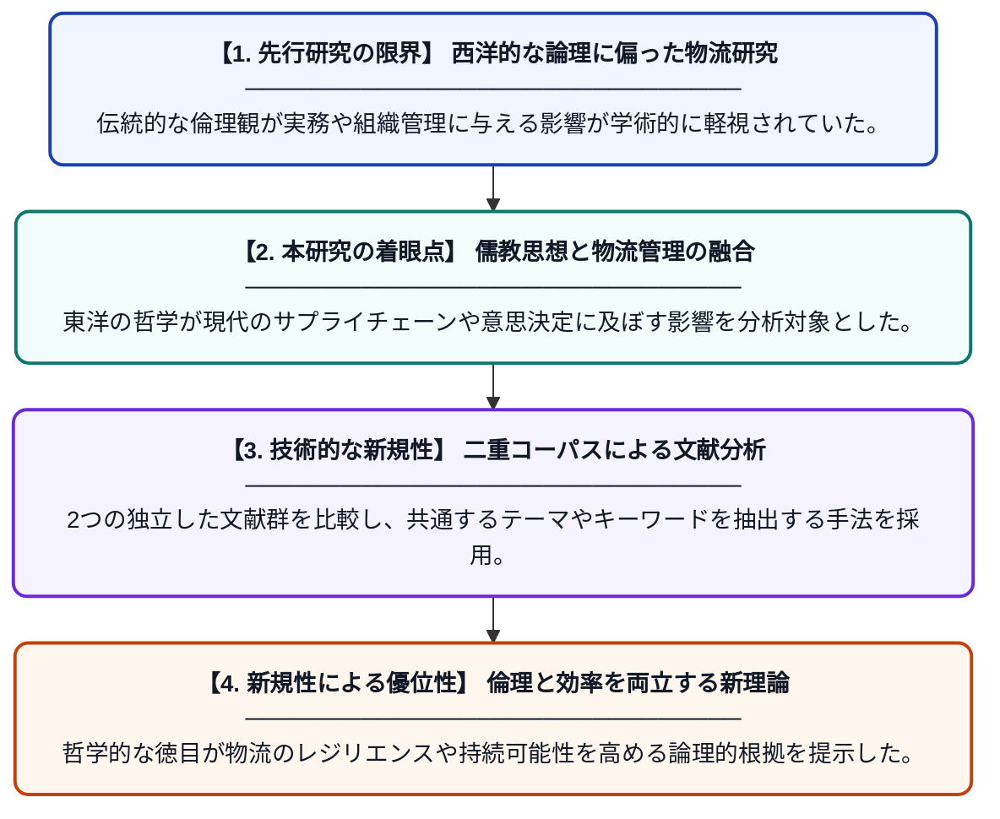

# 儒教思想と海運・物流の概念的融合の解明：二重コーパスによる計量書誌学的・主題的分析

**Original Title**: *Mapping the conceptual convergence between Confucian thought and shipping and logistics: A dual-corpus bibliometric and thematic analysis*

> **💡 一言要約**: 儒教の教えが現代の物流を変革する

| 項目 | 内容 |
|---|---|
| **著者** | J Barco-Quiñonez, J Freire-Lasso, O Abreo-Gonzalez… |
| **掲載誌** | … of Shipping and Logistics 2026 |
| **アラートキーワード** | logistics |
| **原文リンク** | [https://www.sciencedirect.com/science/article/pii/S2092521226000416](https://www.sciencedirect.com/science/article/pii/S2092521226000416) |
| **PDF版要約** | [README.pdf](./README.pdf) |

---

## 📊 新規性の図解（先行研究との違いと本研究のブレークスルー）

## 📝 要約

本研究は、儒教思想と海運・物流管理の概念的な結びつきを、計量書誌学的分析とテーマ分析を用いて調査しました。Scopusなどから抽出した2つの独立したコーパスを分析することで、東洋の倫理観がいかに現代の物流戦略や管理モデルに寄与しているかを体系的に明らかにしています。

## ❓ どんな問題に取り組んだか

現代の海運・物流管理は、効率を重視する西洋的な合理主義に偏っており、アジア圏のビジネスで重要な役割を果たす儒教的価値観の影響が体系的に研究されてきませんでした。物流業界における人間関係や道徳的価値観が、実務にどのような理論的根拠を与えているかを解明することが課題となっていました。

## ✨ 何が新しい？何がすごい？（新規性）

本研究の最大の特徴は、儒教と物流という一見異なる分野を「二重コーパス分析」という手法で結合させた点にあります。先行研究が個別の事例紹介に留まっていたのに対し、膨大な文献データから両者の概念的収束を網羅的にマッピングし、その重なりを視覚化しました。これにより、誠実さや調和といった儒教の徳目が、サプライチェーンの効率性や持続可能性に寄与するメカニズムを初めて理論化しました。

## 🎓 大学1年生向けの解説

「物流」と聞くと、AIやトラックなどの機械的なイメージを持つかもしれませんが、実は「人の信頼関係」が非常に重要です。この研究は、古くからある儒教の「思いやり」や「礼儀」といった教えが、現代のモノを運ぶ仕組みにどう役立っているかを分析しました。アジアの企業が大切にする考え方が、実は効率の良い配送や良い協力関係を支えていることがデータから示されています。難しいビジネスの世界も、実は心のあり方が大切だということを教えてくれる研究です。
