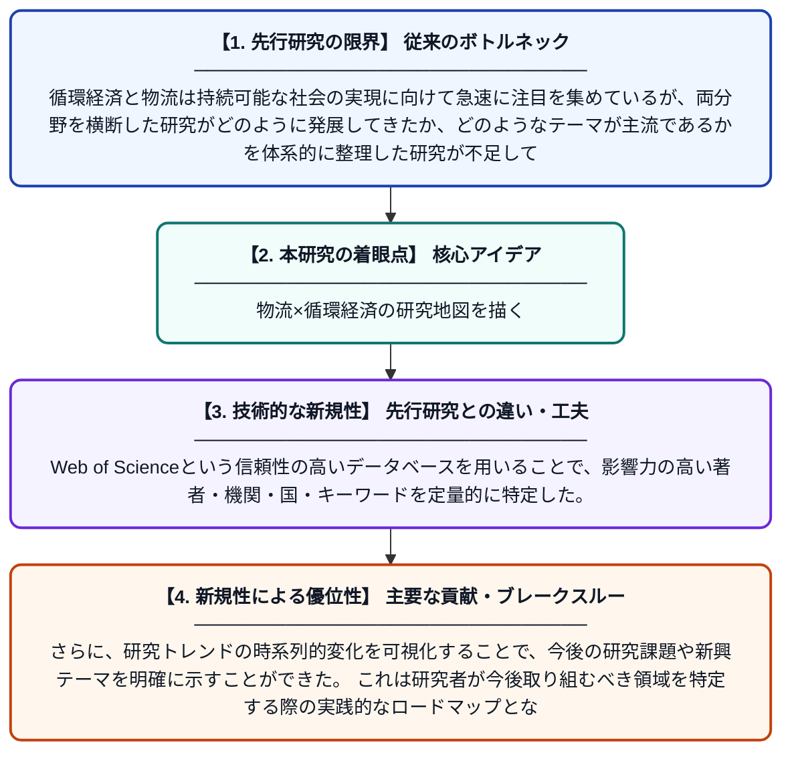

# 循環経済と物流における研究トレンドのマッピング：Web of Scienceに基づく書誌計量分析

**Original Title**: *Mapping Research Trends in Circular Economy and Logistics: A Bibliometric Analysis Based on Web of Science*

> **💡 一言要約**: 物流×循環経済の研究地図を描く

| 項目 | 内容 |
|---|---|
| **著者** | NK Ustalı |
| **掲載誌** | Information Technology in Economics and Business 2026 |
| **アラートキーワード** | logistics |
| **PDF** | [https://journals.adbascientific.com/iteb/article/download/194/138](https://journals.adbascientific.com/iteb/article/download/194/138) |
| **原文リンク** | [https://journals.adbascientific.com/iteb/article/download/194/138](https://journals.adbascientific.com/iteb/article/download/194/138) |
| **PDF版要約** | [README.pdf](./README.pdf) |

---

## 📊 新規性の図解（先行研究との違いと本研究のブレークスルー）

## 📝 要約

本研究は、物流と循環経済の分野における学術論文の発展方向とトレンドを明らかにすることを目的としている。PRISMAフレームワークを用いた系統的レビューと書誌計量分析を組み合わせ、Web of Scienceデータベースに登録された論文群を対象に分析を行った。これにより、両分野の研究の主要テーマ、著者・機関・国別の影響力、および今後の研究方向性が特定された。

## ❓ どんな問題に取り組んだか

循環経済と物流は持続可能な社会の実現に向けて急速に注目を集めているが、両分野を横断した研究がどのように発展してきたか、どのようなテーマが主流であるかを体系的に整理した研究が不足していた。膨大な論文群の中から研究の全体像や将来的な空白領域を把握することが困難であり、研究者や実務家にとって方向性を見定める手がかりが少なかった。

## ✨ 何が新しい？何がすごい？（新規性）

本研究は、PRISMAフレームワークによる系統的レビューと書誌計量分析を組み合わせるという手法上の新規性を持ち、循環経済と物流の両分野を統合的に俯瞰した点が先行研究と異なる。Web of Scienceという信頼性の高いデータベースを用いることで、影響力の高い著者・機関・国・キーワードを定量的に特定した。さらに、研究トレンドの時系列的変化を可視化することで、今後の研究課題や新興テーマを明確に示すことができた。これは研究者が今後取り組むべき領域を特定する際の実践的なロードマップとなる。

## 🎓 大学1年生向けの解説

「循環経済」とは、ものを使い捨てにせず、リサイクルや再利用で資源をぐるぐる回し続ける経済の仕組みです。「物流」は商品を届けるための輸送や保管の仕組みのことです。この研究では、この二つのテーマに関する世界中の学術論文をまとめて調べて、どんな研究が多いか・どの国や研究者が注目されているかを地図のように整理しました。大量の論文を一つ一つ読む代わりに、数字やグラフを使って全体の傾向を分析する「書誌計量分析」という方法を使っています。これにより、これからどんな研究が必要かを示す「研究の道案内」を作ることができました。
