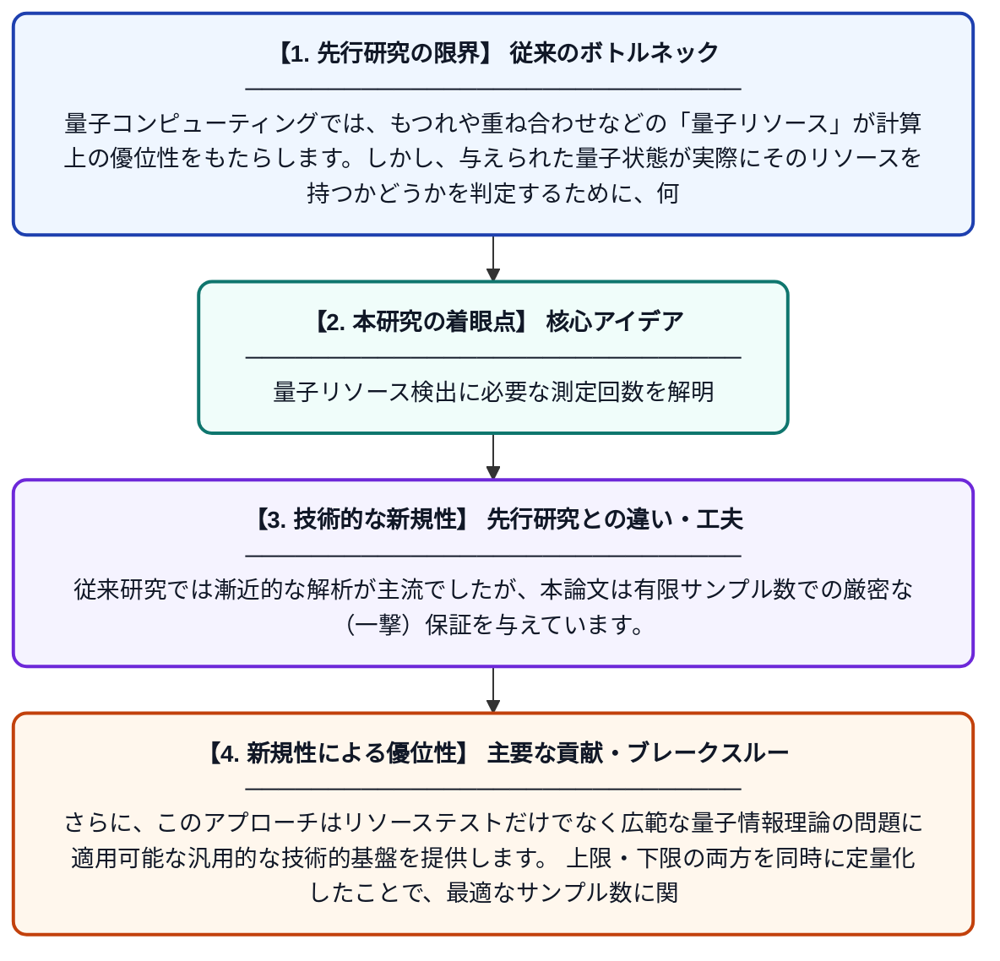

# 一撃量子ブラーリングによる量子リソーステストのサンプル複雑性

**Original Title**: *Sample complexity of quantum resource testing via one-shot quantum blurring*

> **💡 一言要約**: 量子リソース検出に必要な測定回数を解明

| 項目 | 内容 |
|---|---|
| **著者** | D Grinko, L Lami |
| **掲載誌** | arXiv preprint arXiv:2607.24712 2026 |
| **アラートキーワード** | one shot |
| **PDF** | [https://arxiv.org/pdf/2607.24712](https://arxiv.org/pdf/2607.24712) |
| **原文リンク** | [https://arxiv.org/pdf/2607.24712](https://arxiv.org/pdf/2607.24712) |
| **PDF版要約** | [README.pdf](./README.pdf) |

---

## 📊 新規性の図解（先行研究との違いと本研究のブレークスルー）

## 📝 要約

この論文は、量子リソーステスト（量子状態が特定のリソースを持つかどうかを判定すること）の効率性を定量的に評価するための理論的枠組みを構築しています。特に「一撃（one-shot）量子ブラーリング」と呼ばれる新しい技術的手法を導入し、テストに必要なサンプル数（サンプル複雑性）の上限と下限を厳密に導出しました。これにより、量子情報処理における資源の有無を判別するための測定回数がどのくらい必要かを明らかにしています。

## ❓ どんな問題に取り組んだか

量子コンピューティングでは、もつれや重ね合わせなどの「量子リソース」が計算上の優位性をもたらします。しかし、与えられた量子状態が実際にそのリソースを持つかどうかを判定するために、何回測定（サンプリング）すれば十分かという問いは未解決のままでした。この「サンプル複雑性」の定量的な評価が、量子技術の実用化に向けた重要な課題となっていました。

## ✨ 何が新しい？何がすごい？（新規性）

本研究の最大の新規性は、「一撃量子ブラーリング」という新しい数学的ツールを開発し、それを量子リソーステストのサンプル複雑性の定量的評価に応用した点です。従来研究では漸近的な解析が主流でしたが、本論文は有限サンプル数での厳密な（一撃）保証を与えています。さらに、このアプローチはリソーステストだけでなく広範な量子情報理論の問題に適用可能な汎用的な技術的基盤を提供します。上限・下限の両方を同時に定量化したことで、最適なサンプル数に関する完全な理解に一歩踏み込んでいます。

## 🎓 大学1年生向けの解説

量子コンピュータは「量子もつれ」などの特別な性質（リソース）を使って高速計算を行います。しかし、手元の量子状態がそのリソースを本当に持っているかどうかを調べるには、何度も測定実験を繰り返す必要があります。この論文では、「最低何回測定すれば確実に判定できるか」という問いに数学的に答えました。そのために「量子ブラーリング」という、量子状態を意図的にぼかす操作を新たに考案しました。これにより、量子実験をどれだけ効率よく行えるかの理論的限界が明らかになりました。
