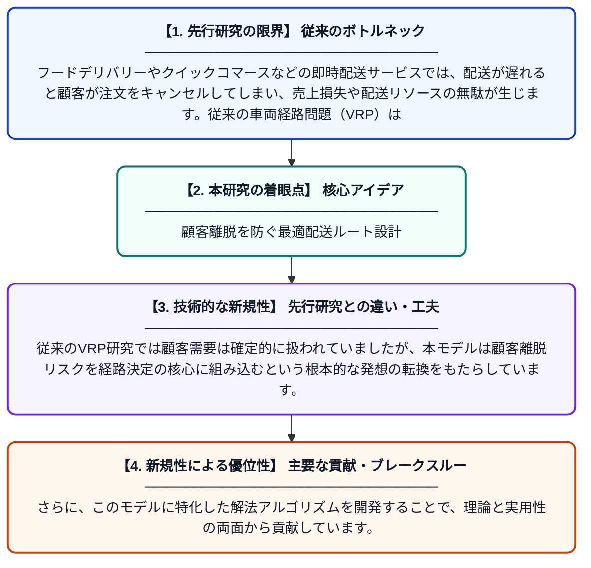

# 顧客損失メカニズムを考慮した即時配送における車両経路最適化とアルゴリズム

**Original Title**: *Vehicle routing optimization and algorithms for instant delivery under customer loss mechanism*

> **💡 一言要約**: 顧客離脱を防ぐ最適配送ルート設計

| 項目 | 内容 |
|---|---|
| **著者** | G Cao, W Zha |
| **掲載誌** | PloS one 2026 |
| **アラートキーワード** | VRP |
| **原文リンク** | [https://journals.plos.org/plosone/article?id=10.1371/journal.pone.0345043](https://journals.plos.org/plosone/article?id=10.1371/journal.pone.0345043) |
| **PDF版要約** | [README.pdf](./README.pdf) |

---

## 📊 新規性の図解（先行研究との違いと本研究のブレークスルー）

## 📝 要約

本論文は、即時配送（クイックコマース）において顧客が待ち時間超過により注文をキャンセルしてしまう「顧客損失」を考慮した新しい車両経路問題（VRP-CLM）モデルを構築しています。従来の配送経路最適化とは異なり、顧客離脱リスクを組み込むことで、より現実的な配送計画の立案を可能にします。さらに、このモデルを効率的に解くための専用アルゴリズムを提案し、実用性を検証しています。

## ❓ どんな問題に取り組んだか

フードデリバリーやクイックコマースなどの即時配送サービスでは、配送が遅れると顧客が注文をキャンセルしてしまい、売上損失や配送リソースの無駄が生じます。従来の車両経路問題（VRP）はこうした顧客離脱の可能性を考慮しておらず、現実の即時配送環境には適合しにくいという課題がありました。

## ✨ 何が新しい？何がすごい？（新規性）

本研究の最大の新規性は、顧客が待機時間に応じて注文をキャンセルする確率を明示的にモデル化した「VRP-CLM（顧客損失メカニズム付き車両経路問題）」を新たに定式化した点にあります。従来のVRP研究では顧客需要は確定的に扱われていましたが、本モデルは顧客離脱リスクを経路決定の核心に組み込むという根本的な発想の転換をもたらしています。さらに、このモデルに特化した解法アルゴリズムを開発することで、理論と実用性の両面から貢献しています。

## 🎓 大学1年生向けの解説

ウーバーイーツのようなフードデリバリーで、料理の到着が遅いとお客さんが注文をキャンセルしてしまうことがありますよね。この研究は「どのルートで配達すれば、キャンセルを減らしながら効率よく届けられるか」を数学的に考えるものです。お客さんが「もう待てない！」とキャンセルする確率を計算に入れた、これまでにない新しい配送計画モデルを作りました。そして、そのモデルを素早く解くための計算手法も一緒に開発しています。つまり、配達業者がより賢く動けるようにする「AIナビ」の土台を作った研究です。
