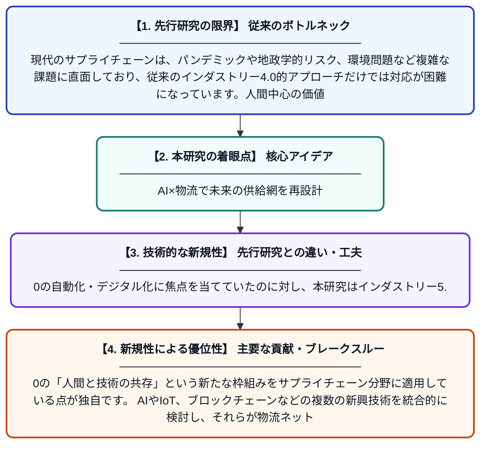

# インダストリー5.0時代における新興技術によるサプライチェーンと物流システムの再構築

**Original Title**: *Reimagining Supply Chain and Logistics Systems through Emerging Technologies in the Industry 5.0 Landscape*

> **💡 一言要約**: AI×物流で未来の供給網を再設計

| 項目 | 内容 |
|---|---|
| **著者** | RD Pandey, S Singh |
| **アラートキーワード** | logistics |
| **原文リンク** | [https://openreview.net/forum?id=9D2yindety](https://openreview.net/forum?id=9D2yindety) |
| **PDF版要約** | [README.pdf](./README.pdf) |

---

## 📊 新規性の図解（先行研究との違いと本研究のブレークスルー）

## 📝 要約

本研究は、インダストリー4.0から5.0への移行期において、AIやロボティクス、IoTなどの新興技術が現代のサプライチェーンおよび物流システムをどのように変革しているかを探求しています。特に、人間と機械の協調を重視するインダストリー5.0の理念のもと、物流ネットワークの構造と機能がどう進化するかを分析しています。この研究は、次世代サプライチェーンの将来像を体系的に描き出すことを目的としています。

## ❓ どんな問題に取り組んだか

現代のサプライチェーンは、パンデミックや地政学的リスク、環境問題など複雑な課題に直面しており、従来のインダストリー4.0的アプローチだけでは対応が困難になっています。人間中心の価値観と先端技術を融合させたインダストリー5.0の視点から、物流システムを根本的に再設計する必要性が高まっています。

## ✨ 何が新しい？何がすごい？（新規性）

先行研究の多くがインダストリー4.0の自動化・デジタル化に焦点を当てていたのに対し、本研究はインダストリー5.0の「人間と技術の共存」という新たな枠組みをサプライチェーン分野に適用している点が独自です。AIやIoT、ブロックチェーンなどの複数の新興技術を統合的に検討し、それらが物流ネットワーク全体に与える影響を包括的に分析しています。また、持続可能性やレジリエンスといった社会的価値を組み込んだ次世代物流モデルの提示という点で、実務・学術両面への貢献が期待されます。

## 🎓 大学1年生向けの解説

みなさんが通販で商品を注文すると、倉庫・輸送・配達など多くの工程を経て届きますが、これを効率よく管理する仕組みを「サプライチェーン（供給連鎖）」といいます。最近はAIやロボットといった最新技術がこの仕組みを大きく変えようとしています。さらに「インダストリー5.0」という考え方では、機械だけに任せるのではなく、人間と機械がうまく協力することを重視しています。この論文は、そうした新しい技術と人間中心の考え方を組み合わせると、未来の物流がどう変わるかを調べたものです。
