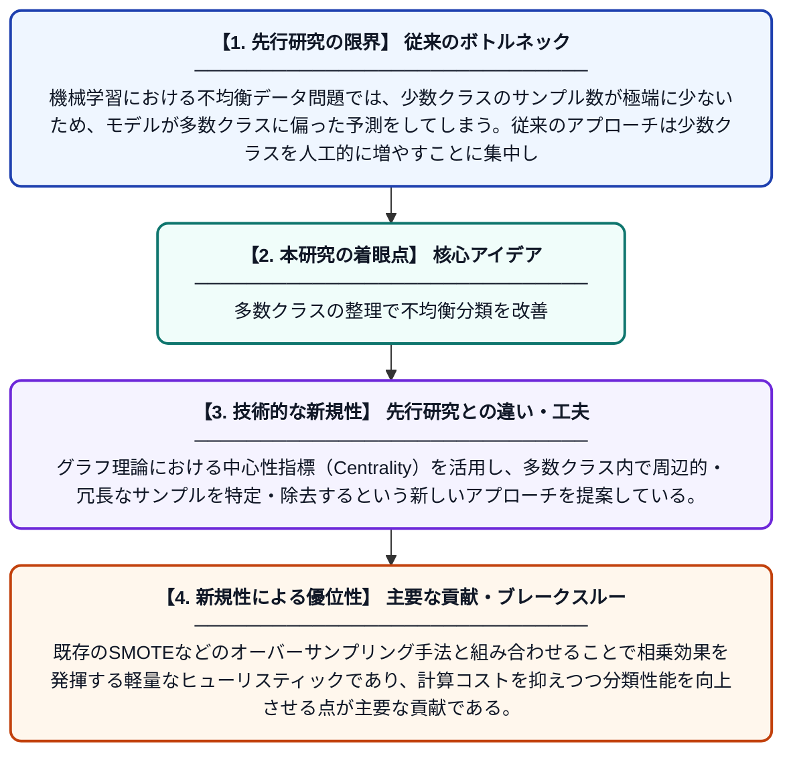

# CMR-SMOTE: 不均衡分類のための中心性に基づく多数クラス洗練手法

**Original Title**: *CMR-SMOTE: Centrality-Guided Majority Refinement for Imbalanced Classification*

> **💡 一言要約**: 多数クラスの整理で不均衡分類を改善

| 項目 | 内容 |
|---|---|
| **著者** | K Qian, Y Yang, Y Duan, X Miao |
| **掲載誌** | International Conference on Computer Intelligence and Software Engineering 2026 |
| **アラートキーワード** | SMOTE |
| **原文リンク** | [https://ieeexplore.ieee.org/abstract/document/11620870/](https://ieeexplore.ieee.org/abstract/document/11620870/) |
| **PDF版要約** | [README.pdf](./README.pdf) |

---

## 📊 新規性の図解（先行研究との違いと本研究のブレークスルー）

## 📝 要約

表形式データの二値分類において、少数クラスのオーバーサンプリングは広く使われているが、多数クラスの冗長なデータは見過ごされがちである。本論文では、グラフの中心性指標を用いて多数クラスから冗長・ノイズ的なサンプルを除去する軽量な手法「CMR-SMOTE」を提案する。これにより、SMOTEなどの既存オーバーサンプリング手法と組み合わせることで、クラス不均衡問題をより効果的に解決する。

## ❓ どんな問題に取り組んだか

機械学習における不均衡データ問題では、少数クラスのサンプル数が極端に少ないため、モデルが多数クラスに偏った予測をしてしまう。従来のアプローチは少数クラスを人工的に増やすことに集中しており、多数クラスに存在する冗長なサンプルやノイズへの対処が不十分であった。この多数クラスの「質の悪さ」が、分類精度をさらに低下させる要因となっている。

## ✨ 何が新しい？何がすごい？（新規性）

本研究の新規性は、少数クラスの増加だけでなく、多数クラスの「不要なサンプルの削除」に着目した点にある。グラフ理論における中心性指標（Centrality）を活用し、多数クラス内で周辺的・冗長なサンプルを特定・除去するという新しいアプローチを提案している。既存のSMOTEなどのオーバーサンプリング手法と組み合わせることで相乗効果を発揮する軽量なヒューリスティックであり、計算コストを抑えつつ分類性能を向上させる点が主要な貢献である。

## 🎓 大学1年生向けの解説

例えば、病気の患者（少数）と健康な人（多数）を見分けるAIを作るとき、データ数の差が大きいとAIは「全員健康」と答えがちになります。これを直すために、これまでは少ない側（患者）のデータを水増しする方法が使われてきました。でも、多い側（健康な人）にも「似たようなデータが多すぎる」という問題があります。この論文では、ネットワーク分析の考え方を使って、多い側の「くどいデータ」をうまく減らす方法を提案しています。これにより、少ない側を増やす既存手法と組み合わせて、より賢いAIが作れるようになります。
