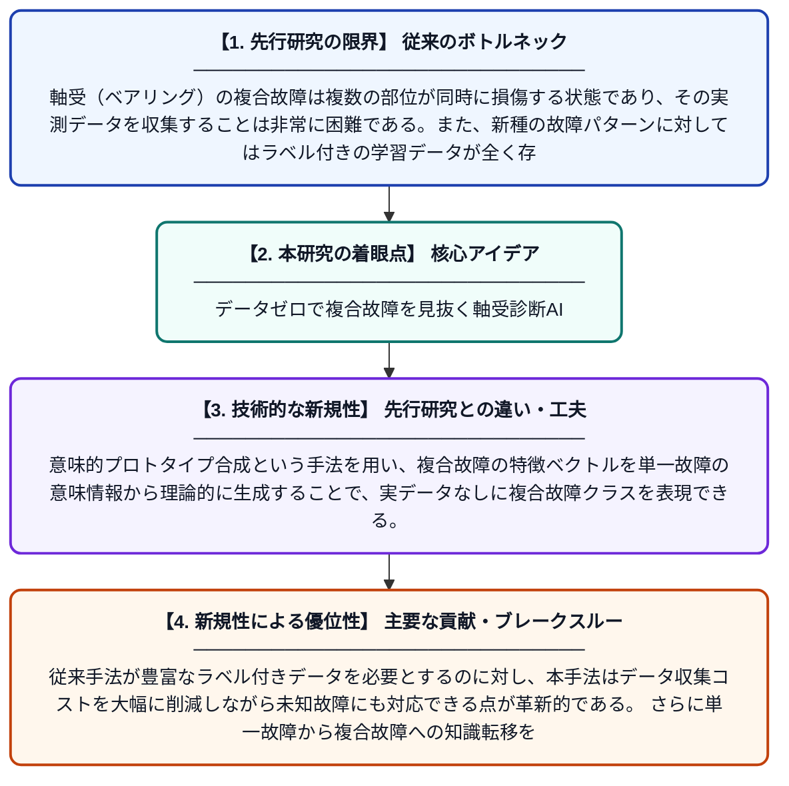

# 意味的プロトタイプ合成によるゼロショット軸受診断：単一故障から複合故障へ

**Original Title**: *Zero-shot bearing diagnosis via semantic prototype synthesis: From single to compound faults*

> **💡 一言要約**: データゼロで複合故障を見抜く軸受診断AI

| 項目 | 内容 |
|---|---|
| **著者** | S Jiao, S Ning, X Zhu, Y Liu, R Zhang, HR Karimi |
| **掲載誌** | Structural Health Monitoring 2026 |
| **アラートキーワード** | zero shot |
| **原文リンク** | [https://journals.sagepub.com/doi/abs/10.1177/14759217261467295](https://journals.sagepub.com/doi/abs/10.1177/14759217261467295) |
| **PDF版要約** | [README.pdf](./README.pdf) |

---

## 📊 新規性の図解（先行研究との違いと本研究のブレークスルー）

## 📝 要約

本論文は、軸受システムにおける複合故障データの不足とラベル付きサンプルの欠如という課題を解決するため、意味的埋め込みに基づくゼロショット診断手法を提案する。単一故障データのみを用いた学習により、未知の複合故障を診断できるフレームワークを構築している。これにより、実際の産業現場で収集困難な複合故障データがなくても、高精度な故障診断が可能となる。

## ❓ どんな問題に取り組んだか

軸受（ベアリング）の複合故障は複数の部位が同時に損傷する状態であり、その実測データを収集することは非常に困難である。また、新種の故障パターンに対してはラベル付きの学習データが全く存在しないため、従来の機械学習手法では対応できないという深刻な問題があった。このような「データ不足」と「未知故障」の二重の課題が、実用的な軸受診断システムの構築を妨げていた。

## ✨ 何が新しい？何がすごい？（新規性）

本研究の最大の新規性は、単一故障データのみで学習しながら、一度も見たことのない複合故障を診断できる「ゼロショット学習」を軸受診断に適用した点である。意味的プロトタイプ合成という手法を用い、複合故障の特徴ベクトルを単一故障の意味情報から理論的に生成することで、実データなしに複合故障クラスを表現できる。従来手法が豊富なラベル付きデータを必要とするのに対し、本手法はデータ収集コストを大幅に削減しながら未知故障にも対応できる点が革新的である。さらに単一故障から複合故障への知識転移を体系的に実現した初めての枠組みとして位置づけられる。

## 🎓 大学1年生向けの解説

機械の中で回転を支える「軸受（ベアリング）」が壊れると、工場の機械全体が止まってしまいます。壊れ方には色々な種類があり、複数の場所が同時に壊れる「複合故障」は特にデータを集めるのが難しいです。この研究では、「1か所だけ壊れたデータ」だけを学習させたAIが、「複数か所同時に壊れた状態」も診断できるようにする技術を開発しました。人間でたとえると、「風邪の症状」と「骨折の症状」を別々に知っているだけで、「風邪＋骨折の両方」の状態を初めて見ても正しく診断できるようなイメージです。これにより、収集が難しいデータがなくても、AIが賢く故障を見つけられるようになります。
