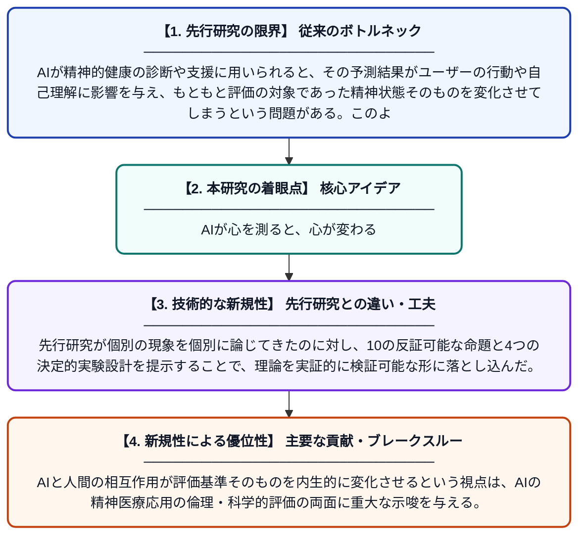

# メンタルAI：人間の精神生活の因果ループにおけるデプロイ後の基準内生性

**Original Title**: *Mental AI: Post-Deployment Criterion Endogeneity in the Causal Loop of Human Mental Life*

> **💡 一言要約**: AIが心を測ると、心が変わる

| 項目 | 内容 |
|---|---|
| **著者** | RSB Kim |
| **掲載誌** | 2026 |
| **アラートキーワード** | affective computing |
| **原文リンク** | [https://www.preprints.org/manuscript/202607.2118](https://www.preprints.org/manuscript/202607.2118) |
| **PDF版要約** | [README.pdf](./README.pdf) |

---

## 📊 新規性の図解（先行研究との違いと本研究のブレークスルー）

## 📝 要約

本論文は、AIが精神的健康の評価・支援に活用された後、そのAIの予測や判断が人間の行動・自己認識を変化させ、元の評価基準自体を変質させてしまう「基準内生性」の問題を体系的に論じる。感情コンピューティングや測定反応性、ループ効果などの概念を統合し、10の反証可能な命題と4つの決定的実験を提案する。AIと人間の精神生活が相互に影響し合うフィードバックループの存在を明らかにし、AIの精神医療応用における根本的な評価上の課題を提起する。

## ❓ どんな問題に取り組んだか

AIが精神的健康の診断や支援に用いられると、その予測結果がユーザーの行動や自己理解に影響を与え、もともと評価の対象であった精神状態そのものを変化させてしまうという問題がある。このような「デプロイ後の基準内生性」は、AIシステムの有効性評価を根本から困難にする。従来の研究はこの因果的循環構造を十分に体系化してこなかった。

## ✨ 何が新しい？何がすごい？（新規性）

本研究は、感情コンピューティング・遂行的予測・応答シフト・ループ効果・AI媒介自己同一性など複数の分野の概念を統合し、精神的健康AIに固有のフィードバックループ問題を初めて包括的な理論枠組みとして定式化した点が新しい。先行研究が個別の現象を個別に論じてきたのに対し、10の反証可能な命題と4つの決定的実験設計を提示することで、理論を実証的に検証可能な形に落とし込んだ。AIと人間の相互作用が評価基準そのものを内生的に変化させるという視点は、AIの精神医療応用の倫理・科学的評価の両面に重大な示唆を与える。

## 🎓 大学1年生向けの解説

たとえば、AIアプリが「あなたはうつ傾向があります」と判定すると、その言葉を受け取った人は自分の行動や考え方を変えてしまうことがあります。すると、次にAIが測ろうとしている「心の状態」は、AIの判定がなかったときとは別物になってしまいます。この論文は、AIが心を評価すること自体が心を変えてしまうという「鶏と卵」のような循環問題を理論的に整理したものです。これは、AIを使った心の健康サービスが本当に正しく機能しているかを評価することを、とても難しくします。著者はこの問題を明確にするための10個の仮説と4つの実験方法も提案しています。
