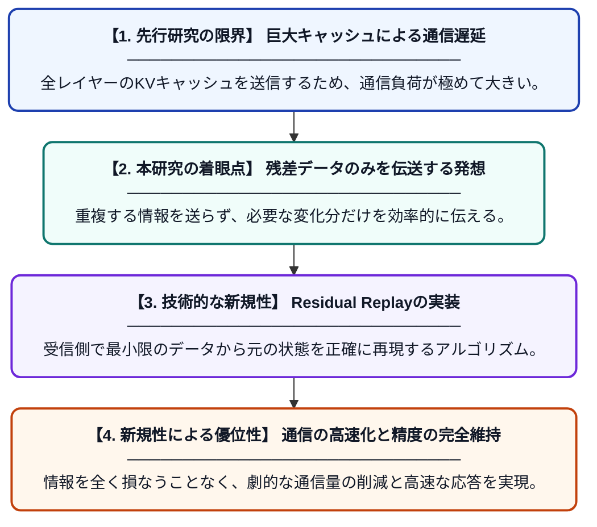

# Residual Replayを用いたマルチエージェントシステムにおけるコンパクトで損失のない潜在表現通信

**Original Title**: *Compact and lossless latent communication for multi-agent systems via residual replay*

> **💡 一言要約**: 通信量と計算を削減する革新的なエージェント間通信

| 項目 | 内容 |
|---|---|
| **著者** | KU Qasim, J Zhang, C Zhao, MK Shaheen |
| **掲載誌** | Knowledge-Based Systems 2026 |
| **アラートキーワード** | multi agent |
| **原文リンク** | [https://www.sciencedirect.com/science/article/pii/S0950705126019908](https://www.sciencedirect.com/science/article/pii/S0950705126019908) |
| **PDF版要約** | [README.pdf](./README.pdf) |

---

## 📊 新規性の図解（先行研究との違いと本研究のブレークスルー）

## 📝 要約

複数の言語モデルエージェントが内部状態（潜在表現）を直接やり取りする際、通信量と計算コストを劇的に削減する「Residual Replay」を提案しました。従来の全KVキャッシュ送信に代わり、残差データのみを伝送・再生することで、情報の損失を防ぎつつ効率的な連携を実現します。

## ❓ どんな問題に取り組んだか

既存のマルチエージェント通信では、受信側での再計算を避けるために送信側の全レイヤーのKVキャッシュを丸ごと送る必要がありました。この方法は通信データ量が極めて膨大になり、ネットワーク帯域を圧迫するという大きな課題がありました。

## ✨ 何が新しい？何がすごい？（新規性）

本研究は「Residual Replay」という新機構を導入し、情報の差分（残差）のみを伝送することで通信量を最小化しました。受信側ではこの残差を用いて内部状態を「再生」するため、情報の損失が一切発生しない（Lossless）点が画期的です。先行研究と比較して、通信効率を極限まで高めながら、精度の低下を防ぐことに成功しています。

## 🎓 大学1年生向けの解説

複数のAI（エージェント）が協力して働くとき、これまでは「言葉」に変換して会話するか、巨大な「脳内データ」をそのまま送るしかありませんでした。この研究では、脳内データの中でも「変化があった重要な部分だけ」を抜き出して送る新しい方法を開発しました。これにより、AIたちは非常に少ないデータ量で、まるでテレパシーのようにお互いの考えを完璧に理解し合えるようになります。
