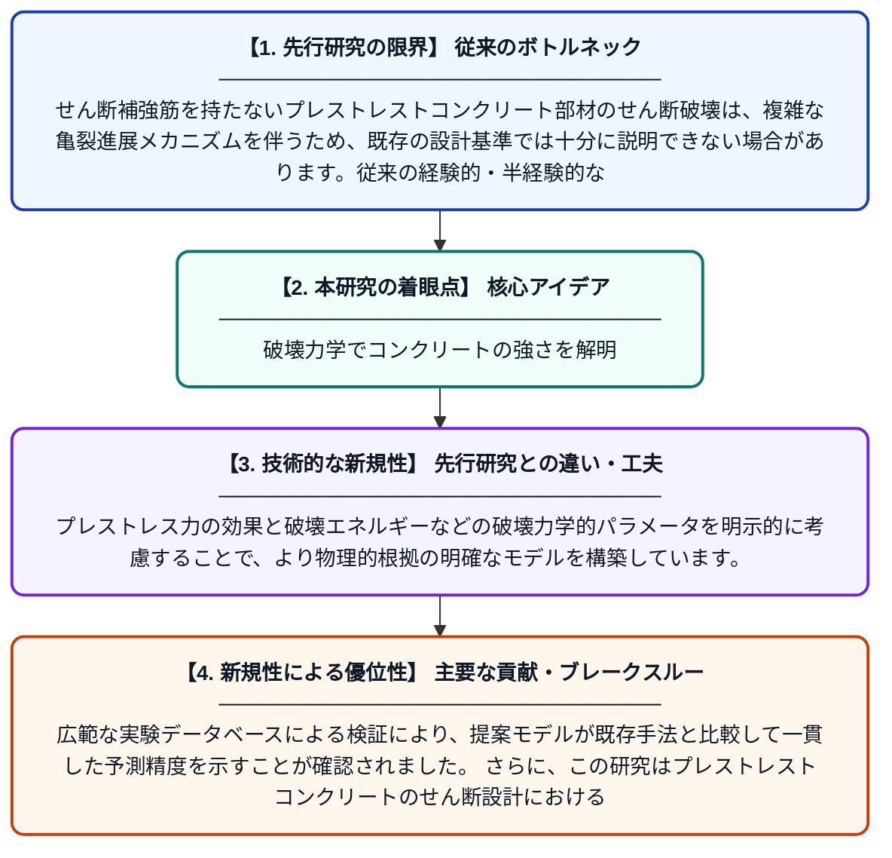

# せん断補強筋を持たないプレストレストコンクリート部材のせん断抵抗に対する破壊力学的アプローチ

**Original Title**: *A fracture-mechanics approach to shear resistance of prestressed concrete members without shear reinforcement*

> **💡 一言要約**: 破壊力学でコンクリートの強さを解明

| 項目 | 内容 |
|---|---|
| **著者** | NL Tran |
| **掲載誌** | Construction and Building Materials 2026 |
| **アラートキーワード** | reinforcement |
| **原文リンク** | [https://www.sciencedirect.com/science/article/pii/S0950061826024177](https://www.sciencedirect.com/science/article/pii/S0950061826024177) |
| **PDF版要約** | [README.pdf](./README.pdf) |

---

## 📊 新規性の図解（先行研究との違いと本研究のブレークスルー）

## 📝 要約

本論文は、せん断補強筋を持たないプレストレストコンクリート梁のせん断抵抗力を破壊力学の観点から解析する新しい手法を提案しています。提案モデルの予測精度は、広範なデータベースを用いて検証され、一貫した精度が確認されました。また、プレストレストコンクリートの解析において破壊力学的特性（亀裂進展に関する材料特性）が重要な役割を果たすことが強調されています。

## ❓ どんな問題に取り組んだか

せん断補強筋を持たないプレストレストコンクリート部材のせん断破壊は、複雑な亀裂進展メカニズムを伴うため、既存の設計基準では十分に説明できない場合があります。従来の経験的・半経験的なせん断強度式は破壊力学的な観点を十分に取り込んでおらず、予測精度にばらつきが生じる課題がありました。

## ✨ 何が新しい？何がすごい？（新規性）

本研究は、従来の経験則に頼ったアプローチではなく、破壊力学の理論をせん断抵抗の解析に体系的に組み込んだ点が新しいです。プレストレス力の効果と破壊エネルギーなどの破壊力学的パラメータを明示的に考慮することで、より物理的根拠の明確なモデルを構築しています。広範な実験データベースによる検証により、提案モデルが既存手法と比較して一貫した予測精度を示すことが確認されました。さらに、この研究はプレストレストコンクリートのせん断設計における破壊力学的特性の重要性を改めて示した貢献を持ちます。

## 🎓 大学1年生向けの解説

コンクリートの橋や建物の梁は、横からかかる力（せん断力）によって斜めに割れることがあります。特に、あらかじめ鉄筋で引っ張り力をかけて強化した『プレストレストコンクリート』で、横方向の補強筋がない場合、どこでどう割れるかを正確に予測するのは難しい問題です。この研究では、材料が割れるときのエネルギーや亀裂の広がり方を扱う『破壊力学』という学問を使って、この問題を理論的に解こうとしました。多くの実験データと比べてもこの方法がうまく機能することが確認され、より安全で合理的な設計につながる可能性があります。
