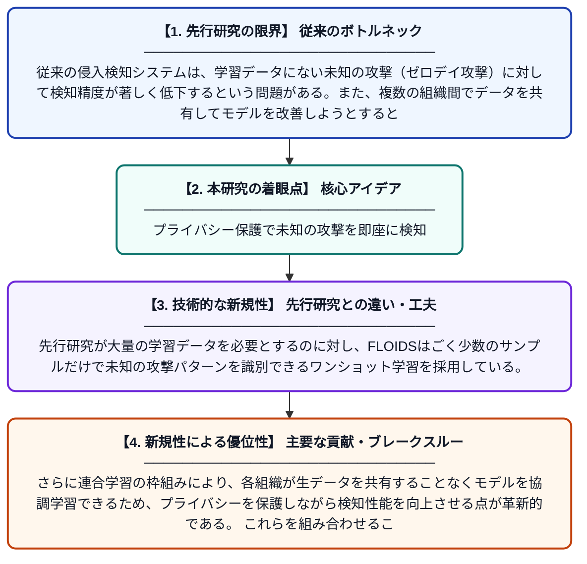

# シャムニューラルネットワークを用いたゼロデイ攻撃検知のための連合学習ベースのワンショット侵入検知システム（FLOIDS）

**Original Title**: *FLOIDS: a federated learning based one-shot intrusion detection system using siamese neural networks for detecting zero-day attacks*

> **💡 一言要約**: プライバシー保護で未知の攻撃を即座に検知

| 項目 | 内容 |
|---|---|
| **著者** | B Selvakumar, B Lakshmanan, P Kaviya, AR Akash |
| **掲載誌** | Cluster Computing 2026 |
| **アラートキーワード** | one shot |
| **原文リンク** | [https://link.springer.com/article/10.1007/s10586-026-06392-3](https://link.springer.com/article/10.1007/s10586-026-06392-3) |
| **PDF版要約** | [README.pdf](./README.pdf) |

---

## 📊 新規性の図解（先行研究との違いと本研究のブレークスルー）

## 📝 要約

本論文では、連合学習とワンショット学習を組み合わせた新しい侵入検知システム「FLOIDS」を提案している。このシステムはシャムニューラルネットワークを活用し、プライバシーを保護しながら分散環境でゼロデイ攻撃（未知の攻撃）を検知できる。NSL-KDDなどのベンチマークデータセットを用いた評価で有効性が確認された。

## ❓ どんな問題に取り組んだか

従来の侵入検知システムは、学習データにない未知の攻撃（ゼロデイ攻撃）に対して検知精度が著しく低下するという問題がある。また、複数の組織間でデータを共有してモデルを改善しようとすると、機密性の高いネットワークデータのプライバシーが侵害されるリスクも存在する。さらに、新しい攻撃パターンを検知するためには大量のラベル付きデータが必要であり、現実的な運用が困難であった。

## ✨ 何が新しい？何がすごい？（新規性）

本研究の最大の新規性は、連合学習・ワンショット学習・シャムニューラルネットワークを統合した点にある。先行研究が大量の学習データを必要とするのに対し、FLOIDSはごく少数のサンプルだけで未知の攻撃パターンを識別できるワンショット学習を採用している。さらに連合学習の枠組みにより、各組織が生データを共有することなくモデルを協調学習できるため、プライバシーを保護しながら検知性能を向上させる点が革新的である。これらを組み合わせることで、現実の分散ネットワーク環境におけるゼロデイ攻撃検知を実用的に実現した。

## 🎓 大学1年生向けの解説

コンピュータネットワークでは、ハッカーが新しい手口（ゼロデイ攻撃）で侵入してくることがあり、これを自動で検知するのが侵入検知システムです。このシステムの難しいところは、一度も見たことがない攻撃を見分けることと、複数の会社が協力しながらも互いの秘密情報を守ることを同時に実現することです。FLOIDSでは「シャムニューラルネットワーク」という、2つの入力を比較して似ているかどうかを判断するAIを使い、少ないデータでも新しい攻撃を見つけられるようにしました。また「連合学習」という技術で、各組織のデータを外に出さずにAIを一緒に鍛えることができます。これにより、プライバシーを守りながら未知の攻撃にも対応できる安全なシステムが実現しました。
