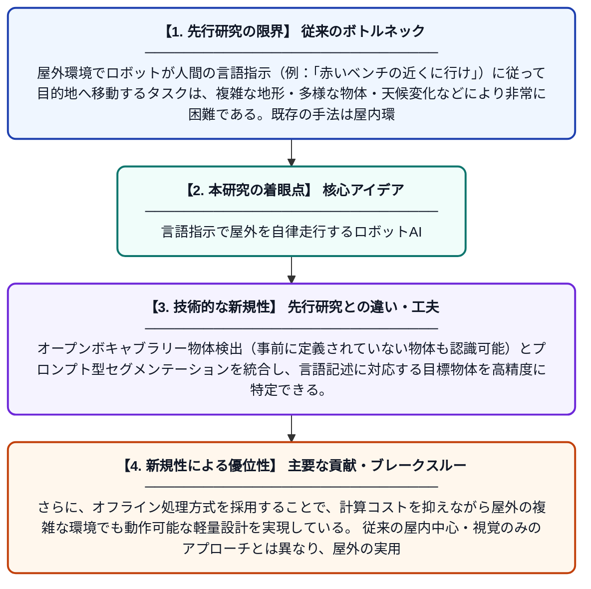

# 屋外環境における幾何学的目標位置特定を用いたオフライン視覚言語ナビゲーション

**Original Title**: *Offline Vision-Language Navigation with Geometric Goal Localization for Outdoor Environments*

> **💡 一言要約**: 言語指示で屋外を自律走行するロボットAI

| 項目 | 内容 |
|---|---|
| **著者** | A Salmasi, X Yu, T Westerlund |
| **掲載誌** | arXiv preprint arXiv:2607.22226 2026 |
| **アラートキーワード** | Open-Vocabulary Object ... |
| **PDF** | [https://arxiv.org/pdf/2607.22226](https://arxiv.org/pdf/2607.22226) |
| **Git リポジトリ** | [https://github.com/aliiisa1375/Edge_Behav.We](https://github.com/aliiisa1375/Edge_Behav.We) |
| **原文リンク** | [https://arxiv.org/pdf/2607.22226](https://arxiv.org/pdf/2607.22226) |
| **PDF版要約** | [README.pdf](./README.pdf) |

---

## 📊 新規性の図解（先行研究との違いと本研究のブレークスルー）

## 📝 要約

本論文は、屋外環境でロボットが言語指示に従って自律的にナビゲーションを行うシステムを提案する。オープンボキャブラリー物体検出・プロンプト型セグメンテーション・LiDAR幾何情報を組み合わせた軽量なハイブリッド意味論的・幾何学的目標位置特定フレームワークを構築し、視覚的方位を保ちながら距離・位置を推定する。事前に収集した地図データを活用するオフライン方式を採用することで、リアルタイム処理の負荷を軽減しつつ高精度なナビゲーションを実現する。

## ❓ どんな問題に取り組んだか

屋外環境でロボットが人間の言語指示（例：「赤いベンチの近くに行け」）に従って目的地へ移動するタスクは、複雑な地形・多様な物体・天候変化などにより非常に困難である。既存の手法は屋内環境に偏っており、屋外での距離・位置の正確な推定が課題となっていた。さらに、リアルタイムでの重い計算処理がロボットの実用化を妨げていた。

## ✨ 何が新しい？何がすごい？（新規性）

本研究の主な新規性は、視覚情報だけでなくLiDARの3D点群データを組み合わせたハイブリッドな目標位置特定フレームワークにある。オープンボキャブラリー物体検出（事前に定義されていない物体も認識可能）とプロンプト型セグメンテーションを統合し、言語記述に対応する目標物体を高精度に特定できる。さらに、オフライン処理方式を採用することで、計算コストを抑えながら屋外の複雑な環境でも動作可能な軽量設計を実現している。従来の屋内中心・視覚のみのアプローチとは異なり、屋外の実用的なシナリオへの適用可能性を大きく高めた点が特筆される。

## 🎓 大学1年生向けの解説

たとえば「公園のベンチまで行って」と言葉で指示するだけで、ロボットが自分でその場所を見つけて移動できるシステムを作りました。カメラで周囲の物体を言葉と結び付けて認識しつつ、レーザーセンサー（LiDAR）で距離や形状も測ることで、目的地の正確な位置を推定します。地図データをあらかじめ作っておく「オフライン方式」を使うので、ロボットの計算負担が小さくて済みます。これにより、屋外のような難しい環境でも言語指示だけでナビゲーションができるようになります。
