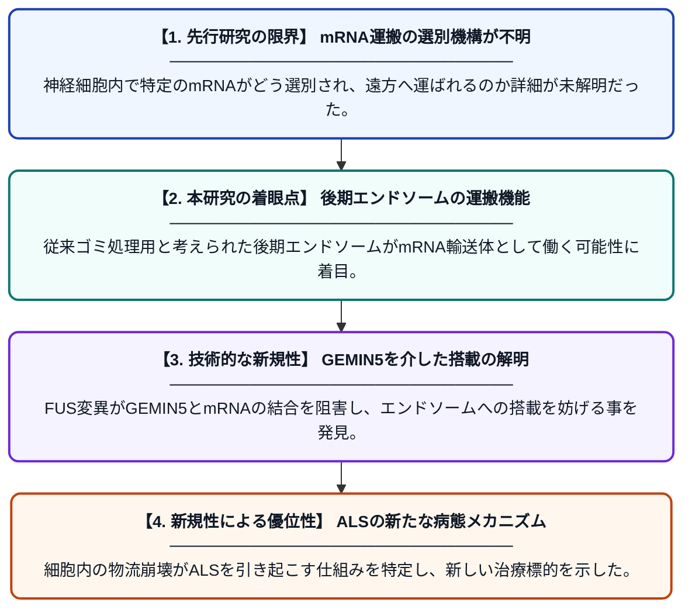

# ALSに関連するFUS変異は、神経の後期エンドソームへのGEMIN5依存的なmRNAリクルートを阻害する

**Original Title**: *ALS-linked FUS mutation impairs GEMIN5-dependent mRNA recruitment to neuronal late endosomes*

> **💡 一言要約**: ALS変異によるmRNA輸送障害のメカニズムを解明

| 項目 | 内容 |
|---|---|
| **著者** | A Setti, LS Mecarelli, T Santini, A D'Angelo… |
| **掲載誌** | Cell Reports 2026 |
| **アラートキーワード** | ALS |
| **原文リンク** | [https://www.sciencedirect.com/science/article/pii/S2211124726012854](https://www.sciencedirect.com/science/article/pii/S2211124726012854) |
| **PDF版要約** | [README.pdf](./README.pdf) |

---

## 📊 新規性の図解（先行研究との違いと本研究のブレークスルー）

## 📝 要約

神経細胞において、後期エンドソームが特定のmRNAを遠方に運ぶ輸送体として機能していることを解明しました。ALS（筋萎縮性側索硬化症）に関連するFUSタンパク質の変異が、GEMIN5を介したmRNAの搭載プロセスを阻害し、神経の維持に必要なロジスティクスを破壊することを示しています。

## ❓ どんな問題に取り組んだか

神経細胞は非常に長く複雑な構造を持つため、特定のmRNAを必要な場所へ正確に輸送する高度な仕組みが必要です。しかし、どの細胞小器官がどのmRNAを選別して運ぶのか、またALSなどの疾患でそのプロセスがどのように破綻するのかは十分に解明されていませんでした。

## ✨ 何が新しい？何がすごい？（新規性）

後期エンドソームが単なる廃棄物処理の場ではなく、特定のmRNAを運別・輸送するアクティブなハブとして機能することを突き止めた点が非常に独創的です。特に、GEMIN5がmRNAをエンドソームへ導くアダプターとして機能し、FUS変異体がこの相互作用を物理的に阻害することを分子レベルで特定しました。これにより、FUS変異によるALS発症の主要な原因として「エンドソームを介した輸送障害」という新たな視点を提示しました。

## 🎓 大学1年生向けの解説

神経細胞はとても細長いため、細胞の端っこまで必要な材料（mRNAという設計図）を届ける必要があります。この研究では、細胞内の「ゴミ袋」のような役割だと思われていた後期エンドソームが、実は特定の設計図を運ぶ「トラック」の役割も果たしていることを発見しました。ALSという病気では、あるタンパク質の異常が原因で、このトラックに設計図を積み込めなくなってしまい、神経の先端が壊れてしまうことが分かりました。
