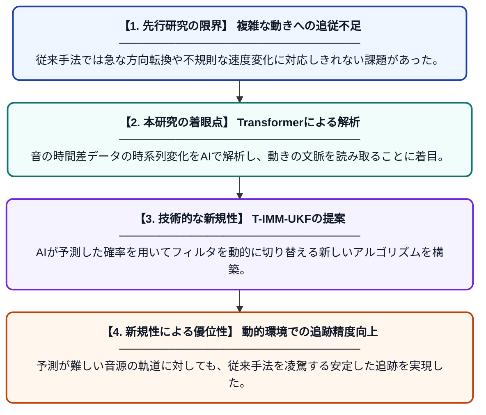

# 動的な音源追跡のためのTransformerベース適応型IMM-UKF法

**Original Title**: *Transformer-Based Adaptive IMM-UKF Method for Dynamic Sound Source Tracking*

> **💡 一言要約**: AIが音の動きを予測し高精度な追跡を実現

| 項目 | 内容 |
|---|---|
| **著者** | R Wang, P Cao, X Cui, F Yang, J Xie |
| **掲載誌** | Applied Sciences 2026 |
| **アラートキーワード** | kalman filter |
| **PDF** | [https://www.mdpi.com/2076-3417/16/22/11537/pdf](https://www.mdpi.com/2076-3417/16/22/11537/pdf) |
| **原文リンク** | [https://www.mdpi.com/2076-3417/16/22/11537/pdf](https://www.mdpi.com/2076-3417/16/22/11537/pdf) |
| **PDF版要約** | [README.pdf](./README.pdf) |

---

## 📊 新規性の図解（先行研究との違いと本研究のブレークスルー）

## 📝 要約

本研究は、動く音源を正確に追跡するために、Transformerと適応型IMM-UKFを組み合わせた新しい手法「T-IMM-UKF」を提案しています。時間的な推論ネットワークを用いて、複数のマイク間に生じる到達時間差（TDOA）の特徴を解析し、音源の動きを動的に推定します。

## ❓ どんな問題に取り組んだか

従来の音源追跡では、環境のノイズや音源の急激な動き、不規則な軌道に追従することが困難でした。特に、複数のマイクを用いた到達時間差（TDOA）の変動をリアルタイムで正確にモデル化し、追跡を維持する手法には精度向上の余地がありました。

## ✨ 何が新しい？何がすごい？（新規性）

本研究の新規性は、Transformerを導入して時系列的なTDOA特徴から適応的なモデル確率を直接推定する点にあります。これにより、従来のIMM-UKF（相互多重モデル・無香料カルマンフィルタ）で課題となっていた固定的な遷移確率の限界を克服しました。過去の観測データから現在の運動状態に最適なモデルを動的に選択することで、複雑な軌道でも高精度な追跡が可能になっています。

## 🎓 大学1年生向けの解説

部屋の中で動き回る「音の主」を、マイクを使って追いかける技術の話です。マイクに届く音の時間差から場所を特定しますが、急に曲がったり止まったりするとAIも混乱してしまいます。そこで、文章の理解が得意な「Transformer」というAIを使い、過去の動きから「次はこう動くはずだ」という予測を賢く行えるようにしました。これにより、複雑な動きでも正確に追い続けられるようになりました。
