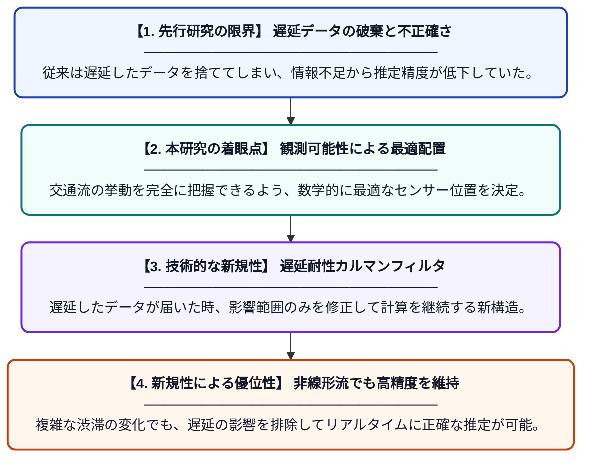

# 環状道路における交通状態推定のための観測可能性に基づくセンサ配置と遅延耐性カルマンフィルタリング

**Original Title**: *Observability-Driven Sensor Placement and Delay-Resilient Kalman Filtering for Traffic State Estimation on Ring Roads*

> **💡 一言要約**: 遅延データも無駄にしない、環状道路の最適交通推定

| 項目 | 内容 |
|---|---|
| **著者** | M Azimi, SS Mousavi, H Atrianfar, K Riehl, A Kouvelas |
| **掲載誌** | IEEE Transactions on … 2026 |
| **アラートキーワード** | kalman filter |
| **原文リンク** | [https://ieeexplore.ieee.org/abstract/document/11783122/](https://ieeexplore.ieee.org/abstract/document/11783122/) |
| **PDF版要約** | [README.pdf](./README.pdf) |

---

## 📊 新規性の図解（先行研究との違いと本研究のブレークスルー）

## 📝 要約

環状道路の交通状況を正確に把握するため、最適なセンサの設置場所とデータの受信遅延に強い推定アルゴリズムを提案した研究です。通信遅延が生じたデータを破棄せずに活用しつつ、非線形な交通流モデルに対して高精度な状態推定を実現しています。

## ❓ どんな問題に取り組んだか

交通状態の推定では、センサの設置コストと精度のバランスが重要ですが、どこに置くのが最適かという明確な基準が不足していました。また、通信遅延によりデータが順不同で届くと、従来のカルマンフィルタでは正確に処理できず推定が不安定になる課題がありました。

## ✨ 何が新しい？何がすごい？（新規性）

システムの「観測可能性」を定量的指標として用い、最小限のセンサで最大限の情報を得るための配置手法を確立しました。技術的には、遅延したデータを破棄せず、影響を受けた区間のみを前向きに再計算する「遅延耐性構造」を提案しています。これにより、非線形フィルタの利点を活かしつつ、データの欠損を防ぎ、計算効率と推定精度の両立を達成しました。

## 🎓 大学1年生向けの解説

道路の混雑を予測するにはセンサーが必要ですが、闇雲に置くとお金がかかる割に効果が出ません。また、センサーのデータが遅れて届くと、今の状況を計算する時に混乱が起きてしまいます。この研究では、どこに置けば一番効率的に道路の様子がわかるかを数学的に計算し、データが遅れても正しく計算し直す魔法のような仕組みを作りました。これによって、渋滞状況を安く正確に把握できるようになります。
