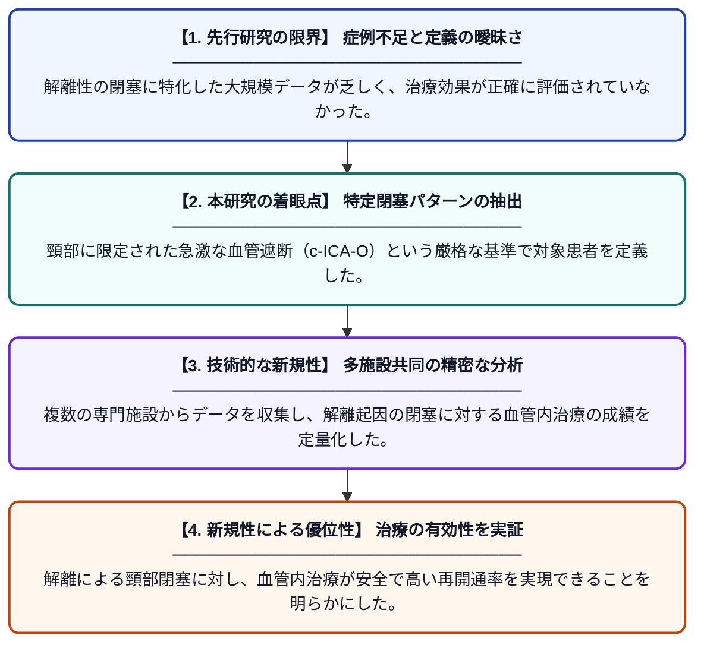

# 動脈解離に起因する頸部内頸動脈閉塞に対する血管内治療：多施設共同解析

**Original Title**: *Endovascular treatment for cervical internal carotid artery occlusion due to dissection: a multicenter analysis*

> **💡 一言要約**: 動脈解離による頸部血管閉塞へのカテーテル治療の有効性を立証

| 項目 | 内容 |
|---|---|
| **著者** | JA Sousa, JP Marto, C Riegler, P Gebert, TD Toluay… |
| **掲載誌** | European Radiology 2026 |
| **アラートキーワード** | ICA |
| **原文リンク** | [https://link.springer.com/article/10.1007/s00330-026-13095-1](https://link.springer.com/article/10.1007/s00330-026-13095-1) |
| **PDF版要約** | [README.pdf](./README.pdf) |

---

## 📊 新規性の図解（先行研究との違いと本研究のブレークスルー）

## 📝 要約

この研究は、動脈解離によって首の太い血管（内頸動脈）が完全に閉塞した脳梗塞患者に対し、カテーテルを用いた血管内治療の効果と安全性を多施設データから検証したものです。分析の結果、特定の閉塞パターンを持つ症例において、この治療法が良好な再開通率と臨床的改善をもたらすことが示されました。

## ❓ どんな問題に取り組んだか

動脈の壁が裂ける「解離」による血管閉塞は、通常の動脈硬化による閉塞とは治療の難易度や性質が異なります。しかし、この特定の病態に絞った大規模な調査は少なく、カテーテル治療がどの程度有効で安全であるかという明確な基準が不足していました。

## ✨ 何が新しい？何がすごい？（新規性）

本研究の新規性は、頸部内頸動脈に限定された急激な閉塞（c-ICA-O）という特定の画像診断的定義を用い、多施設共同で症例を詳細に分析した点にあります。先行研究では他の要因による閉塞と混同されることが多かったのに対し、解離特有の閉塞メカニズムに焦点を当てることで、治療後の高い再開通率と患者の自立度改善を具体的に証明しました。

## 🎓 大学1年生向けの解説

首にある大切な血管の壁が剥がれてしまい、血液が通らなくなることで脳梗塞が起きることがあります。この研究では、足の付け根などから細い管（カテーテル）を血管に入れ、詰まった場所を治す「血管内治療」がどのくらい役立つかを調べました。全国の多くの病院のデータを集めて詳しく調べた結果、この治療によって多くの患者さんの血流が元通りになり、その後の生活の質も向上することが分かりました。
